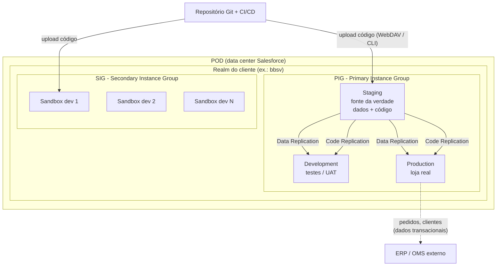
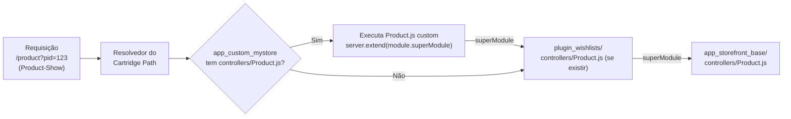
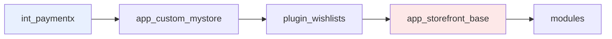
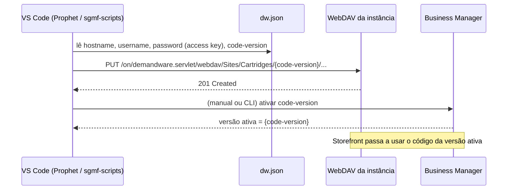
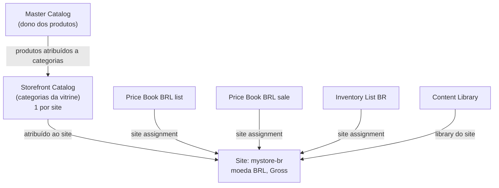
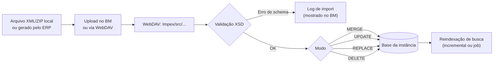
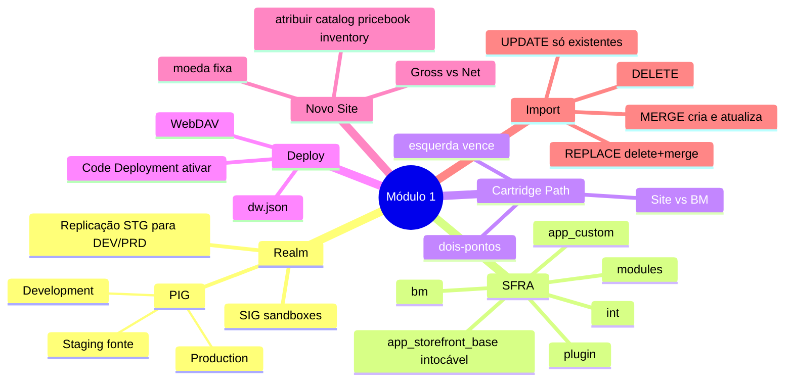

# Guia Definitivo de Engenharia e Certificação Salesforce B2C Commerce (SFRA)

## MÓDULO 1 — Arquitetura Global, Ecossistema SFRA e B2C Commerce Setup

> **Peso no exame:** 11% (domínio "B2C Commerce Setup") — cerca de 6 a 7 questões.
> **Objetivos oficiais cobertos:** configurar IDE/WebDAV para a versão de código correta; importar arquivos via módulos de Import/Export; montar a sequência correta do Cartridge Path; criar um site novo com moeda e taxação; atribuir as configurações de dados (catálogo, price books, inventário) ao site.

> ⚠️ **Nota de versão:** o guia oficial que você anexou diz que as questões estão alinhadas à release **Spring '23**. A Salesforce revisa guias de exame periodicamente; confira a versão vigente no Trailhead antes de agendar. Tudo aqui segue o comportamento do SFRA (v6.x/v7.x) e da plataforma atual; onde há incerteza eu sinalizo com **🔎 Verificar**.

---

### Sumário

1. [Tópico 1.1 — Arquitetura da Nuvem B2C: POD, Realm, PIG, SIG e Replicação](#tópico-11--arquitetura-da-nuvem-b2c-pod-realm-pig-sig-e-replicação)
2. [Tópico 1.2 — Estrutura do SFRA e Tipos de Cartridge](#tópico-12--estrutura-do-sfra-e-tipos-de-cartridge)
3. [Tópico 1.3 — Cartridge Path: Site vs Business Manager e Precedência](#tópico-13--cartridge-path-site-vs-business-manager-e-precedência)
4. [Tópico 1.4 — IDE, WebDAV, `dw.json` e Code Versions](#tópico-14--ide-webdav-dwjson-e-code-versions)
5. [Tópico 1.5 — Criando um Novo Site e Atribuindo Dados](#tópico-15--criando-um-novo-site-e-atribuindo-dados)
6. [Tópico 1.6 — Import/Export no Business Manager](#tópico-16--importexport-no-business-manager)
7. [Revisão Relâmpago do Módulo 1](#revisão-relâmpago-do-módulo-1)

---

## Tópico 1.1 — Arquitetura da Nuvem B2C: POD, Realm, PIG, SIG e Replicação

### 1. Conceito & Glossário Desmistificado

O B2C Commerce (antigo Demandware) é um **SaaS multi-tenant**: você não administra servidores, sistema operacional, banco de dados nem CDN. Você entrega **código (cartridges)** e **dados (catálogos, preços, conteúdo, configurações)**. A Salesforce hospeda e escala.

| Termo | Tradução prática |
|---|---|
| **POD** | Um "cluster" físico de hardware num data center da Salesforce (ex.: POD em us-east). Hospeda muitos clientes. Você raramente interage com ele diretamente, mas ele define latência, IPs de saída (para *allowlist* em firewalls de parceiros) e janelas de manutenção. |
| **Realm** | O "condomínio" de um cliente. É o conjunto de **todas as instâncias** de um cliente (PIG + SIG). Identificado por um código de 4 letras (ex.: `bbsv`). |
| **Instance (Instância)** | Um ambiente completo e isolado com sua própria base de dados, código e Business Manager. |
| **PIG** — *Primary Instance Group* | Grupo de 3 instâncias "oficiais": **Production (PRD)**, **Staging (STG)** e **Development (DEV)**. Existe **um PIG por realm**. |
| **SIG** — *Secondary Instance Group* | As **sandboxes** dos desenvolvedores. Hoje são *On-Demand Sandboxes* (ODS), criadas e destruídas sob demanda via API/CLI. Isoladas do PIG: **não participam da replicação**. |
| **Replicação** | Processo de copiar **dados** ou **código** de **Staging** para **Production** ou **Development**. |
| **Business Manager (BM)** | A interface web administrativa de cada instância (`https://<host>/on/demandware.store/Sites-Site`). |
| **Storefront** | A loja que o cliente final vê. |

#### Papel de cada instância do PIG

| Instância | Para que serve | Regra de ouro |
|---|---|---|
| **Staging** | Onde merchandisers editam catálogo/conteúdo/promos e onde o **código é testado e implantado** antes de ir ao ar. É a **fonte** de toda replicação. | Edite dados aqui. Performance é **menor** (não use para teste de carga). |
| **Development** | Ambiente para testar dados e código replicados com configuração próxima da produção (ex.: testes de integração, UAT). | Recebe replicação de Staging. |
| **Production** | A loja real. Escalável, com CDN/eCDN. | **Não edite dados replicáveis aqui** — a próxima replicação sobrescreve. Dados transacionais (pedidos, clientes) nascem aqui. |
| **Sandbox (SIG)** | Desenvolvimento individual do dev. | Não recebe replicação. Dados entram por **Site Import** ou Import/Export. |

### 2. Arquitetura & Como Funciona por Baixo dos Panos



**Como o fluxo funciona na vida real:**

1. O desenvolvedor trabalha numa **sandbox** (SIG). Código vai do Git para a sandbox via WebDAV (VS Code + Prophet, `sgmf-scripts`, `sfcc-ci` ou `b2c-tools`).
2. O pipeline de CI/CD envia um **build versionado** (ex.: `release_2026_10_17`) para **Staging**.
3. Merchandisers mexem em catálogo, preços, conteúdo e promoções **em Staging**.
4. Um **Replication Process** copia de Staging para Development (testes) e depois para Production.
5. **Production** gera os dados transacionais (pedidos, clientes, cestas), que são exportados para ERP/OMS por jobs ou integrações.

#### Dados replicáveis vs não replicáveis

| Replicável (vai de STG → PRD) | Não replicável (nasce no próprio ambiente) |
|---|---|
| Catálogos, categorias, produtos | Pedidos (Orders) |
| Price Books, Inventory Lists (configurável) | Clientes e perfis (Customers) |
| Content Assets, Libraries, Slots | Cestas (Baskets) |
| Promoções, Campanhas, Cupons | Custom Objects marcados como **não replicáveis** |
| Site Preferences, Search settings | Logs |
| Custom Objects **marcados como replicáveis** | |

#### Code Replication vs Data Replication

| Aspecto | Code Replication | Data Replication |
|---|---|---|
| O que copia | Uma **code version** inteira (cartridges) | Grupos de dados selecionados (globais e por site) |
| Opções | *Transfer only* ou *Transfer and activate* | Selecionar grupos (catalog, content, price books...) por site; *Run now* ou agendado |
| Undo | Ativar a versão anterior no Code Deployment | Existe **Undo** para a **última** replicação de dados |
| Caminho no BM | `Administration > Replication > Code Replication` | `Administration > Replication > Data Replication` |

> 💡 **Por que Staging é a fonte?** Porque Production precisa de estabilidade e auditoria. Se você editasse dados em Production, criaria "drift" (divergência) que seria **apagado** na próxima replicação.

### 3. Guia Prático de Business Manager (BM)

**Criar um processo de replicação de dados (em Staging):**

1. `Administration > Replication > Data Replication` → **New**.
2. **Target:** `Development` ou `Production`.
3. **Type:** escolha *Replication* (há também opção de *Undo* da última).
4. **Start:** *Manually* ou agendado (data/hora).
5. **Grupos:** marque *Global* (ex.: Custom Objects globais, Locales, Price Books se globais) e/ou grupos por **site** (Catalogs, Content, Promotions, Site Preferences, Search Settings...).
6. Confirme e acompanhe o status na lista (Pending → Running → Finished/Failed).

**Replicar código:**

1. `Administration > Replication > Code Replication` → **New**.
2. Target (DEV/PRD) → escolha **Transfer and activate** (deixa a versão ativa no destino) ou **Transfer only** (copia mas não ativa).

**Sandboxes (SIG):** são gerenciadas fora do BM, via **On-Demand Sandbox API**, `sfcc-ci sandbox:create` ou console de administração do Account Manager / ferramentas de parceiros. 🔎 **Verificar:** o número de sandboxes e o perfil de recursos (*medium/large/xlarge*) dependem do contrato do realm.

### 4. Implementação em Código (Hands-On)

Não há "código" de replicação no storefront, mas um dev precisa saber **detectar o ambiente** para não chamar serviços de produção a partir de sandbox:

```javascript
'use strict';

// dw.system.System expõe o tipo de instância atual
var System = require('dw/system/System');

/**
 * Retorna true se estivermos em Production.
 * Constantes disponíveis: System.PRODUCTION_SYSTEM, System.STAGING_SYSTEM,
 * System.DEVELOPMENT_SYSTEM (sandboxes também retornam DEVELOPMENT_SYSTEM).
 */
function isProduction() {
    return System.getInstanceType() === System.PRODUCTION_SYSTEM;
}

module.exports = { isProduction: isProduction };
```

✅ **Boa prática:** usar `System.getInstanceType()` ou, melhor ainda, a configuração **Force PRD behavior** / **Mock** do Service Framework (Módulo 3/5) para diferenciar ambientes sem `if` espalhado.

❌ **Anti-padrão:**

```javascript
// RUIM: hostname hard-coded quebra quando o domínio muda ou ao usar alias/eCDN
if (request.httpHost === 'www.minhaloja.com.br') { /* lógica de produção */ }
```

### 5. Foco no Exame (Pegadinhas & Quotas)

- **"Onde o merchandiser deve editar o catálogo?"** → **Staging**. Nunca Production.
- **"Uma alteração feita em Production sumiu"** → foi sobrescrita pela replicação de Staging.
- **Sandboxes não recebem replicação.** Se a questão sugere "replicar de Staging para a sandbox", é distrator. Use **Site Export/Import**.
- **Custom Object criado em Production sumiu após replicação** → o tipo estava como **replicável**. Para dados gerados em Production (ex.: log de webhook), use tipo **não replicável**.
- **Undo de replicação** existe para dados (apenas a última). Para código, basta reativar a versão anterior.
- Staging **não** é ambiente de teste de carga/performance.

---

## Tópico 1.2 — Estrutura do SFRA e Tipos de Cartridge

### 1. Conceito & Glossário Desmistificado

- **SFRA (Storefront Reference Architecture):** a implementação de referência oficial de uma loja B2C, baseada em **controllers JavaScript** (padrão MVC, inspirado no Express.js), **Bootstrap 4** no front, ISML no template. Substituiu o **SiteGenesis** (que usava *pipelines* e depois *controllers* JS sem o módulo `server`).
- **Cartridge:** uma **pasta** que agrupa código e recursos (controllers, models, scripts, templates, static, forms, properties, metadados de Page Designer, `steptypes.json`, `hooks.json`). É a unidade de **deploy e reutilização**. Pense nela como um "pacote/plugin".
- **Cartridge Path:** a lista ordenada de cartridges que um site usa. A plataforma procura arquivos da **esquerda para a direita** e usa o **primeiro** que encontrar.
- **`module.superModule`:** referência ao arquivo de **mesmo nome e caminho relativo** na **próxima** cartridge do path (à direita). Base da extensão no SFRA.

#### Tipos e convenções de nome

| Prefixo | Propósito | Exemplo |
|---|---|---|
| `app_storefront_base` | O SFRA "core". **Nunca edite.** | `app_storefront_base` |
| `app_custom_*` | A customização da sua marca (overrides, novas rotas, templates). | `app_custom_mystore` |
| `plugin_*` | Funcionalidades opcionais oficiais/comunitárias que estendem o SFRA. | `plugin_wishlists`, `plugin_giftregistry`, `plugin_productcompare`, `plugin_instorepickup` |
| `int_*` | Integrações com terceiros (LINK cartridges). | `int_adyen_SFRA`, `int_cybersource_sfra` |
| `bm_*` | Extensões do Business Manager (menus, telas). | `bm_app_storefront_base` (vem com o SFRA), `bm_custom_reports` |
| `modules` | Pasta especial do SFRA com módulos compartilhados (ex.: `server`). Fica no path como `modules`. | `modules` |

> 🔎 **Verificar:** o conteúdo e a necessidade de `bm_app_storefront_base` variam entre versões do SFRA (em versões recentes ela habilita, por exemplo, componentes do Page Designer no BM). O que importa no exame é a convenção `bm_` e que ela vai no **Business Manager Cartridge Path**.

#### Estrutura de pastas de uma cartridge SFRA

```text
app_custom_mystore/
├── package.json                 ← aponta para hooks.json (opcional)
├── steptypes.json               ← definição de steps de Job (opcional, na raiz da cartridge)
└── cartridge/
    ├── app_custom_mystore.properties   ← metadado da cartridge (gerado)
    ├── controllers/             ← rotas: Product.js, Cart.js...
    ├── models/                  ← modelos JSON (decorators)
    ├── scripts/
    │   ├── helpers/             ← funções utilitárias
    │   ├── factories/           ← criação de models
    │   ├── middleware/          ← middlewares customizados
    │   ├── hooks/               ← implementações de hooks
    │   ├── jobs/ ou steps/      ← scripts de job
    │   └── hooks.json
    ├── forms/default/*.xml      ← definição de formulários
    ├── templates/
    │   ├── default/*.isml       ← templates
    │   └── resources/*.properties ← textos traduzíveis
    ├── static/default/          ← CSS/JS/imagens compilados
    ├── client/default/          ← fontes SCSS/JS (compilados por webpack/sgmf-scripts)
    └── experience/              ← Page Designer (pages/ e components/)
```

### 2. Arquitetura & Como Funciona por Baixo dos Panos



**Planejar upgrades sem quebrar o site:**

1. `app_storefront_base` fica **intacta**, idealmente vinda direto do repositório oficial (`SalesforceCommerceCloud/storefront-reference-architecture`) via Git subtree/submodule ou pacote.
2. Toda mudança fica em `app_custom_*` usando **`append`/`prepend`** (preferência) e **`replace`** só quando inevitável.
3. Para templates, copie para a cartridge custom **apenas** os ISML que precisa alterar (override por mesmo caminho). Quanto menos arquivos sobrescritos, mais fácil o upgrade.
4. Para JS/CSS cliente, importe os módulos da base e estenda (`require('base/product/detail')`, alias `base` configurado no webpack do `sgmf-scripts`).
5. Ao atualizar o SFRA, faça *diff* dos arquivos que você sobrescreveu contra a nova versão da base.

### 3. Guia Prático de Business Manager (BM)

- Instalar o SFRA de exemplo numa sandbox: faça upload do código (cartridges `app_storefront_base`, `modules`, `bm_app_storefront_base`) e importe os **dados de demonstração** (site **RefArch** e **RefArchGlobal**) via `Administration > Site Development > Site Import & Export` (arquivo zip do repositório `storefront-reference-architecture` / *storefrontdata*).
- Conferir em `Administration > Sites > Manage Sites` que os sites `RefArch` e `RefArchGlobal` apareceram.

> 🔎 **Verificar:** o nome exato do zip de dados de demonstração muda entre versões do SFRA; siga o README do repositório oficial da versão que você baixou.

### 4. Implementação em Código (Hands-On)

**Override de template (substituição por mesmo caminho):**

```text
app_storefront_base/cartridge/templates/default/product/components/productTile.isml   ← original
app_custom_mystore/cartridge/templates/default/product/components/productTile.isml    ← sua cópia alterada (vence)
```

**Extensão de JS cliente no SFRA (padrão `base`):**

```javascript
// app_custom_mystore/cartridge/client/default/js/product/detail.js
'use strict';

// "base" é um alias para app_storefront_base/cartridge/client/default/js (configurado no webpack)
var base = require('base/product/detail');

// Adiciona um novo comportamento sem copiar o arquivo inteiro
base.trackSizeGuide = function () {
    $('body').on('click', '.size-guide-link', function () {
        // envia evento para analytics
    });
};

module.exports = base;
```

**`package.json` da cartridge (mínimo):**

```json
{
  "name": "app_custom_mystore",
  "hooks": "./cartridge/scripts/hooks.json"
}
```

❌ **Anti-padrão:** editar `app_storefront_base/cartridge/controllers/Product.js` diretamente. Funciona hoje, mas o próximo upgrade do SFRA apaga sua mudança ou gera conflitos difíceis de rastrear.

### 5. Foco no Exame (Pegadinhas & Quotas)

- **"Qual a forma recomendada de adicionar funcionalidade ao SFRA?"** → criar uma **nova cartridge** (custom/plugin) e colocá-la **à esquerda** de `app_storefront_base`. Nunca modificar a base.
- **Integrações de terceiros (LINK)** normalmente vêm como `int_*` e às vezes exigem cartridges adicionais (ex.: uma para controllers e outra para core). Leia a documentação do LINK para a ordem certa.
- **`modules`** deve estar no cartridge path (geralmente à direita de tudo) porque contém o módulo `server`. Se faltar, erros do tipo *module 'server' not found*.
- Questões sobre "SFRA vs SiteGenesis": SFRA = controllers com `server`, middleware chain, Bootstrap, mobile-first; pipelines são legado.

---

## Tópico 1.3 — Cartridge Path: Site vs Business Manager e Precedência

### 1. Conceito & Glossário Desmistificado

- **Site Cartridge Path:** usado pelo **storefront** daquele site (cada site tem o seu).
- **Business Manager Cartridge Path:** usado pelo **BM** (site especial `Sites-Site`). Serve para: extensões de menu do BM (`bm_*`), **jobs com escopo de organização**, e alguns hooks/serviços chamados do contexto BM.
- **Precedência:** **esquerda vence**. O primeiro arquivo encontrado é usado; os demais só são alcançados via `superModule` (JS) ou não são alcançados (ISML, properties, forms são resolvidos pelo primeiro match).

### 2. Arquitetura & Como Funciona por Baixo dos Panos



Leitura: ao buscar `templates/default/cart/cart.isml`, a plataforma olha `int_paymentx`, depois `app_custom_mystore`, depois `plugin_wishlists`, depois `app_storefront_base`. Usa o **primeiro** que existir.

**Regra prática de ordenação:**

```text
[cartridges que estendem tudo, ex.: integrações que fazem append no checkout] :
[app_custom_<marca>] :
[plugin_*] :
[int_* que plugins dependem] :
app_storefront_base :
modules
```

> Não existe ordem "mágica" universal: a regra é **"quem estende fica à esquerda de quem é estendido"**. Se `app_custom_mystore` faz `server.extend(module.superModule)` em `Product.js` e quer pegar a versão do `plugin_wishlists`, então `app_custom_mystore` precisa estar à esquerda de `plugin_wishlists`.

#### Resolução de conflitos de precedência

| Situação | Sintoma | Correção |
|---|---|---|
| Duas cartridges sobrescrevem o mesmo ISML | Só uma customização aparece | Mesclar as mudanças manualmente na cartridge mais à esquerda |
| Dois plugins fazem `server.extend` na mesma rota | Funciona se ambos chamam `superModule` (cadeia) | Garantir a ordem desejada; o `append` da cartridge mais à esquerda executa por último (ver nota abaixo) |
| Cartridge custom à direita da base | `module.superModule` é `null` ou template custom ignorado | Mover para a esquerda |
| Cartridge não listada no path | Arquivos ignorados | Adicionar ao path (Site ou BM conforme o caso) |

> **Nota sobre ordem de execução com várias extensões:** cada cartridge à esquerda pega o `server` já montado pela da direita (via `superModule`) e acrescenta middlewares. Assim, `append` da cartridge mais à **esquerda** é registrado **por último** e executa **depois** dos `append` das cartridges à direita. `prepend` da cartridge mais à esquerda executa **antes** de todos.

### 3. Guia Prático de Business Manager (BM)

**Site Cartridge Path:**

1. `Administration > Sites > Manage Sites`.
2. Clique no site (ex.: `RefArch`) → aba **Settings**.
3. Campo **Cartridges:** cole a lista separada por **dois-pontos** `:` sem espaços.
   ```text
   app_custom_mystore:plugin_wishlists:app_storefront_base
   ```
4. **Apply**. Em instâncias com cache, pode ser necessário invalidar o cache da página na aba **Cache**.

**Business Manager Cartridge Path:**

1. `Administration > Sites > Manage Sites`.
2. Seção **Business Manager Site** → link **Manage the Business Manager site** (o nome do link pode variar levemente) → aba **Settings** (ou **Cartridges**).
3. Campo **Cartridges:** ex.: `bm_custom_reports:int_myjobs:app_storefront_base`.

> 🔎 **Verificar:** o rótulo exato do link do BM site varia entre versões do BM; o objetivo é editar o cartridge path do site `Sites-Site`.

### 4. Implementação em Código (Hands-On)

**Exemplo que só funciona com a ordem correta:**

```javascript
// app_custom_mystore/cartridge/controllers/Product.js
'use strict';

var server = require('server');
// Se app_custom_mystore estiver à DIREITA de app_storefront_base,
// module.superModule será null e esta linha lança erro.
server.extend(module.superModule);

server.prepend('Show', function (req, res, next) {
    // Executa ANTES do Product-Show da base. Ótimo para validações/redirects.
    if (!req.querystring.pid) {
        res.redirect(require('dw/web/URLUtils').url('Home-Show'));
        return next();
    }
    return next();
});

module.exports = server.exports();
```

**Script `require` que respeita o cartridge path (`*/`):**

```javascript
// "*/" = procure no cartridge path inteiro, primeiro match vence (permite override)
var productHelpers = require('*/cartridge/scripts/helpers/productHelpers');

// "app_storefront_base/" = força a versão da base (ignora overrides). Use só quando for intencional.
var baseHelpers = require('app_storefront_base/cartridge/scripts/helpers/productHelpers');
```

✅ **Boa prática:** usar `require('*/cartridge/...')` para permitir que outra cartridge sobrescreva o helper.
❌ **Anti-padrão:** `require('app_storefront_base/cartridge/...')` em código custom sem necessidade, o que impede overrides futuros.

### 5. Foco no Exame (Pegadinhas & Quotas)

- **Separador:** dois-pontos `:`. Questões podem trazer vírgula ou ponto-e-vírgula como distrator.
- **"Qual a sequência correta?"** → procure a alternativa em que a cartridge que **estende** está **antes** (à esquerda) da que é **estendida**, e `app_storefront_base` perto do fim.
- **Job com escopo de organização não encontra o script** → a cartridge precisa estar no **Business Manager cartridge path**, não só no do site.
- **Customização não aparece em uma das lojas** de um realm multi-site → cada site tem **seu próprio** cartridge path; verifique o site certo.

---

## Tópico 1.4 — IDE, WebDAV, `dw.json` e Code Versions

### 1. Conceito & Glossário Desmistificado

- **WebDAV:** protocolo HTTP para ler/escrever arquivos remotos. É como o código chega à instância e como você acessa logs e arquivos de Impex.
- **Code Version:** uma **pasta** no servidor que contém um conjunto completo de cartridges. Só **uma** versão está **ativa** por instância. Você pode subir várias e alternar (rollback instantâneo).
- **`dw.json`:** arquivo de configuração local (na raiz do projeto) lido por ferramentas como **Prophet Debugger** (extensão VS Code), `sgmf-scripts` (`npm run uploadCartridge`) e outras, com host, credenciais e versão de código.
- **Access Key (WebDAV):** com o Account Manager, o upload via WebDAV usa o **usuário do BM + uma chave de acesso** gerada no perfil (não a senha de login com SSO).
- **Autenticação de dois fatores em Staging:** Staging pode exigir **certificado cliente** (`.p12`) para WebDAV.

### 2. Arquitetura & Como Funciona por Baixo dos Panos



**URLs WebDAV úteis:**

| Pasta | URL |
|---|---|
| Código | `https://<host>/on/demandware.servlet/webdav/Sites/Cartridges/<versao>/` |
| Impex (import/export) | `https://<host>/on/demandware.servlet/webdav/Sites/Impex/` |
| Logs | `https://<host>/on/demandware.servlet/webdav/Sites/Logs/` |
| Catálogos (imagens) | `https://<host>/on/demandware.servlet/webdav/Sites/Catalogs/<catalog-id>/` |
| Libraries (conteúdo) | `https://<host>/on/demandware.servlet/webdav/Sites/Libraries/<library-id>/` |

### 3. Guia Prático de Business Manager (BM)

**Gerar a Access Key do WebDAV:**

1. No BM, clique no seu nome (canto superior direito) → **Manage Access Keys**.
2. Gere uma chave para o escopo **WebDAV File Access and UX Studio**.
3. Use seu login do BM como `username` e a chave como `password` no `dw.json`.

**Gerenciar Code Versions:**

1. `Administration > Site Development > Code Deployment`.
2. Você vê a lista de versões; a ativa está marcada.
3. Clique na versão → **Activate** para ativá-la. Ou crie uma nova pasta de versão e faça upload.
4. Também é possível ver as cartridges dentro de cada versão.
5. Após ativar, o cache é invalidado para o novo código.

> 🔎 **Verificar:** existem limites de quantas code versions a instância mantém; versões antigas devem ser removidas periodicamente (CI/CD costuma fazer isso).

### 4. Implementação em Código (Hands-On)

**`dw.json` (raiz do projeto — NUNCA comitar no Git):**

```json
{
    "hostname": "zzzz-001.dx.commercecloud.salesforce.com",
    "username": "dev.user@empresa.com",
    "password": "SUA_ACCESS_KEY_WEBDAV",
    "code-version": "sandbox_dev_v1"
}
```

| Campo | Significado |
|---|---|
| `hostname` | Host da instância, **sem** `https://` |
| `username` | Login do usuário no BM |
| `password` | Access Key do WebDAV (não a senha SSO) |
| `code-version` | Nome da pasta de versão de código alvo |

> 🔎 **Verificar:** para Staging com dois fatores, o Prophet aceita campos adicionais para o certificado (`p12`, `passphrase` ou similares). Confira o README da versão da extensão que você usa.

**`.gitignore` obrigatório:**

```gitignore
dw.json
node_modules/
cartridges/*/cartridge/static/default/css/
cartridges/*/cartridge/static/default/js/
```

**Scripts npm típicos do SFRA (`package.json` da raiz do repositório):**

```json
{
  "scripts": {
    "compile:js": "sgmf-scripts --compile js",
    "compile:scss": "sgmf-scripts --compile css",
    "uploadCartridge": "sgmf-scripts --uploadCartridge app_storefront_base && sgmf-scripts --uploadCartridge modules",
    "watch": "sgmf-scripts --watch"
  }
}
```

**Fluxo diário recomendado:**

```bash
npm install            # dependências
npm run compile:js     # compila client/ -> static/
npm run compile:scss
npm run uploadCartridge   # envia para a code-version do dw.json
# no VS Code com Prophet: "upload on save" mantém a sandbox sincronizada
```

❌ **Anti-padrões:**

- Comitar `dw.json` com credenciais no repositório.
- Editar arquivos direto no WebDAV (sem Git) — você perde histórico.
- Subir código direto na code version **ativa** de Production. O correto é Staging + replicação (ou deploy em versão nova e ativação controlada).

### 5. Foco no Exame (Pegadinhas & Quotas)

- **"Código subiu mas a loja não mudou"** → (1) o `code-version` do `dw.json` não é a versão **ativa**; ativar em `Code Deployment`; ou (2) a cartridge não está no cartridge path; ou (3) **cache** (invalidar).
- **"Como fazer rollback rápido?"** → ativar a code version anterior em `Administration > Site Development > Code Deployment`.
- `dw.json` fica na **raiz do projeto**, não dentro da cartridge.
- **Static files (CSS/JS)** precisam ser **compilados** antes do upload; SCSS em `client/` não é servido.

---

## Tópico 1.5 — Criando um Novo Site e Atribuindo Dados

### 1. Conceito & Glossário Desmistificado

- **Site:** uma loja (storefront) com seu próprio cartridge path, catálogo de vitrine, locales, moedas e preferências. Um realm pode ter vários sites (ex.: Brasil, Argentina, Outlet).
- **Default Currency:** moeda padrão do site. 🔑 **Definida na criação e não pode ser alterada depois.** Moedas adicionais são **permitidas** via preferências.
- **Taxation (Gross vs Net):**
  - **Gross:** preços **já incluem** imposto (padrão Europa/Brasil para B2C — "preço final").
  - **Net:** imposto é **somado** ao preço no checkout (padrão EUA — sales tax).
- **Time Zone do site:** fuso usado para agendamentos (promoções, slots) e datas do site.
- **Data assignments:** um site só "vê" catálogo, price books e inventário se eles forem **atribuídos** a ele.

### 2. Arquitetura & Como Funciona por Baixo dos Panos



Regras-chave:

- Um site tem **exatamente um** Storefront Catalog.
- Um site pode ter **vários** Price Books atribuídos (lista, promoção, por moeda).
- Um site usa **uma** Inventory List padrão (há também listas por loja física para BOPIS).
- **Active Data** (métricas de vendas/visualizações por produto, usadas em sorting rules) é alimentado pela plataforma e pode ser importado; não é configurado como "atribuição" e sim habilitado/consumido.

### 3. Guia Prático de Business Manager (BM)

**Passo 1 — Criar o site**

1. `Administration > Sites > Manage Sites` → **New**.
2. **ID:** ex.: `mystore-br` (o ID vira parte das URLs `Sites-mystore-br-Site`; escolha bem, não se muda depois).
3. **Name:** "Minha Loja Brasil".
4. **Currency (Default):** `BRL`.
5. **Taxation:** `Gross` (Brasil) ou `Net` (EUA).
6. **Apply.**

**Passo 2 — Configurações gerais do site**

1. `Administration > Sites > Manage Sites > [mystore-br]` → aba **General**:
   - **Time Zone:** ex.: `America/Sao_Paulo`.
   - **Site Status:** `Online`, `Online (Protected)` (exige senha de storefront), `Maintenance`, `Offline`.
2. Aba **Settings:** **Cartridges** (ver Tópico 1.3).
3. Aba **Cache:** configurações de page cache (Módulo 3).

**Passo 3 — Locales e moedas**

- `Merchant Tools > Site Preferences > Locales` → ativar `pt_BR`, `default`.
- `Merchant Tools > Site Preferences > Currencies` → moedas **permitidas** adicionais (quando há multi-moeda).
- Os locales disponíveis globalmente ficam em `Administration > Global Preferences > Locales`.

**Passo 4 — Atribuir o Storefront Catalog**

1. `Merchant Tools > Products and Catalogs > Catalogs`.
2. Abra o **catálogo de vitrine** → **Edit** (ou aba de propriedades) → **Site Assignments** → marque `mystore-br`.
   - Alternativa: a atribuição também pode vir num **site import** (`site.xml`) ou no XML do catálogo.

**Passo 5 — Atribuir Price Books**

1. `Merchant Tools > Products and Catalogs > Price Books` → abra o price book.
2. Aba **Site Assignments** → marque `mystore-br` → **Apply**.

**Passo 6 — Atribuir Inventory List**

1. Selecione o site no seletor do topo.
2. `Merchant Tools > Products and Catalogs > Inventory` → abra a lista → atribuição ao site (ou em `Merchant Tools > Site Preferences` na seção de inventário, conforme a versão do BM).

> 🔎 **Verificar:** o local exato da tela de atribuição de inventário mudou entre versões do BM. O conceito cobrado no exame é: **o site precisa de uma inventory list atribuída** para mostrar disponibilidade e permitir compra.

**Passo 7 — Library de conteúdo**

- Sites podem usar uma **Shared Library** (compartilhada) ou uma **private site library**. Configurável no site import/export e em `Merchant Tools > Content > Libraries`.

### 4. Implementação em Código (Hands-On)

**Lendo configurações do site no código:**

```javascript
'use strict';

var Site = require('dw/system/Site');

var currentSite = Site.getCurrent();
var defaultCurrency = currentSite.getDefaultCurrency();   // 'BRL'
var timezone = currentSite.getTimezone();                  // 'America/Sao_Paulo'
var allowed = currentSite.getAllowedCurrencies();          // List de Currency
var siteId = currentSite.getID();                          // 'mystore-br'

// Custom Site Preference (Módulo 3): leitura segura
var freeShippingThreshold = currentSite.getCustomPreferenceValue('freeShippingThreshold');
```

**Trecho de `site.xml` (formato de Site Import) — ilustrativo:**

```xml
<?xml version="1.0" encoding="UTF-8"?>
<site xmlns="http://www.demandware.com/xml/impex/site/2007-04-30" site-id="mystore-br">
    <name>Minha Loja Brasil</name>
    <currency>BRL</currency>
    <taxation>gross</taxation>
    <timezone>America/Sao_Paulo</timezone>
    <custom-cartridges>app_custom_mystore:app_storefront_base</custom-cartridges>
    <storefront-catalog-id>storefront-catalog-br</storefront-catalog-id>
</site>
```

> 🔎 **Verificar:** os nomes exatos de elementos do `site.xml` devem ser validados contra o XSD `site.xsd` da sua instância. O exemplo serve para entender o que um site carrega, não como XML de produção.

❌ **Anti-padrão:** hard-code de moeda (`'BRL'`) em templates ou cálculos. Use `session.currency` / `Site.getCurrent().getDefaultCurrency()` e `dw.util.StringUtils.formatMoney()`.

### 5. Foco no Exame (Pegadinhas & Quotas)

- **"O site precisa mudar a moeda padrão"** → não é possível alterar após a criação; é preciso **criar um novo site** (ou adicionar moedas permitidas, se o requisito for multi-moeda).
- **Gross vs Net:** "preços exibidos incluem impostos" = **Gross**. "Imposto calculado e adicionado no checkout (EUA)" = **Net**.
- **Produtos não aparecem no novo site** → checklist: storefront catalog atribuído? Produtos `online` e com categoria `online`? Price book atribuído e com preço na moeda do site? Inventory list atribuída? Índice de busca reconstruído?
- **Produto aparece mas "indisponível"** → falta inventory list atribuída ou estoque.
- **Produto sem preço** → falta price book na **moeda** do site.

---

## Tópico 1.6 — Import/Export no Business Manager

### 1. Conceito & Glossário Desmistificado

- **Import/Export:** mecanismo nativo para mover dados em lote via **XML** (validado por **XSD**) e, em alguns casos, CSV (ex.: catálogo em CSV aceita só MERGE).
- **Site Import & Export:** move um **site inteiro** (ou partes) como **zip** com estrutura de pastas (`sites/`, `catalogs/`, `pricebooks/`, `libraries/`, `meta/`...). Ideal para popular sandboxes.
- **Modos de importação** (confirmado na documentação oficial):

| Modo | O que faz | Analogia |
|---|---|---|
| **MERGE** | **Cria** o objeto se não existir e depois aplica **UPDATE**. | "Upsert" |
| **UPDATE** | **Atualiza apenas objetos existentes**. Não cria novos. | `UPDATE ... WHERE id` |
| **REPLACE** | Equivale a **DELETE seguido de MERGE**: atributos que o arquivo não traz são **removidos**. | "Sobrescrever registro inteiro" |
| **DELETE** | **Remove** do banco os objetos listados no arquivo. | `DELETE` |

Detalhes importantes da documentação:

- Elementos de **lista** no XML (ex.: atribuições de categoria, listas de valores) **substituem a lista inteira** no banco tanto em MERGE quanto em REPLACE, para a parte contida no arquivo; a diferença é que em MERGE, se a lista **não** vier no arquivo, a lista no banco **permanece**, e em REPLACE ela é **apagada**.
- É possível sobrescrever o modo **por elemento** apenas com `mode="delete"` (ex.: `<product product-id="X" mode="delete"/>`), permitindo criar, atualizar e apagar num único arquivo.
- **Active Data** sempre importa em **REPLACE**.
- **Price book** importado em REPLACE ou DELETE substitui/apaga **o price book inteiro**, inclusive preços que não estão no arquivo.
- Produtos **novos** importados em MERGE/REPLACE ficam **offline** por padrão se o status não for informado; produtos existentes mantêm o status.
- Catálogo em **CSV** só aceita **MERGE**.

### 2. Arquitetura & Como Funciona por Baixo dos Panos



**Em produção real**, imports recorrentes rodam como **Jobs** (Módulo 5) com steps padrão (ex.: `ImportCatalog`, `ImportPriceBook`, `ImportInventoryLists`) lendo arquivos de `Impex/src`, normalmente depositados por SFTP do ERP e copiados por um step customizado.

### 3. Guia Prático de Business Manager (BM)

| O que importar | Onde no BM |
|---|---|
| Catálogo, Price Book, Inventory | `Merchant Tools > Products and Catalogs > Import & Export` |
| Conteúdo (Library) | `Merchant Tools > Content > Import & Export` |
| Promoções/Campanhas/Cupons | `Merchant Tools > Online Marketing > Import & Export` |
| Clientes | `Merchant Tools > Customers > Import & Export` |
| Pedidos (export) | `Merchant Tools > Ordering > Import & Export` |
| **Metadados** (System Object Types, Custom Object Types) e Custom Objects | `Administration > Site Development > Import & Export` |
| **Site inteiro** (zip) | `Administration > Site Development > Site Import & Export` |

**Fluxo típico de import (ex.: catálogo):**

1. `Merchant Tools > Products and Catalogs > Import & Export`.
2. Seção **Upload** → **Upload** o XML (vai para a pasta Impex da instância).
3. Seção **Catalogs** → **Import**.
4. Selecione o arquivo → **Next** → o BM **valida o XML contra o schema**. Erros aparecem aqui.
5. Escolha o **modo** (Merge/Update/Replace/Delete) → **Import**.
6. Acompanhe o status na lista de processos; clique para ver o log.

**Site Import (zip):**

1. `Administration > Site Development > Site Import & Export`.
2. **Upload** do zip (ou escolha um já presente) → **Import**.
3. O zip vai para `Impex/src/instance/` no WebDAV.
4. Para exportar, selecione o que incluir (sites, catálogos, libraries, metadados, custom objects) → **Export** → baixe o zip.

**Schemas XSD:** use os XSDs oficiais (`catalog.xsd`, `pricebook.xsd`, `inventory.xsd`, `metadata.xsd`, `customobject.xsd`, `site.xsd`...) para validar arquivos no VS Code antes do upload (extensão XML da Red Hat com `xsi:schemaLocation`). 🔎 **Verificar:** a distribuição dos XSDs (download no BM/documentação ou repositórios da comunidade) depende da versão; o BM sempre valida no import.

### 4. Implementação em Código (Hands-On)

**Catálogo — criar, atualizar e apagar num só arquivo (MERGE + delete por elemento):**

```xml
<?xml version="1.0" encoding="UTF-8"?>
<catalog xmlns="http://www.demandware.com/xml/impex/catalog/2006-10-31" catalog-id="master-catalog-br">

    <!-- Criado se não existir, atualizado se existir (modo MERGE no processo) -->
    <product product-id="CAM-001">
        <display-name xml:lang="x-default">Camiseta Básica</display-name>
        <display-name xml:lang="pt-BR">Camiseta Básica</display-name>
        <online-flag>true</online-flag>      <!-- sem isso, produto NOVO fica offline -->
        <searchable-flag>true</searchable-flag>
        <custom-attributes>
            <custom-attribute attribute-id="material">Algodão</custom-attribute>
        </custom-attributes>
    </product>

    <!-- Sobrescreve o modo apenas para este elemento: remove o produto -->
    <product product-id="CAM-OLD" mode="delete"/>

    <!-- Atribuição de categoria (normalmente vive no catálogo de vitrine) -->
    <category-assignment category-id="camisetas" product-id="CAM-001">
        <primary-flag>true</primary-flag>
    </category-assignment>
</catalog>
```

**Price book:**

```xml
<?xml version="1.0" encoding="UTF-8"?>
<pricebooks xmlns="http://www.demandware.com/xml/impex/pricebook/2006-10-31">
    <pricebook>
        <header pricebook-id="brl-list-prices">
            <currency>BRL</currency>
            <display-name xml:lang="x-default">Preços de Lista BRL</display-name>
            <online-flag>true</online-flag>
        </header>
        <price-tables>
            <price-table product-id="CAM-001">
                <amount quantity="1">79.90</amount>
            </price-table>
        </price-tables>
    </pricebook>
</pricebooks>
```

**Inventory:**

```xml
<?xml version="1.0" encoding="UTF-8"?>
<inventory xmlns="http://www.demandware.com/xml/impex/inventory/2007-05-31">
    <inventory-list>
        <header list-id="inventory-br">
            <default-instock>false</default-instock>
            <description>Estoque CD Brasil</description>
        </header>
        <records>
            <record product-id="CAM-001">
                <allocation>150</allocation>
                <perpetual>false</perpetual>
                <preorder-backorder-handling>none</preorder-backorder-handling>
            </record>
        </records>
    </inventory-list>
</inventory>
```

> 🔎 **Verificar:** os *namespaces* (datas no URI) acima são os historicamente usados pela plataforma; valide sempre contra o XSD da sua instância.

**Custom Object (export/import via Administration):**

```xml
<?xml version="1.0" encoding="UTF-8"?>
<custom-objects xmlns="http://www.demandware.com/xml/impex/customobject/2006-10-31">
    <custom-object type-id="NewsletterSubscription" object-id="cliente@exemplo.com">
        <object-attribute attribute-id="firstName">Ana</object-attribute>
    </custom-object>
</custom-objects>
```

❌ **Anti-padrões:**

- Importar price book completo em **REPLACE** quando o arquivo é **delta** (só alguns preços) → você **apaga todos os outros preços**.
- Usar **UPDATE** para um feed com produtos novos → os novos são **ignorados**.
- Escrever script customizado que cria produtos um a um via API, em vez de usar o importador nativo (mais lento, sem validação, consome quotas).

### 5. Foco no Exame (Pegadinhas & Quotas)

- **"Feed com produtos novos e alterados, sem apagar atributos que não vieram"** → **MERGE**.
- **"Feed só deve alterar produtos que já existem"** → **UPDATE**.
- **"Remover atributos obsoletos / deixar o objeto exatamente como no arquivo"** → **REPLACE**.
- **"Remover alguns produtos e criar outros no mesmo arquivo"** → MERGE com `mode="delete"` no elemento.
- **"Produto importado não aparece na loja"** → produto novo sem `online-flag` fica **offline**; ou falta atribuição de categoria; ou índice não reconstruído.
- **Metadados (atributos customizados)** se importam em `Administration > Site Development > Import & Export`, não em Merchant Tools.
- **Arquivos de import ficam em `Impex/src`** (WebDAV). Site import em `Impex/src/instance`.

---

## Revisão Relâmpago do Módulo 1



| Pergunta | Resposta em 1 linha |
|---|---|
| Onde editar dados? | Staging |
| Sandboxes recebem replicação? | Não |
| Ordem do cartridge path? | Quem estende à esquerda; separador `:` |
| Código subiu e nada mudou? | Ativar a code version + checar path + cache |
| Pode mudar moeda padrão? | Não após criar o site |
| Import que cria e atualiza? | MERGE |
| Job de organização não acha script? | Cartridge no BM cartridge path |

---

➡️ **Próximo:** [Módulo 2 — Trabalhando com um Site B2C no Business Manager](./Modulo_2_Site_B2C_no_BM.md)
