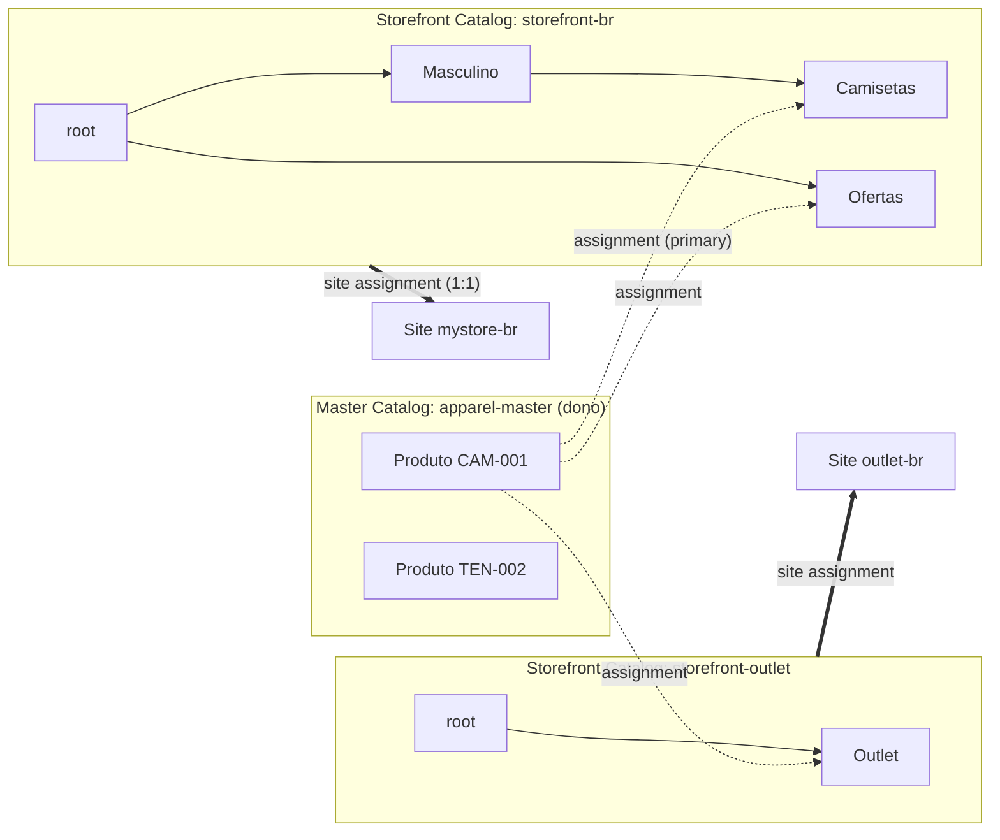
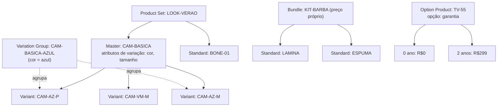
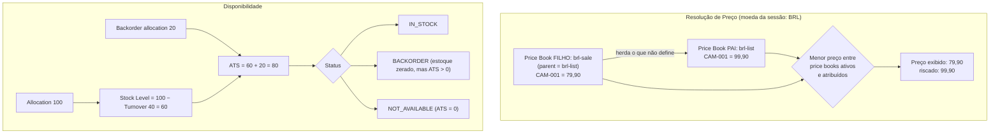
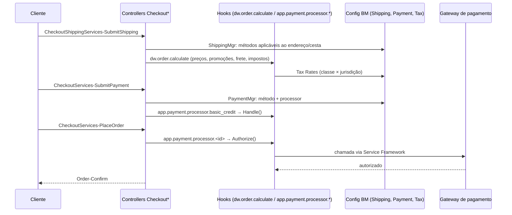
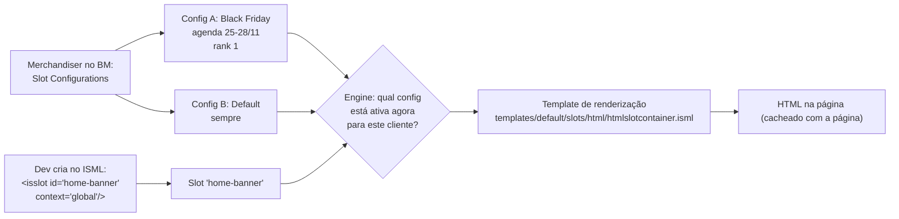

# Guia Definitivo de Engenharia e Certificação Salesforce B2C Commerce (SFRA)

## MÓDULO 2 — Trabalhando com um Site B2C no Business Manager

> **Peso no exame:** 12% (domínio "Work With a B2C Site") — cerca de 7 questões.
> **Objetivos oficiais cobertos:** modelo de dados de produto e busca, categorização, inventário e price books; configurar pagamento e frete para permitir pedidos; trabalhar com Content Assets, Page Designer, Content Slots e Content Folders.

---

### Sumário

1. [Tópico 2.1 — Master Catalog vs Storefront Catalog](#tópico-21--master-catalog-vs-storefront-catalog)
2. [Tópico 2.2 — Tipos de Produto](#tópico-22--tipos-de-produto)
3. [Tópico 2.3 — Categorias, Price Books e Inventory Lists](#tópico-23--categorias-price-books-e-inventory-lists)
4. [Tópico 2.4 — Checkout no BM: Frete, Pagamento e Impostos](#tópico-24--checkout-no-bm-frete-pagamento-e-impostos)
5. [Tópico 2.5 — Conteúdo: Assets, Folders, Slots e Page Designer (visão do merchandiser)](#tópico-25--conteúdo-assets-folders-slots-e-page-designer-visão-do-merchandiser)
6. [Revisão Relâmpago do Módulo 2](#revisão-relâmpago-do-módulo-2)

---

## Tópico 2.1 — Master Catalog vs Storefront Catalog

### 1. Conceito & Glossário Desmistificado

| Termo | O que é na prática |
|---|---|
| **Catalog** | Um container de produtos e/ou categorias. |
| **Master Catalog** (catálogo de produtos) | **Dono** dos produtos. Guarda os dados do produto (nome, descrição, atributos, imagens, variações). Normalmente alimentado pelo PIM/ERP. **Não é atribuído a site.** |
| **Storefront Catalog** (catálogo de vitrine / *site catalog*) | Define a **árvore de categorias da navegação** do site e **atribui** (*assigns*) produtos dos master catalogs a essas categorias. **Atribuído a um site.** |
| **Ownership (posse)** | Cada produto pertence a **um único** catálogo (o master). |
| **Assignment (atribuição)** | Ligação produto → categoria. Um produto pode ser atribuído a **várias** categorias, inclusive de catálogos diferentes. |
| **Primary Category** | A categoria "principal" do produto naquele catálogo, usada para breadcrumb e URL. |
| **Classification Category** | Categoria (normalmente no master) que define quais **atributos** o produto tem (ex.: "Calçados" tem `tamanho`). |
| **Root category** | Raiz da árvore de categorias (`root`). |

**Por que separar?** Um único master catalog pode alimentar vários sites (Brasil, Outlet, Marketplace) com navegações diferentes, sem duplicar dados de produto.

### 2. Arquitetura & Como Funciona por Baixo dos Panos



**Regras que o motor aplica para um produto aparecer na loja:**

1. O produto está **online** (e dentro de `online-from`/`online-to`, se definidos).
2. Está **atribuído** a pelo menos uma categoria **online** do storefront catalog do site.
3. É **searchable** (para aparecer em busca/listagem).
4. Tem **preço** num price book ativo e atribuído ao site, na moeda da sessão (se a configuração do site exigir preço para exibir).
5. O **índice de busca** foi atualizado.

### 3. Guia Prático de Business Manager (BM)

**Criar catálogos:**

1. `Merchant Tools > Products and Catalogs > Catalogs` → **New**.
2. **ID** (ex.: `storefront-br`), **Name**.
3. Para o catálogo de vitrine, atribua ao site (aba/link **Site Assignments** ou nas propriedades do catálogo, conforme a versão do BM).

**Atribuir produtos a categorias:**

- Pelo produto: `Merchant Tools > Products and Catalogs > Products` → abra o produto → aba **Categories** → **Assign** → escolha a categoria do storefront catalog → marque **Primary** se for a principal.
- Pela categoria: `Merchant Tools > Products and Catalogs > Catalogs > [catálogo] > [categoria]` → aba **Products** → **Assign**.
- Em massa: XML de catálogo com `<category-assignment>` (Módulo 1) — preferido para volumes grandes.

**Online/searchable:**

- Produto: aba **General** → `Online`, `Searchable`, `Online From/To`.
- Categoria: aba **General** → `Online`, `Online From/To`, `Show in Menu Navigation` (atributo customizado do SFRA `showInMenu`).

### 4. Implementação em Código (Hands-On)

```javascript
'use strict';

var CatalogMgr = require('dw/catalog/CatalogMgr');
var ProductMgr = require('dw/catalog/ProductMgr');

// Catálogo de vitrine do site atual (o master não é acessível assim)
var siteCatalog = CatalogMgr.getSiteCatalog();
var root = siteCatalog.getRoot();

// Categoria por ID (respeita o storefront catalog do site)
var camisetas = CatalogMgr.getCategory('camisetas');
if (camisetas && camisetas.isOnline()) {
    // Subcategorias online — útil para menus
    var subcats = camisetas.getOnlineSubCategories();
}

var product = ProductMgr.getProduct('CAM-001');
if (product) {
    var primaryCategory = product.getPrimaryCategory();   // pode ser null
    var isAssigned = product.isAssignedToSiteCatalog();    // está na vitrine do site?
    var classificationCategory = product.getClassificationCategory();
}
```

❌ **Anti-padrão:** percorrer a árvore de categorias inteira em toda requisição para montar o menu. ✅ Monte o menu num **template cacheado** (ou remote include cacheado) e use os helpers do SFRA (`models/categories.js`).

### 5. Foco no Exame (Pegadinhas & Quotas)

- **"Onde ficam os dados de produto?"** → Master catalog. **"O que é atribuído ao site?"** → Storefront catalog (exatamente **um** por site).
- **"Produto existe no BM mas não aparece na vitrine"** → falta **category assignment** no storefront catalog, produto **offline**, categoria offline, sem preço, ou índice desatualizado.
- **"Mesmo produto em dois sites com categorias diferentes"** → um master catalog + dois storefront catalogs.
- **Um produto pode pertencer a dois masters?** Não. Pode ser **atribuído** a categorias de vários catálogos.

---

## Tópico 2.2 — Tipos de Produto

### 1. Conceito & Glossário Desmistificado

| Tipo | Descrição | Vai ao carrinho? | Exemplo |
|---|---|---|---|
| **Standard Product** | Produto simples, sem variações. | Sim | Caneca única |
| **Master Product** | "Pai" que define **atributos de variação** (cor, tamanho). Não tem SKU próprio vendável. | **Não** (precisa escolher a variante) | "Camiseta Básica" |
| **Variant (Product Variation)** | Combinação concreta de valores de variação. Tem SKU, estoque e pode ter preço próprio. | Sim | Camiseta Básica Azul M |
| **Variation Group** | Subconjunto de variantes de um master, agrupadas por um ou mais valores (ex.: todas as **azuis**). Pode ser atribuído a categoria com imagens/nome próprios. | Não diretamente (resolve para variante) | "Camiseta Básica Azul" |
| **Product Set** | Coleção de produtos exibidos juntos; cada item é comprado **separadamente** (escolhe quais e quantos). Sem preço próprio. | Os itens individuais | "Look completo" |
| **Product Bundle** | Kit vendido como **uma unidade**, com **preço próprio**; os itens internos (*bundled products*) vão junto. | Sim, como uma linha + linhas dependentes | "Kit Barbear" |
| **Option Product** | Produto com **opções** que alteram preço (garantia, gravação, embrulho). | Sim, com *option line items* | TV + garantia estendida |

**Regras importantes:**

- Um **Product Set não pode conter outro Product Set**.
- Um **Bundle** tem preço e estoque próprios; a disponibilidade também depende dos itens incluídos.
- **Master** herda atributos para as variantes: se a variante não define um atributo (ex.: descrição), usa o do master.
- Variation attributes podem ser **por produto** (local) ou **compartilhados** (shared variation attributes no master catalog).

### 2. Arquitetura & Como Funciona por Baixo dos Panos



**Herança de dados na PDP:** quando a PDP recebe `pid` de um master, o SFRA mostra o seletor de variações; ao escolher valores, uma chamada AJAX (`Product-Variation`) resolve a variante e devolve o JSON atualizado (preço, estoque, imagens).

### 3. Guia Prático de Business Manager (BM)

**Criar master + variantes:**

1. `Merchant Tools > Products and Catalogs > Products` → **New** → produto `CAM-BASICA` no master catalog.
2. Abra o produto → aba **Variations** → **Variation Attributes** → adicione `color` e `size` e os valores.
3. Na mesma aba, crie/atribua as **Variants** (ou importe via XML `<variations>`).
4. Para **Variation Group**: na aba Variations, crie um grupo selecionando os valores (ex.: color=azul).

**Product Set:** produto novo → aba **Product Sets** (ou **Set Products**) → atribua os produtos membros.
**Bundle:** produto novo → aba **Bundles** (*Bundled Products*) → adicione itens com quantidade.
**Options:** aba **Options** → defina a opção e os valores; preços de opção podem ser definidos por moeda.

> 🔎 **Verificar:** os rótulos exatos das abas (ex.: "Product Sets" vs "Set Products") variam por versão do BM; o conceito é o mesmo.

### 4. Implementação em Código (Hands-On)

```javascript
'use strict';

var ProductMgr = require('dw/catalog/ProductMgr');

var product = ProductMgr.getProduct(pid);

if (product.isMaster()) {
    var variationModel = product.getVariationModel();
    // Atributo de variação "color"
    var colorAttr = variationModel.getProductVariationAttribute('color');
    // Resolver variante a partir de seleção
    variationModel.setSelectedAttributeValue('color', 'azul');
    variationModel.setSelectedAttributeValue('size', 'M');
    var selectedVariant = variationModel.getSelectedVariant(); // null se combinação inválida
}

if (product.isVariant()) {
    var master = product.getMasterProduct();
}

if (product.isVariationGroup()) { /* ... */ }
if (product.isProductSet()) {
    var setProducts = product.getProductSetProducts();   // Collection
}
if (product.isBundle()) {
    var bundled = product.getBundledProducts();          // Collection
    var qty = product.getBundledProductQuantity(bundled[0]); // Quantity
}
if (product.isOptionProduct()) {
    var optionModel = product.getOptionModel();
}
```

**No SFRA, prefira a factory** em vez de tratar tipos manualmente:

```javascript
var ProductFactory = require('*/cartridge/scripts/factories/product');
// A factory decide o tipo (set, bundle, variante, master) e aplica os decorators corretos
var productModel = ProductFactory.get({ pid: pid, variables: req.querystring.variables });
```

❌ **Anti-padrão:** adicionar o **master** ao carrinho. O master não é vendável; o SFRA resolve a variante antes do `Cart-AddProduct`.

### 5. Foco no Exame (Pegadinhas & Quotas)

- **"Cliente escolhe itens individuais de um look e compra só alguns"** → **Product Set**.
- **"Kit com preço único, vendido junto"** → **Bundle**.
- **"Página de categoria mostrar 'Camiseta Azul' como item separado com fotos azuis"** → **Variation Group**.
- **"Garantia estendida com preço adicional"** → **Option Product**.
- **Master não vai ao carrinho**; variantes herdam atributos não definidos do master.
- Sets **não** contêm sets.

---

## Tópico 2.3 — Categorias, Price Books e Inventory Lists

### 1. Conceito & Glossário Desmistificado

**Price Book:** tabela de preços **numa moeda**. Pode ter:

- **Parent price book:** o filho **herda** preços que não define (útil para "preço promocional" sobrepondo "preço de lista").
- **Online flag** e **validade** (`online-from`/`online-to`).
- **Tiered prices:** preço por quantidade (`<amount quantity="10">`).
- **Site assignment:** só price books atribuídos são considerados no site.
- **List price vs Sale price:** convenção do SFRA — um price book de lista (preço "de") e um de venda (preço "por"). O SFRA mostra o preço riscado quando o preço de venda é menor que o de lista.

**Regra de seleção de preço:** quando um produto tem preço em mais de um price book **ativo e atribuído** ao site (na moeda da sessão), a plataforma usa o **menor** preço. Price books também podem ser ativados para grupos específicos de clientes via **campanhas/promoções de price book**.

> 🔎 **Verificar:** detalhes de "price book promotions" (como associar price book a customer group dentro de campanha) mudaram de nomenclatura ao longo das releases. No exame, o conceito é: preço específico para segmento → price book + campanha/customer group, não código customizado.

**Inventory List:**

| Campo/Conceito | Significado |
|---|---|
| **Allocation** | Quantidade alocada para venda online. |
| **Turnover** | Quantidade já consumida (pedidos/reservas) desde a última alocação. |
| **Stock Level** | `Allocation − Turnover` (nunca negativo). |
| **Perpetual** | Estoque "infinito": sempre disponível (produtos digitais, sob encomenda). |
| **Backorder** | Permite vender além do estoque, até a quantidade de backorder (com data prevista `in-stock date`). |
| **Pre-order** | Vender antes do lançamento, até uma quantidade de pre-order. |
| **ATS (Available To Sell)** | O que ainda pode ser vendido: estoque disponível + quantidade de pre-order/backorder restante. Usado pelo `isOrderable()`. |
| **Default In-Stock** (flag da lista) | Comportamento para produtos **sem registro** na lista: considerados disponíveis ou não. |

### 2. Arquitetura & Como Funciona por Baixo dos Panos



### 3. Guia Prático de Business Manager (BM)

**Categorias:**

- `Merchant Tools > Products and Catalogs > Catalogs > [storefront catalog]` → **New** categoria.
- Abas: **General** (online, nome, descrição, page title/meta), **Products**, **Category Attributes**, **Search Refinement Definitions** (Módulo 3), **Sorting Rules**.

**Price Books:**

1. `Merchant Tools > Products and Catalogs > Price Books` → **New**.
2. **ID**, **Currency** (BRL), **Parent** (opcional), **Online**, datas de validade.
3. Aba **Price Definitions** → adicione preços por produto (ou importe XML).
4. Aba **Site Assignments** → marque o site.

**Inventory:**

1. `Merchant Tools > Products and Catalogs > Inventory` → **New** lista (ex.: `inventory-br`), com **Default In-Stock** desmarcado (recomendado: produto sem registro = indisponível).
2. Aba **Records** → por produto: Allocation, Perpetual, Pre-order/Backorder Handling (`None`, `Preorder`, `Backorder`), quantidade de pre/backorder, In-Stock Date.
3. Atribua a lista ao site (Módulo 1).

### 4. Implementação em Código (Hands-On)

```javascript
'use strict';

var ProductMgr = require('dw/catalog/ProductMgr');
var ProductAvailabilityModel = require('dw/catalog/ProductAvailabilityModel');

var product = ProductMgr.getProduct('CAM-001');

// ----- PREÇO -----
var priceModel = product.getPriceModel();
var salePrice = priceModel.getPrice();                          // dw.value.Money (preço efetivo, menor)
var listPrice = priceModel.getPriceBookPrice('brl-list');       // preço de um price book específico
var priceInfo = priceModel.getPriceInfo();                      // de qual price book veio
var pbId = priceInfo ? priceInfo.getPriceBook().getID() : null;

// ----- DISPONIBILIDADE -----
var availabilityModel = product.getAvailabilityModel();
var inStock = availabilityModel.isInStock();                    // há estoque (considera ATS)
var canOrder3 = availabilityModel.isOrderable(3);              // posso comprar 3 unidades?
var status = availabilityModel.getAvailabilityStatus();         // IN_STOCK, PREORDER, BACKORDER, NOT_AVAILABLE
var record = availabilityModel.getInventoryRecord();            // pode ser null
var ats = record ? record.getATS().getValue() : 0;

if (status === ProductAvailabilityModel.AVAILABILITY_STATUS_BACKORDER) {
    var inStockDate = record.getInStockDate();                   // data prevista
}
```

**SFRA:** o decorator `availability` (`models/product/decorators/availability.js`) já monta mensagens de disponibilidade usando `Resource.msg` — estenda esse decorator em vez de recalcular no template.

❌ **Anti-padrão:** calcular desconto "na mão" no ISML (`preço * 0.9`). Preços diferenciados → price books; descontos → promoções. Código manual quebra impostos, relatórios e OCAPI.

### 5. Foco no Exame (Pegadinhas & Quotas)

- **"Mostrar preço riscado"** → dois price books (lista e venda); SFRA compara.
- **"Preço especial para clientes VIP"** → price book + campanha/customer group (configuração, não código).
- **"Produto mostra 'esgotado' mas há estoque físico"** → lista não atribuída ao site, produto sem registro e `Default In-Stock` = false, ou `Allocation` zerada.
- **"Vender produto que chega mês que vem"** → **Pre-order** (antes do lançamento) ou **Backorder** (produto já existente, temporariamente sem estoque).
- **"Produto digital sempre disponível"** → **Perpetual**.
- **Price book em moeda diferente da sessão é ignorado.**

---

## Tópico 2.4 — Checkout no BM: Frete, Pagamento e Impostos

### 1. Conceito & Glossário Desmistificado

| Termo | Significado |
|---|---|
| **Shipping Method** | Opção de entrega (Normal, Expresso). Tem **custo** (fixo, por peso/valor via tabela, sobretaxas por produto), **moeda**, **exclusões** (produtos, endereços) e restrição por **customer group**. Um é marcado como **default**. |
| **Payment Method** | Meio de pagamento visível ao cliente (`CREDIT_CARD`, `GIFT_CERTIFICATE`, `PayPal`...). Restrições por país, moeda, customer group, valor mínimo/máximo. |
| **Payment Card** | Bandeiras aceitas (Visa, Master...) dentro de `CREDIT_CARD`. |
| **Payment Processor** | Quem **processa** o pagamento: `BASIC_CREDIT`, `BASIC_GIFT_CERTIFICATE` (simulados) ou de integração (`ADYEN_...`, `CYBERSOURCE_...`). O ID do processor define qual **hook** de pagamento o SFRA chama. |
| **Tax Class** | Classe fiscal do produto (`standard`, `reduzida`, `exempt`). Produto e método de frete têm tax class. |
| **Tax Jurisdiction** | Região fiscal (país, estado, CEP). |
| **Tax Rate** | Percentual para a combinação **Tax Class × Jurisdiction**. |

### 2. Arquitetura & Como Funciona por Baixo dos Panos



**Como o SFRA liga payment processor a código:** o ID do processor configurado no BM (ex.: `BASIC_CREDIT`) é convertido em minúsculas e usado no nome do hook: `app.payment.processor.basic_credit`. Uma integração registra seu próprio hook (ex.: `app.payment.processor.adyen_component`) no `hooks.json`.

### 3. Guia Prático de Business Manager (BM)

**Shipping Methods:** `Merchant Tools > Ordering > Shipping Methods`

1. **New** → ID (`standard-br`), Name, **Currency** (BRL), **Default** (sim/não), **Online/Enabled**, **Tax Class**.
2. **Shipping Cost:** definir custo fixo ou **tabela** por peso/valor do pedido; **Product Shipping Cost** (sobretaxa por produto).
3. **Exclusions:** produtos excluídos (ex.: itens grandes não vão por Expresso) e **Address Exclusions** (ex.: CEPs não atendidos).
4. **Customer Groups:** restringir a grupos (ex.: método "Retirada VIP").
5. Frete grátis "acima de R$X" → **promoção de frete** em `Merchant Tools > Online Marketing > Promotions`, não no shipping method.

**Payment Methods:** `Merchant Tools > Ordering > Payment Methods`

1. Selecione `CREDIT_CARD` → **Enabled**, **Payment Processor** = `BASIC_CREDIT` (ou o da integração).
2. **Payment Cards:** habilite bandeiras, defina processor por cartão se necessário.
3. Restrições: **Countries**, **Currencies**, **Customer Groups**, **Min/Max amount**.

**Payment Processors:** `Merchant Tools > Ordering > Payment Processors` — lista os processors disponíveis (criados por integrações via import de metadados/site import).

**Taxes:** `Merchant Tools > Ordering > Taxes`

1. **Tax Classes:** crie (`standard`, `exempt`); marque a default.
2. **Tax Jurisdictions:** país/estado/CEP.
3. **Tax Rates:** % para cada classe × jurisdição.
4. Atribua tax class ao produto (aba General) e ao shipping method.

> Em projetos reais (especialmente EUA/Net), impostos costumam vir de serviço externo (Avalara, Vertex) via hook de cálculo. As tabelas do BM servem para cenários simples.

### 4. Implementação em Código (Hands-On)

**`hooks.json` de pagamento (padrão SFRA):**

```json
{
  "hooks": [
    {
      "name": "app.payment.processor.basic_credit",
      "script": "./cartridge/scripts/hooks/payment/processor/basic_credit"
    }
  ]
}
```

**Processor customizado (esqueleto com `Handle` e `Authorize`):**

```javascript
'use strict';

var Transaction = require('dw/system/Transaction');
var PaymentMgr = require('dw/order/PaymentMgr');
var Resource = require('dw/web/Resource');

/**
 * Handle: chamado no SubmitPayment. Cria/atualiza o PaymentInstrument na cesta.
 * NÃO cobra o cliente aqui.
 */
function Handle(basket, paymentInformation) {
    var serverErrors = [];
    var fieldErrors = {};

    Transaction.wrap(function () {
        // remove instrumentos de cartão anteriores
        var existing = basket.getPaymentInstruments('CREDIT_CARD');
        for (var i = 0; i < existing.length; i++) {
            basket.removePaymentInstrument(existing[i]);
        }
        var pi = basket.createPaymentInstrument('CREDIT_CARD', basket.totalGrossPrice);
        pi.setCreditCardHolder(basket.billingAddress.fullName);
        pi.setCreditCardType(paymentInformation.cardType.value);
        // Em produção, salve TOKEN do gateway, nunca o PAN completo
        pi.setCreditCardToken(paymentInformation.creditCardToken);
        pi.setCreditCardExpirationMonth(paymentInformation.expirationMonth.value);
        pi.setCreditCardExpirationYear(paymentInformation.expirationYear.value);
    });

    return { fieldErrors: fieldErrors, serverErrors: serverErrors, error: false };
}

/**
 * Authorize: chamado no PlaceOrder, depois de criar o pedido.
 */
function Authorize(orderNumber, paymentInstrument, paymentProcessor) {
    var serverErrors = [];
    try {
        // var result = gatewayService.call({...}); (Módulo 5)
        Transaction.wrap(function () {
            paymentInstrument.paymentTransaction.setTransactionID(orderNumber);
            paymentInstrument.paymentTransaction.setPaymentProcessor(paymentProcessor);
        });
    } catch (e) {
        serverErrors.push(Resource.msg('error.technical', 'checkout', null));
        return { fieldErrors: [], serverErrors: serverErrors, error: true };
    }
    return { fieldErrors: [], serverErrors: serverErrors, error: false };
}

exports.Handle = Handle;
exports.Authorize = Authorize;
```

**Como o SFRA chama (simplificado de `checkoutHelpers`):**

```javascript
var HookMgr = require('dw/system/HookMgr');
var PaymentMgr = require('dw/order/PaymentMgr');

var processor = PaymentMgr.getPaymentMethod(pi.getPaymentMethod()).getPaymentProcessor();
var hookName = 'app.payment.processor.' + processor.ID.toLowerCase();
if (HookMgr.hasHook(hookName)) {
    var authResult = HookMgr.callHook(hookName, 'Authorize', orderNumber, pi, processor);
}
```

> 🔎 **Verificar:** as assinaturas exatas de `Handle`/`Authorize` mudaram levemente entre versões do SFRA (ex.: parâmetro `paymentInformation`). Confira o arquivo `basic_credit.js` da sua versão da base.

❌ **Anti-padrões:**
- Guardar número completo do cartão/CVV em atributo customizado ou log (viola PCI).
- Fazer a cobrança no `Handle` (o pedido ainda não existe).

### 5. Foco no Exame (Pegadinhas & Quotas)

- **"Habilitar novo meio de pagamento"** → criar/ativar **Payment Method**, associar a um **Payment Processor**, e o processor ter **hook** implementado.
- **"Método de frete não aparece para um CEP"** → **Address Exclusion** ou **customer group** restrito, ou moeda diferente.
- **"Produto pesado não pode ir por Expresso"** → **Product Exclusion** no shipping method.
- **"Frete grátis acima de R$200"** → **Shipping promotion**, não configuração do método.
- **Imposto errado para um produto** → tax class do produto ou rate da jurisdição.

---

## Tópico 2.5 — Conteúdo: Assets, Folders, Slots e Page Designer (visão do merchandiser)

### 1. Conceito & Glossário Desmistificado

| Termo | Significado |
|---|---|
| **Library** | Repositório de conteúdo. Pode ser **compartilhada** entre sites (*shared library*) ou **privada** do site. |
| **Content Asset** | Bloco de conteúdo reutilizável (HTML/rich text, imagens, atributos). Ex.: "Política de Trocas", "rodapé". Tem ID, online, searchable, folder. |
| **Content Folder** (Library Folder) | Organiza assets (como categorias organizam produtos). Usado em navegação de conteúdo e busca de conteúdo. |
| **Content Slot** | Uma "**vaga**" no template (definida pelo dev com `<isslot>`), preenchida pelo merchandiser com **configurações** agendáveis. |
| **Slot Configuration** | O que aparece no slot: tipo de conteúdo (**Products, Categories, Content Assets, HTML**), template de renderização, agendamento, customer groups, rank. |
| **Contexto do slot** | **Global** (aparece em qualquer página que inclua o slot), **Category** (configuração muda por categoria), **Folder** (por pasta de conteúdo). |
| **Page Designer** | Editor visual (drag-and-drop) onde o merchandiser monta **páginas** e **componentes** criados pelo dev (Módulo 5). |

### 2. Arquitetura & Como Funciona por Baixo dos Panos



**Cache e agendamento:** o conteúdo do slot é renderizado **junto com a página** (ou o remote include) e fica no **page cache**. Uma configuração agendada começa a aparecer quando a entrada de cache em uso expira/é invalidada. Se o requisito é "trocar o banner exatamente à meia-noite", atenção ao tempo de cache da página. 🔎 **Verificar:** a plataforma considera janelas de agendamento de algumas entidades para limitar o tempo de cache; não confie nisso sem testar com o Storefront Toolkit (Cache Info).

### 3. Guia Prático de Business Manager (BM)

**Content Assets:**

1. `Merchant Tools > Content > Content Assets` → **New**.
2. **ID** (`politica-trocas`), **Name**, **Online**, **Searchable**, **Body** (editor rich text), atributos de página (title, description).
3. Classifique numa **Folder** (`Merchant Tools > Content > Library Folders`).
4. Para sites com shared library, verifique qual library o site usa.

**Content Slots:**

1. `Merchant Tools > Online Marketing > Content Slots`.
2. Filtre por **contexto** (Global / Category / Folder) e encontre o slot (ex.: `home-main`). Ele só aparece se o dev declarou o `<isslot>` num template.
3. **New** configuração:
   - **Configuration ID**, **Enabled**, **Default** (usada quando nenhuma agendada se aplica).
   - **Content Type:** Products / Categories / Content Assets / HTML.
   - **Template:** escolha entre os templates de slot disponíveis na cartridge.
   - **Schedule** e **Customer Groups**: definidos ao associar a configuração a uma **Campaign** (*Merchant Tools > Online Marketing > Campaigns*), ou diretamente na configuração conforme a versão do BM.
   - **Rank:** desempate quando várias configs estão ativas.
4. Para slot de **categoria**: escolha a categoria e crie a config para ela.

**Page Designer (visão merchandiser):**

1. `Merchant Tools > Content > Page Designer` → **New Page** → escolha o **Page Type** (definido pelo dev).
2. Arraste **Components** para as **Regions**.
3. Configure atributos de cada componente (imagem, texto, link, produto).
4. **Visibility:** agendamento e customer groups por página/componente.
5. **Publish** → a página fica acessível via `Page-Show?cid=<pageId>` (ou URL amigável/atribuição a categoria, conforme configuração).

### 4. Implementação em Código (Hands-On)

**Declarando slots no ISML:**

```html
<!-- Slot global: mesma configuração em qualquer página que o inclua -->
<isslot id="home-main-m" description="Banner principal da home" context="global" />

<!-- Slot de categoria: a configuração varia por categoria -->
<isslot id="cat-banner-m"
        description="Banner do topo da PLP"
        context="category"
        context-object="${pdict.productSearch.category}" />

<!-- Slot de folder -->
<isslot id="folder-banner"
        description="Banner da pasta de conteúdo"
        context="folder"
        context-object="${pdict.folder}" />
```

**Template de renderização de slot (`templates/default/slots/html/htmlslotcontainer.isml`):**

```html
<iscontent type="text/html" charset="UTF-8" compact="true" />
<isif condition="${slotcontent != null}">
    <div class="html-slot-container">
        <isloop items="${slotcontent.content}" var="markupText">
            <!-- Conteúdo HTML do merchandiser: encoding off é intencional aqui -->
            <isprint value="${markupText.markup}" encoding="off" />
        </isloop>
    </div>
</isif>
```

> `slotcontent` é a variável implícita disponível no template de slot, com `slotcontent.content` (coleção do tipo configurado) e `slotcontent.callout`.

**Incluindo um Content Asset:**

```html
<!-- Remote include do controller Page-Include do SFRA (cache independente) -->
<isinclude url="${URLUtils.url('Page-Include', 'cid', 'footer-links')}" />
```

```javascript
// Em script: buscar asset
var ContentMgr = require('dw/content/ContentMgr');
var asset = ContentMgr.getContent('politica-trocas');
if (asset && asset.isOnline()) {
    var body = asset.custom.body;   // MarkupText
}
// No SFRA, prefira o model: require('*/cartridge/models/content')
```

❌ **Anti-padrão:** colocar texto de marketing hard-coded no ISML. Qualquer mudança exige deploy. Use content asset, slot ou Page Designer.

### 5. Foco no Exame (Pegadinhas & Quotas)

- **"Banner diferente por categoria"** → slot com `context="category"` e `context-object`.
- **"Mesmo banner em todas as páginas"** → `context="global"`.
- **"Slot não aparece em Content Slots no BM"** → o dev não declarou o `<isslot>` num template ativo / cartridge fora do path.
- **"Config agendada não aparece no horário"** → cache da página; ou config não **enabled**; ou campanha inativa/customer group.
- **Tipos de conteúdo de slot:** Products, Categories, Content Assets, HTML. (Não existe tipo "Promotion" — distrator comum.)
- **Merchandiser montar landing page sem dev** → Page Designer (se os componentes já existem).

---

## Revisão Relâmpago do Módulo 2

| Cenário | Resposta |
|---|---|
| Onde ficam dados de produto | Master catalog |
| O que vai para o site | Storefront catalog (1 por site) |
| Look com itens comprados separados | Product Set |
| Kit com preço único | Bundle |
| Grupo "Azul" de um master na PLP | Variation Group |
| Preço riscado | Price book de lista + de venda |
| Múltiplos preços válidos | Vence o menor |
| Vender sem estoque com data prevista | Backorder |
| Novo meio de pagamento | Payment Method + Processor + hook |
| Frete grátis acima de X | Promoção de frete |
| Banner por categoria | `isslot context="category"` |

➡️ **Próximo:** [Módulo 3 — Dados, Busca, Objetos, Performance e Monitoramento](./Modulo_3_Dados_Busca_Performance.md)
