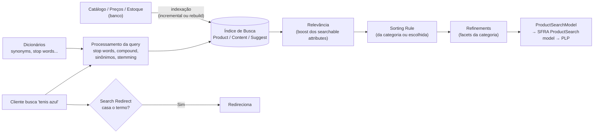
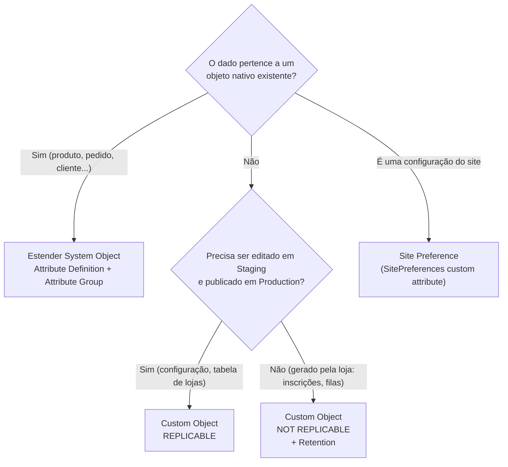
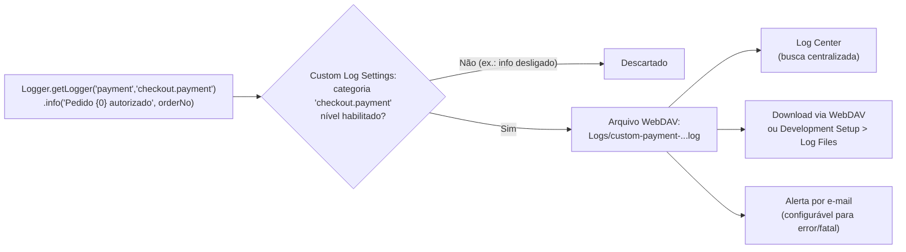
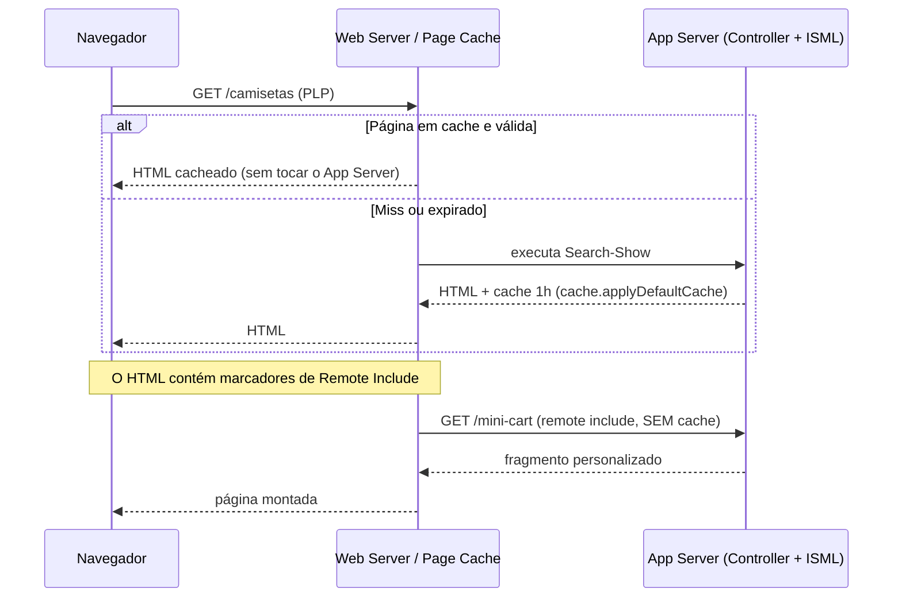
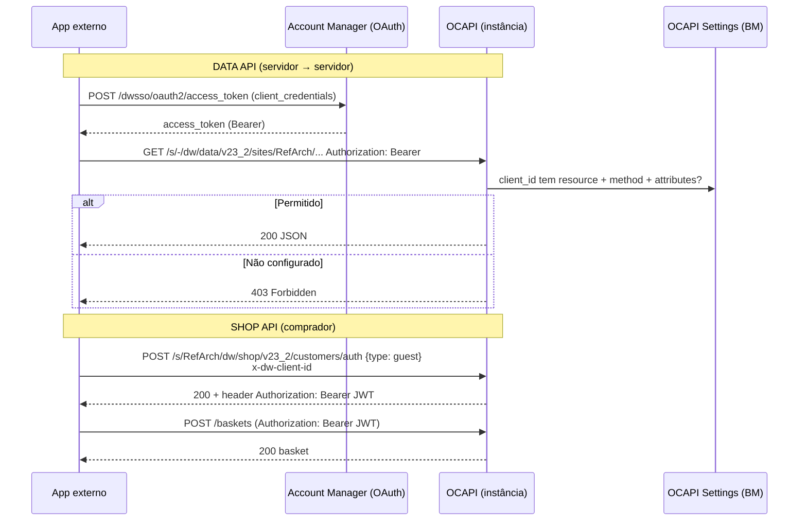
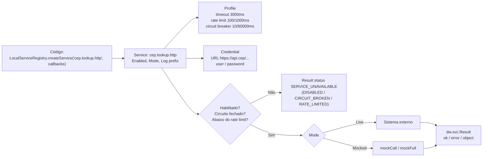

# Guia Definitivo de Engenharia e Certificação Salesforce B2C Commerce (SFRA)

## MÓDULO 3 — Gestão de Dados, Busca, Objetos, Performance e Monitoramento no BM

> **Peso no exame:** 24% (domínio "Data Management Using Business Manager") — cerca de 14 a 15 questões. É o maior domínio "de BM".
> **Objetivos oficiais cobertos:** preferências de busca; refinements e sorting; categorias de log e acesso a logs; estender system objects; decidir e criar custom objects; ferramentas de performance (cache, profilers); permissões OCAPI de Shop e Data; configuração de serviços.

---

### Sumário

1. [Tópico 3.1 — Motor de Busca](#tópico-31--motor-de-busca)
2. [Tópico 3.2 — System Object Extensions vs Custom Objects](#tópico-32--system-object-extensions-vs-custom-objects)
3. [Tópico 3.3 — Logging e Diagnóstico no BM](#tópico-33--logging-e-diagnóstico-no-bm)
4. [Tópico 3.4 — Performance: Page Cache, Profilers e Storefront Toolkit](#tópico-34--performance-page-cache-profilers-e-storefront-toolkit)
5. [Tópico 3.5 — Governança de OCAPI](#tópico-35--governança-de-ocapi)
6. [Tópico 3.6 — Services no BM: Service, Profile e Credentials](#tópico-36--services-no-bm-service-profile-e-credentials)
7. [Revisão Relâmpago do Módulo 3](#revisão-relâmpago-do-módulo-3)

---

## Tópico 3.1 — Motor de Busca

### 1. Conceito & Glossário Desmistificado

A busca do B2C Commerce trabalha sobre um **índice** pré-calculado, não sobre o banco "ao vivo". Toda listagem de categoria (PLP) no SFRA é, na verdade, uma **busca** (`ProductSearchModel`) filtrada pela categoria.

| Termo | Significado |
|---|---|
| **Search Index** | Estrutura otimizada (produtos, conteúdo, sugestões). Precisa ser **reconstruída** (*rebuild*) ou atualizada **incrementalmente** quando dados mudam. |
| **Searchable Attributes** | Atributos de produto/conteúdo pesquisáveis por texto livre, cada um com **boost factor** (peso de relevância). |
| **Search Refinement** | Filtro da PLP (facets): por **categoria**, por **atributo** (cor, marca) ou por **preço** (faixas). Definido **por categoria** e **herdado** pelas subcategorias. |
| **Sorting Rule** | Regra de ordenação composta por atributos (ex.: "mais vendidos" = Active Data revenue desc, depois nome asc). |
| **Sorting Option** | Item do dropdown "Ordenar por" na loja, que aponta para uma sorting rule. |
| **Search Dictionaries** | **Synonyms** (bidirecional: "tênis" ↔ "sneaker"), **Hypernyms/Hyponyms** (unidirecional entre genérico e específico), **Stop Words** (ignoradas: "de", "para"), **Compound Words** (ex.: "guardachuva" ↔ "guarda chuva"), **Common Phrases** (termos que devem ser tratados juntos). |
| **Search Redirect** | Termo de busca que manda o cliente direto para uma URL (ex.: "trocas" → página de política de trocas). |
| **Active Data** | Métricas de produto (receita, visualizações, conversão) usadas em sorting rules dinâmicas. |

> 🔎 **Verificar (direção hypernym/hyponym):** a lógica é "buscar o termo genérico também retorna os específicos", e não o inverso. A tela do BM explica a direção em cada entrada; valide o comportamento com o Storefront Toolkit → Search Information.

### 2. Arquitetura & Como Funciona por Baixo dos Panos



**Herança de refinements:** definir "Cor" e "Marca" na categoria `root` faz todas as subcategorias herdarem. Uma subcategoria pode **adicionar** ou **ocultar** (desativar) refinements herdados.

### 3. Guia Prático de Business Manager (BM)

**Tornar um atributo pesquisável (ex.: `material` customizado):**

1. Crie o atributo em `Administration > Site Development > System Object Types > Product > Attribute Definitions` (Tópico 3.2).
2. `Merchant Tools > Search > Searchable Attributes` → aba **Product** → **Add** → escolha `material` → defina **Boost Factor** (ex.: 1.0; nome do produto costuma ter boost maior).
3. `Merchant Tools > Search > Search Indexes` → selecione o índice de **Product** → **Rebuild** (ou aguarde a indexação incremental, se ativa).

**Search Preferences:** `Merchant Tools > Search > Search Preferences` — opções como correção ortográfica, busca fuzzy, sugestões. 🔎 **Verificar:** o conjunto de opções varia por release.

**Criar refinement:**

1. `Merchant Tools > Products and Catalogs > Catalogs > [storefront catalog] > [categoria, ex.: root]`.
2. Aba **Search Refinement Definitions** → **New**:
   - **Refinement Type:** `Category`, `Attribute` ou `Price`.
   - **Attribute:** ex.: `brand` (para Attribute).
   - **Display Name:** "Marca" (localizável).
   - **Value set:** mostrar valores do resultado da busca vs todos.
   - **Sorting:** por nome, por contagem de resultados, ordem definida.
   - **Price:** defina faixas (`0–50`, `50–100`...).
3. Rebuild do índice se o atributo for novo no índice.

**Sorting:**

1. `Merchant Tools > Search > Sorting Rules` → **New** → adicione **Sorting Attributes** (ex.: `brand` asc) ou **Dynamic Attributes** (Active Data, ex.: `revenue` desc), com pesos.
2. `Merchant Tools > Search > Sorting Options` → crie a opção "Mais vendidos" apontando para a regra (aparece no dropdown do SFRA).
3. Regra padrão por categoria: na categoria → aba de **Sorting Rule** (default sorting rule).

**Dicionários:** `Merchant Tools > Search > Search Dictionaries` → escolha o tipo (Synonyms, Hypernyms, Stop Words, Compound Words, Common Phrases) e o **locale**.

**Redirects:** `Merchant Tools > Search > Search Redirects` → termo + URL (ou pipeline/controller destino), por locale.

**Índices:** `Merchant Tools > Search > Search Indexes` → status, **Rebuild**, configuração de **incremental indexing**. Em produção, rebuilds pesados rodam via **job** agendado (step padrão de indexação).

### 4. Implementação em Código (Hands-On)

```javascript
'use strict';

var ProductSearchModel = require('dw/catalog/ProductSearchModel');
var CatalogMgr = require('dw/catalog/CatalogMgr');

var psm = new ProductSearchModel();
psm.setSearchPhrase('tenis azul');             // texto livre (usa searchable attributes e dicionários)
psm.setCategoryID('calcados');                 // restringe à categoria
psm.setRecursiveCategorySearch(true);          // inclui subcategorias
psm.addRefinementValues('brand', 'Acme');      // aplica refinement de atributo
psm.setPriceMin(100);
psm.setPriceMax(300);

// Sorting rule pelo ID configurado no BM
var sortingRule = CatalogMgr.getSortingRule('best-sellers');
if (sortingRule) {
    psm.setSortingRule(sortingRule);
}

psm.search();                                   // executa contra o ÍNDICE

var count = psm.getCount();
var hits = psm.getProductSearchHits();          // Iterator de ProductSearchHit
while (hits.hasNext()) {
    var hit = hits.next();
    var product = hit.getProduct();             // representante do hit
    // hit.getMinPrice(), hit.getMaxPrice() vêm do índice (sem consultar price book)
}

// Refinements disponíveis para montar facets
var refinements = psm.getRefinements();
var refinementDefs = refinements.getRefinementDefinitions();
```

**SFRA:** o controller `Search-Show` usa `searchHelpers.setupSearch()` e o model `models/search/productSearch.js` para montar refinements e paginação. Estenda o helper/model, não reescreva a busca.

❌ **Anti-padrão crítico (cai muito na prova):**

```javascript
// RUIM: varre o catálogo inteiro no banco a cada requisição da loja
var ProductMgr = require('dw/catalog/ProductMgr');
var all = ProductMgr.queryAllSiteProducts();
while (all.hasNext()) {
    var p = all.next();
    if (p.custom.material === 'Algodão') { /* ... */ }
}
// e ainda esquece all.close()!
```

✅ **Correto:** `ProductSearchModel` com refinement/atributo indexado. `queryAllSiteProducts()` só em **jobs**, sempre com `close()`.

### 5. Foco no Exame (Pegadinhas & Quotas)

- **"Atributo novo não é encontrado na busca"** → adicionar em **Searchable Attributes** **e** reconstruir o **índice**.
- **"Filtro por marca em todas as categorias"** → refinement na **root** (herança).
- **"Clientes buscam 'notebook' e 'laptop'"** → **Synonyms**.
- **"Busca por 'frete' deve abrir a página de frete"** → **Search Redirect**.
- **"Ordenar por mais vendidos"** → Sorting Rule com **Active Data** + Sorting Option.
- **"Ignorar 'de', 'para'"** → **Stop Words**.
- PLP **é** busca: performance de PLP = índice + cache.

---

## Tópico 3.2 — System Object Extensions vs Custom Objects

### 1. Conceito & Glossário Desmistificado

| | **System Object (extensão)** | **Custom Object** |
|---|---|---|
| O que é | Tipos nativos da plataforma (`Product`, `Order`, `Customer`, `Profile`, `Basket`, `SitePreferences`, `Category`, `Content`...). Você **adiciona atributos** a eles. | Tipo **novo** criado por você, com chave primária própria. |
| Acesso | `objeto.custom.meuAtributo` | `CustomObjectMgr` |
| Quando usar | O dado **pertence** a um objeto existente (ex.: "material" do produto, "CPF" do perfil, "nota fiscal" do pedido). | O dado **não pertence** a nenhum system object (ex.: inscrições de newsletter de não-clientes, configurações de integração, filas de reprocessamento, logs de webhook). |
| Custo | Barato; segue o ciclo de vida do objeto. | Tem **quotas** de quantidade; precisa de limpeza (retenção). |

**Glossário de atributos:**

- **Attribute Definition:** ID, Display Name, **Value Type** (String, Text, HTML, Int, Number, Boolean, Date, Date+Time, Email, Password, Set of String/Int/Number, Enum of String/Int, Image, Quantity, Money), **Localizable**, **Mandatory**, **Externally managed**, **Site-specific** (para alguns tipos, valor por site).
- **Attribute Group:** agrupamento que define **onde o atributo aparece** na tela do BM (sem grupo, o atributo existe mas o merchandiser não o vê).
- **SitePreferences:** system object especial para **configurações** por site (feature flags, thresholds). Lido com `Site.getCurrent().getCustomPreferenceValue('id')`.

**Custom Object Type — propriedades:**

| Propriedade | Significado |
|---|---|
| **ID** | Nome do tipo (ex.: `NewsletterSubscription`). |
| **Key Attribute** | Chave primária (`String` ou `Int`), única. |
| **Storage Scope** | **Organization** (compartilhado entre sites) ou **Site** (cada site tem os seus). |
| **Data Replication** | **Replicable** (vai de STG→PRD; editado em Staging) ou **Not replicable** (gerado no próprio ambiente, ex.: Production). |
| **Retention (dias)** | Objetos mais antigos que N dias são **apagados automaticamente**. |

### 2. Arquitetura & Como Funciona por Baixo dos Panos



### 3. Guia Prático de Business Manager (BM)

**Estender `Product` com `material`:**

1. `Administration > Site Development > System Object Types` → clique em **Product**.
2. Aba **Attribute Definitions** → **New**:
   - **ID:** `material`, **Display Name:** "Material", **Value Type:** `String`, **Localizable:** sim (se varia por idioma).
   - **Apply**.
3. Aba **Attribute Grouping** → escolha um grupo existente ou crie (`productCustom`) → **Add** o atributo `material` ao grupo.
4. Agora o merchandiser vê "Material" em `Merchant Tools > Products and Catalogs > Products > [produto]` (aba de atributos).

**Criar Site Preference:**

1. `Administration > Site Development > System Object Types > SitePreferences` → **Attribute Definitions** → **New** (`freeShippingThreshold`, `Number`).
2. **Attribute Grouping** → crie grupo `checkoutConfig` e adicione o atributo.
3. Valor por site: `Merchant Tools > Site Preferences > Custom Preferences > checkoutConfig`.

**Criar Custom Object Type:**

1. `Administration > Site Development > Custom Object Types` → **New**.
2. **ID:** `NewsletterSubscription`, **Key Attribute:** `email` (String), **Storage Scope:** `Site`, **Data Replication:** `Not replicable`, **Retention:** ex.: 365 dias.
3. Aba **Attribute Definitions:** `firstName`, `lastName`, `optInDate`...
4. Aba **Attribute Grouping:** crie grupo para visualizar no BM.
5. Ver/editar instâncias: `Merchant Tools > Custom Objects > Custom Object Editor` (ou `Manage Custom Objects`).

**Exportar metadados para versionar no Git:** `Administration > Site Development > Import & Export` → **Export** → *Meta Data* → gera `system-objecttype-extensions.xml` e `custom-objecttype-definitions.xml`. Versione esses XMLs e importe nas outras instâncias.

### 4. Implementação em Código (Hands-On)

**Metadata XML (versionável no Git):**

```xml
<?xml version="1.0" encoding="UTF-8"?>
<metadata xmlns="http://www.demandware.com/xml/impex/metadata/2006-10-31">
    <!-- Extensão de system object -->
    <type-extension type-id="Product">
        <custom-attribute-definitions>
            <attribute-definition attribute-id="material">
                <display-name xml:lang="x-default">Material</display-name>
                <type>string</type>
                <localizable-flag>true</localizable-flag>
                <mandatory-flag>false</mandatory-flag>
                <externally-managed-flag>false</externally-managed-flag>
            </attribute-definition>
        </custom-attribute-definitions>
        <group-definitions>
            <attribute-group group-id="productCustom">
                <display-name xml:lang="x-default">Atributos Custom</display-name>
                <attribute attribute-id="material"/>
            </attribute-group>
        </group-definitions>
    </type-extension>

    <!-- Novo custom object type -->
    <custom-type type-id="NewsletterSubscription">
        <display-name xml:lang="x-default">Inscrição Newsletter</display-name>
        <staging-mode>no-staging</staging-mode>          <!-- não replicável -->
        <storage-scope>site</storage-scope>
        <retention-days>365</retention-days>
        <key-definition attribute-id="email">
            <type>string</type>
            <min-length>0</min-length>
        </key-definition>
        <attribute-definitions>
            <attribute-definition attribute-id="firstName">
                <type>string</type>
            </attribute-definition>
        </attribute-definitions>
    </custom-type>
</metadata>
```

> 🔎 **Verificar:** os valores de `staging-mode` (ex.: `source-to-target` para replicável, `no-staging` para não replicável) devem ser conferidos no XSD `metadata.xsd`.

**Lendo/escrevendo atributos:**

```javascript
'use strict';

var Transaction = require('dw/system/Transaction');
var CustomObjectMgr = require('dw/object/CustomObjectMgr');
var Site = require('dw/system/Site');

// System object extension: leitura simples
var material = product.custom.material;

// Escrita: SEMPRE em transação
Transaction.wrap(function () {
    order.custom.invoiceNumber = 'NF-12345';
});

// Site Preference
var threshold = Site.getCurrent().getCustomPreferenceValue('freeShippingThreshold') || 0;

// Custom Object: criar (upsert manual)
function saveSubscription(email, firstName) {
    Transaction.wrap(function () {
        var co = CustomObjectMgr.getCustomObject('NewsletterSubscription', email);
        if (!co) {
            co = CustomObjectMgr.createCustomObject('NewsletterSubscription', email); // chave = email
        }
        co.custom.firstName = firstName;
    });
}

// Custom Object: consultar com query (use índices/atributos; feche o iterator)
var it = CustomObjectMgr.queryCustomObjects(
    'NewsletterSubscription',
    'custom.firstName = {0}',   // query com placeholders
    'creationDate desc',        // ordenação
    'Ana'
);
try {
    while (it.hasNext()) {
        var sub = it.next();
    }
} finally {
    it.close();                 // libera recursos
}

// Remover
Transaction.wrap(function () {
    var co = CustomObjectMgr.getCustomObject('NewsletterSubscription', 'x@y.com');
    if (co) { CustomObjectMgr.remove(co); }
});
```

❌ **Anti-padrões:**

- Criar Custom Object para guardar "CPF do cliente" → isso é atributo do **Profile**.
- `createCustomObject` fora de transação → erro.
- Custom object replicável sendo criado em Production → apagado na próxima replicação.
- `CustomObjectMgr.getAllCustomObjects()` na loja sem paginar/fechar.

### 5. Foco no Exame (Pegadinhas & Quotas)

- **"Atributo criado mas o merchandiser não vê no BM"** → falta adicionar ao **Attribute Group**.
- **"Dados de formulário de contato de visitantes, sem conta"** → **Custom Object**, **Site** scope, **não replicável**, com **retention**.
- **"Configuração por site (limite de frete grátis)"** → **Site Preference**.
- **"Tabela compartilhada por todos os sites"** → Custom Object com **Organization** scope.
- **Quotas:** custom objects têm limite de quantidade por tipo/instância e há quotas de atributos por objeto e de tamanho de strings. Consulte `Administration > Operations > Quota Status` para os números da sua instância (eles são exibidos lá e nos logs de quota). Retenção automática ajuda a não estourar.

---

## Tópico 3.3 — Logging e Diagnóstico no BM

### 1. Conceito & Glossário Desmistificado

| Termo | Significado |
|---|---|
| **System logs** | Gerados pela plataforma: `error-*.log`, `warn-*.log`, `quota-*.log`, `api-*.log` (problemas de API/deprecações), `jobs-*.log`, `service-*.log`, `syslog`... |
| **Custom logs** | Gerados pelo seu código via `dw.system.Logger`. Arquivo `custom-<prefixo>-<host>-appserver-<data>.log` (com prefixo) ou `customdebug/custominfo/customwarn/customerror` (sem prefixo). |
| **Log Category** | Nome hierárquico que você passa ao logger (ex.: `checkout.payment`), para ativar níveis por categoria. |
| **Log Levels** | `debug` < `info` < `warn` < `error` < `fatal`. |
| **Log Center** | Aplicação web centralizada (por região/realm) para **pesquisar** logs de todas as instâncias com filtros. |
| **Request Log** | No Storefront Toolkit, mostra mensagens de log da requisição atual (sandbox/dev). |

**Regra de níveis:** por padrão, `warn`, `error` e `fatal` de custom logs são gravados. `debug` e `info` precisam ser **habilitados** nas Custom Log Settings (globalmente ou por categoria). 🔎 **Verificar:** em Production há restrições adicionais para `debug`; não dependa de debug em PRD.

### 2. Arquitetura & Como Funciona por Baixo dos Panos



### 3. Guia Prático de Business Manager (BM)

**Custom Log Settings:** `Administration > Operations > Custom Log Settings`

1. **Root log level:** nível mínimo global para custom logs (ex.: `WARN`).
2. **Log Categories:** adicione categoria (ex.: `checkout.payment`) com nível `DEBUG`/`INFO` para ligar só aquela parte.
3. **Log Files:** marque quais níveis vão para **arquivo** (ex.: habilitar `info`/`debug` para escrita em arquivo).
4. **E-mail:** destinatários para mensagens `error`/`fatal`.
5. **Apply.**

**Acessar logs:**

- **WebDAV:** `https://<host>/on/demandware.servlet/webdav/Sites/Logs/` (login do BM + access key).
- **BM:** `Administration > Site Development > Development Setup` → seção **Log Files** (link para navegar pelos arquivos).
- **Log Center:** acessível pelo BM (link no menu de Administration / Operations, conforme versão) ou URL regional do Log Center; exige permissão de usuário.
- **Storefront Toolkit → Request Log** (em sandbox/dev).

> 🔎 **Verificar:** a posição exata do link do Log Center no menu do BM mudou entre releases; o requisito de prova é saber que ele existe e serve para busca centralizada.

### 4. Implementação em Código (Hands-On)

```javascript
'use strict';

var Logger = require('dw/system/Logger');

// getLogger(fileNamePrefix, category)
//  - fileNamePrefix: define o ARQUIVO (custom-payment-*.log). Curto, sem caracteres especiais.
//  - category: define a CATEGORIA usada nas Custom Log Settings.
var log = Logger.getLogger('payment', 'checkout.payment');

function authorize(order) {
    // Placeholders {0}, {1}: evita concatenar strings quando o nível está desligado
    log.info('Autorizando pedido {0} no valor {1}', order.orderNo, order.totalGrossPrice.value);

    if (log.isDebugEnabled()) {
        // Só monta o objeto caro se debug estiver ligado
        log.debug('Itens: {0}', JSON.stringify(buildItemsSummary(order)));
    }

    try {
        // ... chamada ao gateway
    } catch (e) {
        // error com stack (e.stack) mas SEM dados de cartão
        log.error('Falha ao autorizar pedido {0}: {1}\n{2}', order.orderNo, e.message, e.stack);
    }
}
```

❌ **Anti-padrões:**

```javascript
// RUIM: loga PII/PCI — viola LGPD/PCI DSS
Logger.info('Cartão: ' + paymentForm.cardNumber.value + ' CVV: ' + paymentForm.securityCode.value);
// RUIM: concatenação cara executada mesmo com nível desligado
Logger.debug('Basket: ' + JSON.stringify(basket));      // e JSON.stringify de objeto dw.* nem serializa bem
// RUIM: usar Logger.error para fluxo normal → enche error log e dispara alertas
```

### 5. Foco no Exame (Pegadinhas & Quotas)

- **"Mensagens `info` não aparecem no arquivo"** → habilitar o nível em **Custom Log Settings** (root ou categoria).
- **"Separar logs da integração X em arquivo próprio"** → `Logger.getLogger('integrationx', 'categoria')` (o **prefixo** define o arquivo).
- **"Onde investigar erros de várias instâncias juntas?"** → **Log Center**.
- **Quota logs** (`quota-*.log`) registram avisos e violações de quotas — ótima pista de má prática.
- **Nunca logar** cartão, CVV, senha, tokens, dados pessoais desnecessários.

---

## Tópico 3.4 — Performance: Page Cache, Profilers e Storefront Toolkit

### 1. Conceito & Glossário Desmistificado

| Termo | Significado |
|---|---|
| **Page Cache** | Cache de **respostas HTML** do servidor (por URL + variações). Uma página cacheada não executa controller/ISML de novo até expirar. |
| **Static Content Cache** | Cache de arquivos estáticos (CSS, JS, imagens da cartridge e de catálogos/libraries), com TTL próprio. |
| **Dynamic content** | Partes personalizadas (mini-cart, saudação "Olá Ana") que **não** podem ser cacheadas junto com a página → vão em **remote include** sem cache. |
| **Remote Include** | `<isinclude url="...">`: o fragmento é uma **requisição separada** com **política de cache própria**. Permite página cacheada com pedaço dinâmico. |
| **Local Include** | `<isinclude template="...">`: renderiza no mesmo processo e **herda** o cache da página. |
| **Pipeline Profiler** | Mede tempo por controller/rota e por include (hits, tempo total/médio). Apesar do nome histórico, funciona para controllers. |
| **Code Profiler** | Mede tempo de execução de **funções/scripts** (linha de script) — ajuda a achar o método lento. |
| **Storefront Toolkit** | Barra de ferramentas na loja (não-produção) com **Cache Information**, **Content Information**, **Search Information**, **Request Log**, **Page Information**. |

### 2. Arquitetura & Como Funciona por Baixo dos Panos



**Regras do page cache:**

- A política de cache é definida **por resposta** (controller via middleware/`res.cachePeriod`, ou `<iscache>` no template).
- O cache de uma página é o **menor** tempo entre os templates locais incluídos (local include herda; um local include com cache menor reduz o da página).
- **Requisições POST e páginas com sessão/cliente específicos** não devem ser cacheadas.
- `varyby="price_promotion"` cria variações do cache por **preço/promoção** do cliente (customer groups), em vez de desligar o cache.

### 3. Guia Prático de Business Manager (BM)

**Configurar o cache do site:** `Administration > Sites > Manage Sites > [site] > aba Cache`

- **Enable Page Caching** (em sandboxes costuma ficar **desligado** para desenvolvimento; ligue para testar comportamento real).
- **Static Content Cache TTL** (tempo de vida do conteúdo estático).
- **Invalidate:** botões para invalidar **page cache** (todo o site, ou partes) e **static content cache**.
- Em Production, invalidação total causa pico de carga (cache frio). Prefira invalidações seletivas e TTL bem pensado.

**Pipeline Profiler:** `Administration > Operations > Pipeline Profiler`

1. **Turn On** (o profiler adiciona overhead: use por tempo limitado).
2. Navegue/rode o cenário lento.
3. Veja a tabela por **site → controller-rota**: *Hits*, *Total Time*, *Average Time*, *Min/Max*; drill-down mostra includes/templates.
4. **Reset** e **Turn Off** ao terminar.

**Code Profiler:** `Administration > Operations > Code Profiler`

- Ative (modo de desenvolvimento com mais detalhe ou modo de produção com menor overhead).
- Veja tempo por **script/função**, número de chamadas e tempo próprio vs total.
- 🔎 **Verificar:** nomes e opções dos modos do Code Profiler variam por release.

**Storefront Toolkit:**

- Acesse a loja a partir do BM (link **Storefront** no topo) numa instância não-produção.
- **Cache Information:** sobrepõe a página com caixas indicando cada parte, se está **cacheada**, por quanto tempo, e de onde vem (template/remote include).
- **Search Information:** explica relevância e sorting dos produtos de uma busca.
- **Content Information:** mostra quais slots/assets/componentes compõem a página e atalhos para editá-los no BM.
- **Request Log:** logs gerados durante a requisição.

**Quota Status:** `Administration > Operations > Quota Status` → lista quotas de API e de objetos, limites, se são **enforced** e violações nas últimas 24h.

### 4. Implementação em Código (Hands-On)

**Cache via middleware SFRA (preferido em controllers):**

```javascript
'use strict';

var server = require('server');
var cache = require('*/cartridge/scripts/middleware/cache');

// applyDefaultCache: cache padrão (24h no SFRA base)
server.get('Show', cache.applyDefaultCache, function (req, res, next) {
    res.render('home/homePage');
    next();
});

// applyPromotionSensitiveCache: cache menor + varia por preço/promoção (personalizado)
server.get('Tile', cache.applyPromotionSensitiveCache, function (req, res, next) {
    // ...
    next();
});

// Configuração manual no response
server.get('Banner', function (req, res, next) {
    res.cachePeriod = 2;              // número
    res.cachePeriodUnit = 'hours';    // 'hours' ou 'minutes'
    res.personalized = true;          // equivale a varyby="price_promotion"
    res.render('components/banner');
    next();
});

module.exports = server.exports();
```

> O middleware `cache.js` do SFRA define, entre outros: `applyDefaultCache`, `applyPromotionSensitiveCache`, `applyShortPromotionSensitiveCache`, `applyInventorySensitiveCache`. 🔎 **Verificar** os tempos exatos no arquivo da sua versão.

**Página cacheada com fragmento dinâmico:**

```html
<!-- header.isml: parte da página cacheada 24h -->
<header>
    <isinclude template="components/header/logo" />            <!-- LOCAL: mesmo cache -->
    <!-- REMOTE: requisição separada, sem cache, por isso o mini-cart fica correto -->
    <isinclude url="${URLUtils.url('Cart-MiniCart')}" />
</header>
```

❌ **Anti-padrões de performance:**

```html
<!-- RUIM: cache desligado na página inteira só por causa do nome do cliente -->
<iscache status="off"/>
<p>Olá, ${pdict.CurrentCustomer.profile.firstName}</p>
```

```javascript
// RUIM: remote include dentro de loop de produtos (N requisições extras por página)
// <isloop items="${products}" var="p"><isinclude url="${URLUtils.url('Tile-Show','pid',p.id)}"/></isloop>
// (O SFRA faz isso na PLP por design, mas com tiles CACHEADOS. Remote include sem cache em loop é desastre.)
```

### 5. Foco no Exame (Pegadinhas & Quotas)

- **"Página lenta, qual ferramenta mostra o tempo por controller e include?"** → **Pipeline Profiler**.
- **"Qual função do script consome tempo?"** → **Code Profiler**.
- **"Ver quais partes da página estão em cache"** → **Storefront Toolkit → Cache Information**.
- **"Mini-cart mostra carrinho de outro cliente"** → mini-cart estava dentro de parte cacheada: mover para **remote include** sem cache.
- **"Preço VIP aparece errado para alguns clientes com cache"** → usar `varyby="price_promotion"` / `res.personalized = true`.
- **"Mudança no template não aparece"** → cache: invalidar em `Manage Sites > Cache`.
- Remote includes têm **limite** por página (há quota de profundidade/quantidade de includes); evite aninhamento excessivo. Confira em Quota Status.

---

## Tópico 3.5 — Governança de OCAPI

### 1. Conceito & Glossário Desmistificado

**OCAPI (Open Commerce API)** é a API REST/JSON do B2C Commerce.

| API | Para quê | Quem usa | Escopo da URL |
|---|---|---|---|
| **Shop API** | Operações de **loja** em nome de um **comprador**: produtos, busca, cesta, checkout, pedidos do cliente, perfil. | Apps mobile, headless, quiosques. | Por **site**: `/s/{siteId}/dw/shop/vXX_X/...` |
| **Data API** | Operações **administrativas** (como o BM faz): catálogos, produtos, custom objects, jobs, pedidos (admin), sites. | Integrações de back-office (PIM, OMS, ERP). | Organização: `/s/-/dw/data/vXX_X/...` |
| **Meta API** | **Documentação** das outras APIs (descreve recursos e versões). | Ferramentas/devs. | `/dw/meta/...` |

> 📌 Para novos projetos headless, a Salesforce recomenda a **B2C Commerce API (SCAPI)**. O exame de dev, porém, cobra **OCAPI** (Shop/Data + permissões + hooks).

**Glossário do JSON de configuração:**

| Campo | Significado |
|---|---|
| `_v` | Versão do **formato** do arquivo de configuração (ex.: `"23.2"`). |
| `clients` | Lista de clientes autorizados. |
| `client_id` | ID do **API Client** criado no **Account Manager**. |
| `allowed_origins` | Origens permitidas para **CORS** (chamadas de browser). |
| `resources` | Lista de recursos permitidos. |
| `resource_id` | Caminho do recurso (`/products/*`, `/baskets/**`, `/custom_objects/*/*`). `*` = um segmento; `**` = qualquer profundidade. |
| `methods` | Métodos HTTP permitidos (`get`, `post`, `put`, `patch`, `delete`). |
| `read_attributes` | Atributos que podem ser **lidos**: `"(**)"` = todos; `"(id,name,c_material)"` = lista. |
| `write_attributes` | Atributos que podem ser **escritos**. |
| `cache_time` | (Shop API) segundos de cache da resposta para aquele recurso. |
| `personalized_caching_enabled` | (Shop API) cache personalizado por cliente para recursos sensíveis a preço/promoção. 🔎 **Verificar** disponibilidade na sua versão. |

Atributos customizados aparecem no JSON com prefixo **`c_`** (ex.: `c_material`).

### 2. Arquitetura & Como Funciona por Baixo dos Panos



### 3. Guia Prático de Business Manager (BM)

1. **Criar API Client** no **Account Manager** (`account.demandware.com`): gera **client_id** e **secret**; define tipo de auth do token (ex.: `client_secret_post`) e roles. Sandboxes aceitam um client ID de teste com 40 caracteres `a` para Shop API.
2. **Configurar permissões:** `Administration > Site Development > Open Commerce API Settings`.
3. **Select type:** `Shop` ou `Data`.
4. **Select context:** `Global (organization-wide)` ou um **site** específico.
5. Cole o JSON → **Save**. Pode levar alguns minutos para propagar (cache de configuração).
6. Para **Data API**, o usuário/cliente também precisa de **roles/permissões** adequados (ex.: acesso a sites/módulos).

**Dica:** mantenha o JSON no Git e aplique via site import (`ocapi-settings` no zip) para manter instâncias consistentes. 🔎 **Verificar** o nome exato do arquivo/pasta de OCAPI settings no site export da sua versão.

### 4. Implementação em Código (Hands-On)

**Shop API — config mínima para um app mobile:**

```json
{
  "_v": "23.2",
  "clients": [
    {
      "client_id": "aaaaaaaaaaaaaaaaaaaaaaaaaaaaaaaaaaaaaaaa",
      "allowed_origins": ["https://app.minhaloja.com.br"],
      "resources": [
        { "resource_id": "/products/*", "methods": ["get"], "read_attributes": "(**)", "write_attributes": "", "cache_time": 900 },
        { "resource_id": "/product_search", "methods": ["get"], "read_attributes": "(**)", "write_attributes": "", "cache_time": 600 },
        { "resource_id": "/customers/auth", "methods": ["post"], "read_attributes": "(**)", "write_attributes": "(**)" },
        { "resource_id": "/baskets", "methods": ["post"], "read_attributes": "(**)", "write_attributes": "(**)" },
        { "resource_id": "/baskets/**", "methods": ["get", "post", "patch", "put", "delete"], "read_attributes": "(**)", "write_attributes": "(**)" },
        { "resource_id": "/orders", "methods": ["post"], "read_attributes": "(**)", "write_attributes": "(**)" }
      ]
    }
  ]
}
```

**Data API — integração de PIM atualizando produtos e custom objects:**

```json
{
  "_v": "23.2",
  "clients": [
    {
      "client_id": "SEU_CLIENT_ID_DO_ACCOUNT_MANAGER",
      "resources": [
        { "resource_id": "/products/*", "methods": ["get", "patch"], "read_attributes": "(**)", "write_attributes": "(name,c_material,online_flag)" },
        { "resource_id": "/custom_objects/NewsletterSubscription/*", "methods": ["get", "put", "delete"], "read_attributes": "(**)", "write_attributes": "(**)" },
        { "resource_id": "/jobs/*/executions", "methods": ["post"], "read_attributes": "(**)", "write_attributes": "(**)" }
      ]
    }
  ]
}
```

**Estrutura de URL:**

```text
Shop:  https://{host}/s/{siteId}/dw/shop/v23_2/products/{productId}?expand=prices,availability&client_id={clientId}
Data:  https://{host}/s/-/dw/data/v23_2/products/{productId}
Data (por site): https://{host}/s/-/dw/data/v23_2/sites/{siteId}/...
```

**Cabeçalhos úteis:**

| Header | Uso |
|---|---|
| `Authorization: Bearer <token>` | Token OAuth (Data) ou JWT do cliente (Shop). |
| `x-dw-client-id` | Alternativa ao `?client_id=` na query. |
| `Content-Type: application/json` | Requisições com corpo. |
| `If-Match: <etag>` | Controle de concorrência em atualizações de cesta/objetos (evita sobrescrever alterações). |
| `x-dw-http-method-override` | Simula `PATCH`/`DELETE` via `POST` quando um proxy bloqueia esses métodos. |

**Códigos HTTP mais cobrados:**

| Código | Significado típico no OCAPI |
|---|---|
| 200 / 201 / 204 | Sucesso / criado / sem conteúdo |
| 400 | Requisição inválida (JSON, parâmetro) |
| 401 | Não autenticado (token ausente/expirado) |
| 403 | Autenticado mas **sem permissão** (recurso/método/atributo não configurado no OCAPI Settings, ou client_id inválido) |
| 404 | Recurso não encontrado |
| 405 | Método não permitido no recurso |
| 409 | Conflito (ex.: objeto já existe) |
| 412 | Pré-condição falhou (ETag `If-Match` desatualizado) |
| 500 | Erro interno (às vezes causado por **hook** customizado com exceção) |

❌ **Anti-padrões:**
- `"read_attributes": "(**)"` e `"write_attributes": "(**)"` com `methods` de escrita em **todos** os recursos de Data API (`"/**"`) → superfície de ataque enorme. Princípio do menor privilégio.
- Usar Data API a partir de app de navegador/mobile (expõe credenciais administrativas).

### 5. Foco no Exame (Pegadinhas & Quotas)

- **"App recebe 403 ao acessar /baskets"** → recurso/método não liberado para o `client_id` no **OCAPI Settings** (ou contexto errado: config feita em Global vs site).
- **"Integração de back-office atualiza produtos"** → **Data API** (não Shop).
- **"App do comprador"** → **Shop API**.
- **"Atributo custom não vem no JSON"** → falta em `read_attributes`; lembrar do prefixo `c_`.
- **"Reduzir carga de GET de produtos"** → `cache_time` no recurso.
- `*` vs `**` no `resource_id`: `**` casa qualquer profundidade (sub-recursos).
- A **versão** fica na URL (`v23_2`); `_v` no JSON é a versão do **formato da config**.

---

## Tópico 3.6 — Services no BM: Service, Profile e Credentials

### 1. Conceito & Glossário Desmistificado

O **Service Framework** padroniza chamadas a sistemas externos (HTTP, SOAP, FTP/SFTP, genérico) com **timeouts, rate limit, circuit breaker, logs e mocks** configuráveis no BM, sem redeploy.

| Objeto | Responsabilidade | Exemplo |
|---|---|---|
| **Service** | A "integração" em si: **ID** usado no código, tipo, se está habilitada, modo (live/mock), logs, e quais Profile e Credential usa. | `cep.lookup.http` |
| **Service Profile** | **Comportamento/resiliência**: timeout, rate limiting, circuit breaker. Reutilizável entre serviços. | `profile.fast` (timeout 3000 ms) |
| **Service Credential** | **Onde e com quem**: URL, usuário, senha. Muda por ambiente (sandbox → endpoint de teste; produção → real). | `cred.cep.prod` |

| Conceito | Significado |
|---|---|
| **Timeout (ms)** | Tempo máximo da chamada. Excedeu → erro `TIMEOUT`. |
| **Rate Limiter** | Máximo de chamadas por intervalo (ms). Excedeu → `RATE_LIMITED` (sem chamar o externo). |
| **Circuit Breaker** | Se ocorrerem N falhas no intervalo, o circuito "abre" e as próximas chamadas falham imediatamente (`CIRCUIT_BROKEN`) por um tempo, protegendo a loja de esperar um sistema que caiu. |
| **Service Mode: Mocked** | Usa o callback `mockCall`/`mockFull` do código em vez de chamar o externo. |
| **Communication Log Enabled** | Grava requisição/resposta no log de serviço (usar `filterLogMessage` para mascarar dados). |
| **Log Name Prefix** | Prefixo do arquivo de log do serviço. |
| **Force PRD Behavior** | Em instâncias não-produção, faz o serviço se comportar como em Production (ex.: regras de log). |

### 2. Arquitetura & Como Funciona por Baixo dos Panos



### 3. Guia Prático de Business Manager (BM)

`Administration > Operations > Services` — três abas:

**Aba Credentials → New:**
- **Name/ID:** `cred.cep.sandbox`
- **URL:** `https://sandbox.api-cep.exemplo/v1/`
- **User / Password:** se houver (para API key, alguns times usam o campo password e leem no `createRequest`).

**Aba Profiles → New:**
- **Name/ID:** `profile.default.3s`
- **Timeout (ms):** `3000`
- **Enable Circuit Breaker:** sim → **Max Circuit Breaker Calls:** `10`, **Circuit Breaker Interval (ms):** `60000`
- **Enable Rate Limiting:** sim → **Max Calls:** `100`, **Rate Limit Interval (ms):** `1000`

**Aba Services → New:**
- **Name/ID:** `cep.lookup.http` (o mesmo usado no código)
- **Type:** `HTTP` (ou `HTTP Form`, `SOAP`, `FTP`, `SFTP`, `GENERIC`)
- **Enabled:** sim
- **Service Mode:** `Live` ou `Mocked`
- **Log Name Prefix:** `cep`
- **Communication Log Enabled:** sim em sandbox (com filtro)
- **Force PRD Behavior:** conforme necessidade
- **Profile:** `profile.default.3s`
- **Credentials:** `cred.cep.sandbox`

**Status:** a área de serviços mostra estatísticas/estado (ex.: circuit breaker aberto) por serviço. 🔎 **Verificar** o nome exato da aba/tela de status na sua versão.

**Por ambiente:** mantenha o **mesmo Service ID** em todas as instâncias e troque só a **Credential** (URL/senha). Assim o código nunca muda.

### 4. Implementação em Código (Hands-On)

(A implementação completa dos callbacks está no **Módulo 5**.) Visão mínima:

```javascript
'use strict';

var LocalServiceRegistry = require('dw/svc/LocalServiceRegistry');

var cepService = LocalServiceRegistry.createService('cep.lookup.http', {
    createRequest: function (svc, cep) {
        svc.setRequestMethod('GET');
        // URL base vem da Credential configurada no BM
        svc.setURL(svc.getConfiguration().getCredential().getURL() + encodeURIComponent(cep) + '/json');
        return null;                                // GET sem corpo
    },
    parseResponse: function (svc, httpClient) {
        return JSON.parse(httpClient.getText());
    },
    mockCall: function () {
        return { statusCode: 200, statusMessage: 'OK', text: '{"logradouro":"Rua Mock"}' };
    }
});

var result = cepService.call('01001000');
if (result.ok) {
    var endereco = result.object;
} else {
    // result.status: 'ERROR' | 'SERVICE_UNAVAILABLE'
    // result.unavailableReason: 'TIMEOUT' | 'RATE_LIMITED' | 'CIRCUIT_BROKEN' | 'DISABLED' | 'CONFIG_PROBLEM'
}
```

❌ **Anti-padrão:** usar `dw.net.HTTPClient` "cru" com URL e timeout hard-coded:

```javascript
var HTTPClient = require('dw/net/HTTPClient');
var c = new HTTPClient();
c.setTimeout(30000);                       // 30s travando thread da loja
c.open('GET', 'https://api.prod.exemplo/'); // URL de produção no código
c.send();
```

Sem circuit breaker, sem rate limit, sem mock, sem troca por ambiente.

### 5. Foco no Exame (Pegadinhas & Quotas)

- **"Mudar URL do serviço entre sandbox e produção sem deploy"** → **Service Credential**.
- **"Evitar que a loja fique lenta quando o parceiro cai"** → **timeout** baixo + **circuit breaker** no **Profile**.
- **"Testar sem o sistema externo disponível"** → Service Mode **Mocked** + `mockCall`.
- **"Limitar chamadas por segundo exigido pelo parceiro"** → **Rate limiting** no Profile.
- **"Esconder dados sensíveis no communication log"** → callback `filterLogMessage` (Módulo 5).
- O ID do **Service** é o que o código usa; Profile e Credential são associados no BM.

---

## Revisão Relâmpago do Módulo 3

| Cenário | Ferramenta / Config |
|---|---|
| Atributo não aparece na busca | Searchable Attributes + rebuild index |
| Filtro em todas as categorias | Refinement na root |
| "notebook" = "laptop" | Synonyms |
| Termo leva a uma página | Search Redirect |
| Dado de produto novo | System Object extension + Attribute Group |
| Dados de visitantes sem conta | Custom Object não replicável + retenção |
| Configuração por site | Site Preference |
| `info` não aparece | Custom Log Settings |
| Tempo por controller | Pipeline Profiler |
| Tempo por função | Code Profiler |
| Partes cacheadas da página | Storefront Toolkit → Cache Info |
| Parte personalizada em página cacheada | Remote include sem cache |
| 403 no OCAPI | OCAPI Settings (resource/method/attributes/context) |
| Back-office | Data API |
| URL muda por ambiente | Service Credential |
| Parceiro instável | Profile: timeout + circuit breaker |

➡️ **Próximo:** [Módulo 4 — SFRA Parte 1: Controllers, Models, ISML, Forms e i18n](./Modulo_4_SFRA_Core_MVC_ISML_Forms_i18n.md)
