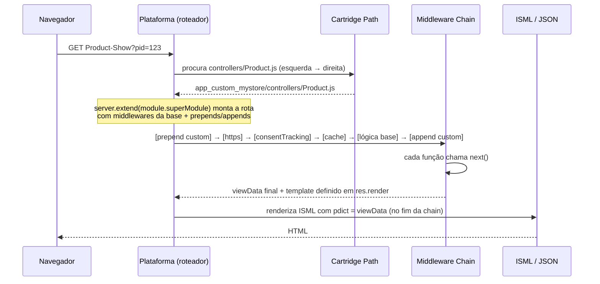
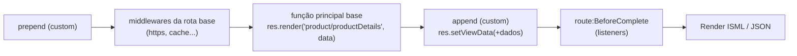
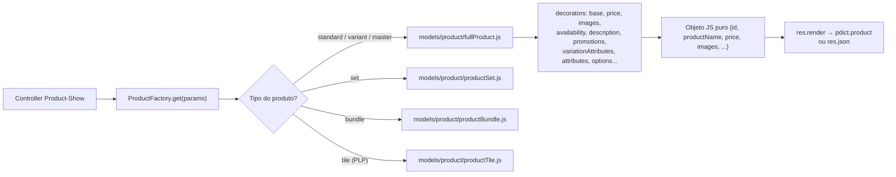
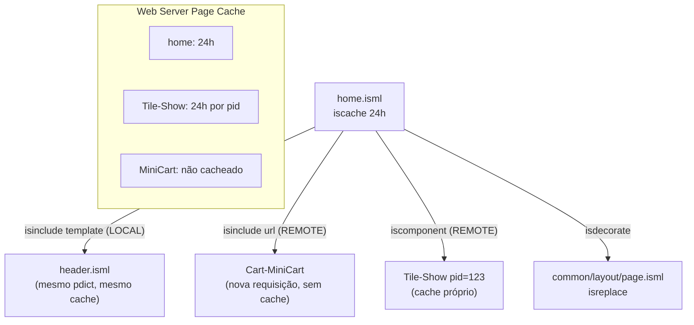
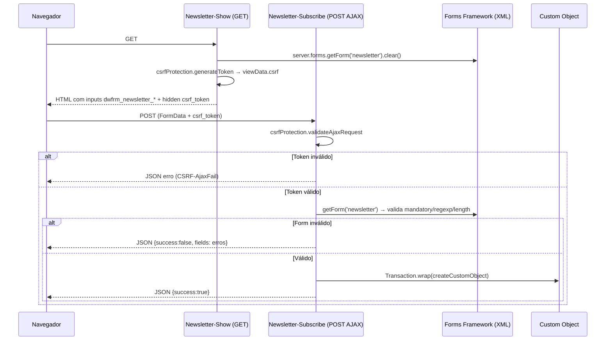
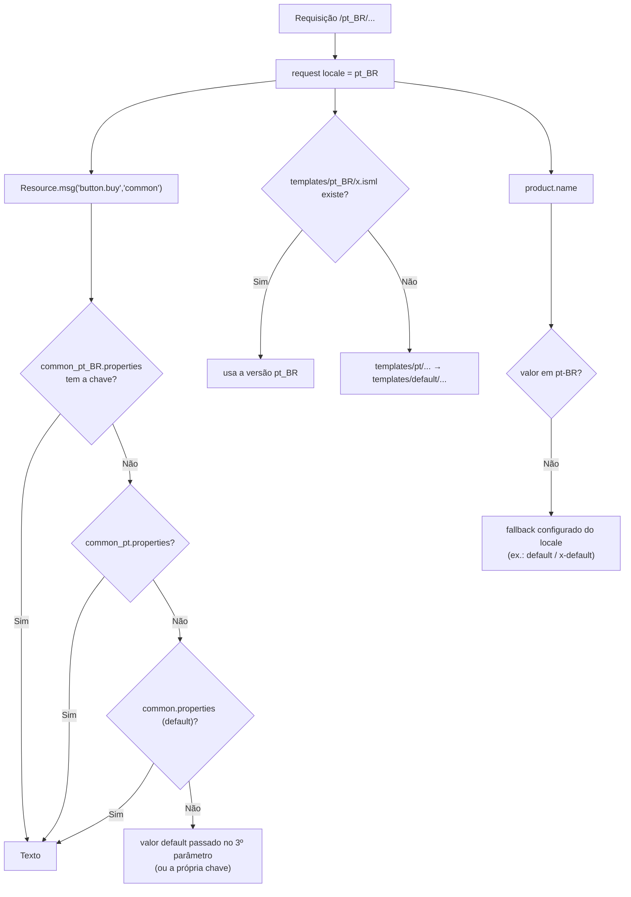
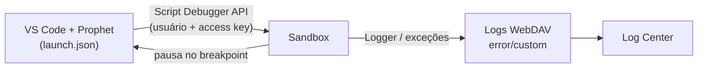

# Guia Definitivo de Engenharia e Certificação Salesforce B2C Commerce (SFRA)

## MÓDULO 4 — Desenvolvimento SFRA Parte 1: Controllers, Models, ISML, Forms e Localização

> **Peso no exame:** parte dos 53% de "Application Development" (o maior domínio). Junto com o Módulo 5, representa mais da metade da prova.
> **Objetivos oficiais cobertos:** ISML com local/remote include e componentes; debug de scripts e controllers; criar/estender controllers com models, decorators, factories e helpers, renderizando template ou JSON; forms com validação, CSRF e bindings; localização de templates, forms, estáticos, properties e atributos.

---

### Sumário

1. [Tópico 4.1 — Controllers SFRA: Rotas, Middleware Chain e Extensão](#tópico-41--controllers-sfra-rotas-middleware-chain-e-extensão)
2. [Tópico 4.2 — Models, Decorators, Factories e Helpers](#tópico-42--models-decorators-factories-e-helpers)
3. [Tópico 4.3 — ISML: Tags, Includes, Cache, Encoding e Custom Tags](#tópico-43--isml-tags-includes-cache-encoding-e-custom-tags)
4. [Tópico 4.4 — Forms Framework e CSRF (exemplo ponta a ponta)](#tópico-44--forms-framework-e-csrf-exemplo-ponta-a-ponta)
5. [Tópico 4.5 — Internacionalização e Localização](#tópico-45--internacionalização-e-localização)
6. [Tópico 4.6 — Debug de Controllers e Scripts](#tópico-46--debug-de-controllers-e-scripts)
7. [Revisão Relâmpago do Módulo 4](#revisão-relâmpago-do-módulo-4)

---

## Tópico 4.1 — Controllers SFRA: Rotas, Middleware Chain e Extensão

### 1. Conceito & Glossário Desmistificado

| Termo | Significado |
|---|---|
| **Controller** | Arquivo JS em `cartridge/controllers/` (ex.: `Product.js`). O nome do arquivo é a primeira parte da URL da rota. |
| **Route (rota)** | Endpoint dentro do controller. URL interna: `Controller-Route` (ex.: `Product-Show`). Acesso: `/on/demandware.store/Sites-RefArch-Site/pt_BR/Product-Show?pid=123` ou URL amigável (SEO). |
| **Módulo `server`** | Framework do SFRA (pasta `modules/server`) inspirado no Express: registra rotas, encadeia middlewares, expõe `req`/`res`. |
| **Middleware** | Função `(req, res, next)` executada em sequência. Cada uma **deve** chamar `next()`. |
| **Middleware Chain** | A lista ordenada de funções de uma rota. |
| **`req`** | Objeto da requisição do SFRA (não é o `request` global do `dw`). Expõe `req.querystring`, `req.form`, `req.currentCustomer`, `req.locale`, `req.session`, `req.httpMethod`, `req.pageMetaData`... |
| **`res`** | Objeto de resposta do SFRA: `res.render()`, `res.json()`, `res.redirect()`, `res.setViewData()`, `res.getViewData()`, `res.setStatusCode()`, `res.cachePeriod`... |
| **viewData** | Objeto acumulado que vira o `pdict` do template (ou o JSON). |
| **Route events** | Eventos emitidos pela rota: `route:Start`, `route:BeforeComplete`, `route:Complete`, `route:Redirect`. Registrados com `this.on(...)` dentro de um middleware. |

**Middlewares de segurança e utilidade mais cobrados:**

| Middleware | Onde fica | O que faz |
|---|---|---|
| `server.middleware.https` | módulo `server` | Exige HTTPS. |
| `server.middleware.http` | módulo `server` | Exige HTTP (raro hoje). |
| `server.middleware.get` / `.post` | módulo `server` | Restringe o método HTTP. |
| `server.middleware.include` | módulo `server` | Só permite a rota ser chamada como **remote include** (bloqueia acesso direto). |
| `userLoggedIn.validateLoggedIn` | `scripts/middleware/userLoggedIn.js` | Redireciona para login se não autenticado. Variante `validateLoggedInAjax` para AJAX. |
| `consentTracking.consent` | `scripts/middleware/consentTracking.js` | Lê o consentimento de rastreamento e disponibiliza no viewData. |
| `csrfProtection.generateToken` | `scripts/middleware/csrf.js` | Gera token CSRF e coloca em `viewData.csrf`. |
| `csrfProtection.validateRequest` | idem | Valida token em POST normal; falhou → logout + redirect para `CSRF-Fail`. |
| `csrfProtection.validateAjaxRequest` | idem | Valida token em AJAX; falhou → resposta JSON de erro (`CSRF-AjaxFail`). |
| `cache.applyDefaultCache` e similares | `scripts/middleware/cache.js` | Define política de page cache. |
| `pageMetaData.computedPageMetaData` | `scripts/middleware/pageMetaData.js` | Aplica meta tags (title/description) calculadas. |

### 2. Arquitetura & Como Funciona por Baixo dos Panos



**Detalhe importante:** `res.render('template')` **não** renderiza imediatamente. Ele registra o template e os dados; a renderização acontece **depois** do último middleware. Por isso um `append` consegue alterar o viewData **depois** do `res.render` da base.



**`prepend` vs `append` vs `replace`:**

| Método | Quando usar | Cuidado |
|---|---|---|
| `server.prepend` | Validar/redirecionar **antes** da base; preparar dados que a base vai ler. | Se redirecionar, a base ainda roda, a menos que você interrompa (ex.: `return next()` após redirect continua a chain; para parar, use `this.emit('route:Complete', req, res)` ou estruture com `res.redirect` e verificações). |
| `server.append` | **Adicionar** dados ao viewData, trocar template, ajustar JSON. **Preferido** (menos acoplamento). | A lógica da base **já rodou** (incluindo chamadas caras). |
| `server.replace` | Fluxo da base não serve. | Você assume a manutenção total da rota (upgrade mais difícil). |

> 🔎 **Verificar:** a forma de **interromper** a chain após um redirect em `prepend` (ex.: `this.done(req, res)` ou emitir `route:Complete`) depende da versão do módulo `server`. Confira `modules/server/route.js` da sua versão. Na prova, o foco é: `prepend` roda antes, `append` depois, `replace` substitui, e `next()` é obrigatório.

### 3. Guia Prático de Business Manager (BM)

- **Cartridge path** do site com a cartridge custom à esquerda (Módulo 1).
- **URL amigável (SEO):** `Merchant Tools > SEO > URL Rules` controla URLs de produto/categoria/conteúdo; aliases de rotas customizadas ficam em `Merchant Tools > SEO > Aliases` / `URL Rules` (conforme versão). Rotas sempre funcionam pela URL padrão `Controller-Route`.
- **Locale/HTTPS:** `Merchant Tools > Site Preferences > Locales` e configurações de alias/hostname em `Merchant Tools > SEO > Aliases`.

### 4. Implementação em Código (Hands-On)

**Novo controller completo (página de "Lojas Parceiras"):**

```javascript
// app_custom_mystore/cartridge/controllers/Partners.js
'use strict';

var server = require('server');                                     // framework de rotas do SFRA
var cache = require('*/cartridge/scripts/middleware/cache');         // políticas de cache
var consentTracking = require('*/cartridge/scripts/middleware/consentTracking');
var pageMetaData = require('*/cartridge/scripts/middleware/pageMetaData');

/**
 * Partners-Show : página HTML cacheada.
 */
server.get(
    'Show',                                   // nome da rota → URL Partners-Show
    server.middleware.https,                  // força HTTPS
    consentTracking.consent,                  // respeita consentimento LGPD/GDPR
    cache.applyDefaultCache,                  // página pública: pode cachear
    function (req, res, next) {
        var partnersHelper = require('*/cartridge/scripts/helpers/partnersHelper');
        var partners = partnersHelper.getActivePartners();   // regra de negócio no helper

        res.render('partners/partnersList', { // template + dados (viram pdict)
            partners: partners
        });
        next();                               // passa para o próximo middleware
    },
    pageMetaData.computedPageMetaData         // meta tags
);

/**
 * Partners-Data : endpoint JSON para AJAX.
 */
server.get('Data', server.middleware.https, function (req, res, next) {
    var partnersHelper = require('*/cartridge/scripts/helpers/partnersHelper');
    var city = req.querystring.city || '';   // parâmetros da query string
    res.json({                               // resposta JSON (Content-Type application/json)
        success: true,
        partners: partnersHelper.getActivePartners(city)
    });
    next();
});

module.exports = server.exports();            // OBRIGATÓRIO: exporta as rotas
```

**Estendendo uma rota da base (`Cart-Show`) com `append`:**

```javascript
// app_custom_mystore/cartridge/controllers/Cart.js
'use strict';

var server = require('server');
server.extend(module.superModule);            // herda TODAS as rotas de Cart.js da próxima cartridge

server.append('Show', function (req, res, next) {
    var viewData = res.getViewData();                       // dados montados pela base
    var Site = require('dw/system/Site');
    var threshold = Site.getCurrent().getCustomPreferenceValue('freeShippingThreshold') || 0;
    var total = viewData.totals ? viewData.totals.subTotal : null; // string formatada no model
    viewData.freeShippingThreshold = threshold;
    res.setViewData(viewData);                              // devolve ao pipeline
    next();
});

module.exports = server.exports();
```

**Usando `route:BeforeComplete` para persistir dados só no fim (padrão da base em Account):**

```javascript
server.post('SaveNickname',
    server.middleware.https,
    csrfProtection.validateAjaxRequest,
    function (req, res, next) {
        var form = server.forms.getForm('nickname');
        if (!form.valid) {
            res.json({ success: false });
            return next();
        }
        res.setViewData({ nickname: form.nickname.value });

        // Executa APÓS todos os appends (inclusive de outras cartridges), antes de renderizar.
        this.on('route:BeforeComplete', function (req, res) { // eslint-disable-line no-shadow
            var Transaction = require('dw/system/Transaction');
            var data = res.getViewData();
            Transaction.wrap(function () {
                req.currentCustomer.raw.profile.custom.nickname = data.nickname;
            });
            res.json({ success: true });
        });
        return next();
    }
);
```

> Por que isso? Outras cartridges podem fazer `append` e **alterar** o viewData antes da gravação. O SFRA base usa esse padrão em `Account-SaveProfile`, `Address-SaveAddress` etc.

❌ **Anti-padrões:**

```javascript
// 1) Esquecer next() → requisição "pendura" / erro de rota sem resposta
server.get('Show', function (req, res, next) {
    res.render('x');
});

// 2) Esquecer module.exports = server.exports() → rota não existe (404 / erro)

// 3) Lógica de negócio pesada dentro do controller (dificulta reuso e teste)
server.get('Show', function (req, res, next) {
    var it = require('dw/catalog/ProductMgr').queryAllSiteProducts(); // e sem close()
    // ...
});

// 4) Usar o global `request.httpParameterMap` em vez de req.querystring/req.form no SFRA
```

### 5. Foco no Exame (Pegadinhas & Quotas)

- **"Adicionar dado à PDP sem mudar a base"** → `server.extend(module.superModule)` + `server.append('Show', ...)` + `res.setViewData`.
- **"Validar algo antes da lógica da base"** → `server.prepend`.
- **"Rota customizada não responde"** → faltou `module.exports = server.exports()`, `next()`, ou cartridge fora do path.
- **"Rota que só deve ser usada como remote include"** → `server.middleware.include`.
- **"Página de conta exige login"** → `userLoggedIn.validateLoggedIn`.
- **`res.render` vs `res.json`**: HTML com template ISML vs resposta JSON para AJAX/integração.
- **`req.querystring`** (GET) vs **`req.form`** (POST).

---

## Tópico 4.2 — Models, Decorators, Factories e Helpers

### 1. Conceito & Glossário Desmistificado

| Peça | O que é | Pasta |
|---|---|---|
| **Model** | Converte objetos `dw.*` (pesados, com métodos, sem JSON nativo) em **objetos JS puros** (JSON-friendly) que o ISML e o `res.json` consomem. | `cartridge/models/` |
| **Decorator** | Função pequena que **adiciona propriedades** a um objeto model usando `Object.defineProperty`. Combinar decorators monta o model final (padrão *Decorator*). | `cartridge/models/product/decorators/` |
| **Factory** | Decide **qual model** criar de acordo com o tipo (ex.: `ProductFactory` escolhe full product, set, bundle, tile). | `cartridge/scripts/factories/` |
| **Helper** | Funções utilitárias **sem estado** reutilizáveis entre controllers (ex.: `productHelpers`, `cartHelpers`, `checkoutHelpers`). | `cartridge/scripts/helpers/` |

**Por que não passar `dw.catalog.Product` direto para o template?**

- O template ficaria cheio de lógica e chamadas à API (lento, difícil de cachear e testar).
- `res.json()` não serializa objetos `dw.*` corretamente.
- Models deixam claro **o contrato** de dados da view e permitem extensão por outras cartridges.

### 2. Arquitetura & Como Funciona por Baixo dos Panos



**Como um decorator funciona:**

```javascript
// app_storefront_base/cartridge/models/product/decorators/description.js (simplificado)
module.exports = function (object, product) {
    Object.defineProperty(object, 'longDescription', {
        enumerable: true,                      // aparece em JSON.stringify / loops
        value: product.getLongDescription() ? product.getLongDescription().markup : null
    });
    Object.defineProperty(object, 'shortDescription', {
        enumerable: true,
        value: product.getShortDescription() ? product.getShortDescription().markup : null
    });
};
```

### 3. Guia Prático de Business Manager (BM)

Models não se configuram no BM, mas **dependem** de dados do BM:

- Novo atributo exibido pelo model (ex.: `material`) → criar o atributo em `Administration > Site Development > System Object Types > Product` (Módulo 3) e preencher no produto.
- Para expor o atributo via OCAPI, configurar `read_attributes` (`c_material`).

### 4. Implementação em Código (Hands-On)

**Passo 1 — Decorator custom:**

```javascript
// app_custom_mystore/cartridge/models/product/decorators/material.js
'use strict';

/**
 * Adiciona a propriedade "material" ao model de produto.
 * @param {Object} object - model em construção
 * @param {dw.catalog.Product} apiProduct - produto da API
 */
module.exports = function (object, apiProduct) {
    Object.defineProperty(object, 'material', {
        enumerable: true,                                  // essencial para res.json
        value: apiProduct.custom.material || null          // atributo localizável já vem no idioma da requisição
    });
};
```

**Passo 2 — Registrar no índice de decorators (estendendo a base):**

```javascript
// app_custom_mystore/cartridge/models/product/decorators/index.js
'use strict';

var base = module.superModule;          // index.js da base (objeto com todos os decorators)
base.material = require('*/cartridge/models/product/decorators/material');
module.exports = base;
```

**Passo 3 — Estender o model `fullProduct`:**

```javascript
// app_custom_mystore/cartridge/models/product/fullProduct.js
'use strict';

var base = module.superModule;          // fullProduct da base
var decorators = require('*/cartridge/models/product/decorators/index');

/**
 * @param {Object} product - objeto vazio a ser decorado
 * @param {dw.catalog.Product} apiProduct
 * @param {Object} options - opções calculadas pela factory (variationModel, promotions, quantity...)
 * @returns {Object} model decorado
 */
module.exports = function fullProduct(product, apiProduct, options) {
    base.call(this, product, apiProduct, options);   // aplica todos os decorators da base
    decorators.material(product, apiProduct);        // + nosso decorator
    return product;
};
```

**Passo 4 — Usar no ISML:**

```html
<isif condition="${pdict.product.material}">
    <p class="product-material">
        ${Resource.msg('label.material', 'product', null)}: <isprint value="${pdict.product.material}" />
    </p>
</isif>
```

**Helper bem escrito:**

```javascript
// app_custom_mystore/cartridge/scripts/helpers/partnersHelper.js
'use strict';

var CustomObjectMgr = require('dw/object/CustomObjectMgr');

/**
 * Retorna parceiros ativos como objetos JS puros (prontos para ISML/JSON).
 * @param {string} [city] - filtro opcional
 * @returns {Array<Object>}
 */
function getActivePartners(city) {
    var query = 'custom.active = {0}';
    var args = [true];
    if (city) {
        query += ' AND custom.city = {1}';
        args.push(city);
    }
    var it = CustomObjectMgr.queryCustomObjects.apply(
        CustomObjectMgr,
        ['Partner', query, 'custom.name asc'].concat(args)
    );
    var result = [];
    try {
        while (it.hasNext()) {
            var co = it.next();
            result.push({                          // mapeia para objeto simples
                id: co.custom.partnerId,
                name: co.custom.name,
                city: co.custom.city
            });
        }
    } finally {
        it.close();                                 // SEMPRE fechar SeekableIterator
    }
    return result;
}

module.exports = { getActivePartners: getActivePartners };
```

**`res.render` vs `res.json`:**

```javascript
res.render('product/productDetails', { product: productModel }); // HTML via ISML
res.json({ product: productModel });                             // JSON (AJAX, ex.: Product-Variation)
```

❌ **Anti-padrões:**

```javascript
// RUIM: passar objeto da API para o template e chamar métodos no ISML
res.render('product/details', { apiProduct: ProductMgr.getProduct(pid) });
// ISML: ${pdict.apiProduct.getPriceModel().getPrice()}  → lógica na view, difícil de cachear/estender

// RUIM: Object.defineProperty sem enumerable:true → some no res.json
Object.defineProperty(object, 'material', { value: 'x' });

// RUIM: copiar fullProduct.js inteiro da base para a cartridge custom (quebra upgrades)
```

### 5. Foco no Exame (Pegadinhas & Quotas)

- **"Adicionar um campo ao JSON de produto do SFRA"** → criar **decorator** + estender `fullProduct` (ou o model relevante) usando `module.superModule`.
- **"Propriedade adicionada não aparece no JSON"** → falta `enumerable: true`.
- **"Onde colocar lógica reutilizável entre vários controllers?"** → **helper** em `scripts/helpers`.
- **"Quem escolhe o model certo para set/bundle/variante?"** → **factory** (`ProductFactory`).
- **Models devolvem objetos JS puros** — essa é a resposta quando perguntarem "por que usar models".

---

## Tópico 4.3 — ISML: Tags, Includes, Cache, Encoding e Custom Tags

### 1. Conceito & Glossário Desmistificado

**ISML (Internet Store Markup Language)**: HTML + tags `<is...>` + expressões `${...}` (JavaScript do lado do servidor). Arquivos `.isml` em `cartridge/templates/default/` (ou `templates/<locale>/`).

**Tags essenciais:**

| Tag | Função |
|---|---|
| `${expr}` | Imprime valor com **encoding HTML automático** (seguro contra XSS). |
| `<isprint value="${}" encoding="..." style="..."/>` | Imprime com controle de **encoding** e **formatação** (moeda, data). |
| `<isset name="x" value="${}" scope="page"/>` | Cria variável. Scopes: `page` (padrão no SFRA), `request`, `session`, `pdict`. |
| `<isif condition="${}">` `<iselseif>` `<iselse>` | Condicionais. |
| `<isloop items="${}" var="item" status="loopState">` | Laço. `status` expõe `count`, `index`, `first`, `last`, `odd`, `even`. Tem `begin`, `end`, `step`. `<isbreak/>`, `<isnext/>`. |
| `<isinclude template="..."/>` | **Local include**: renderiza outro template no mesmo processo; compartilha o `pdict`; **herda o cache**. |
| `<isinclude url="${URLUtils.url('Ctrl-Route')}"/>` | **Remote include**: nova requisição a um controller; **cache próprio**; **não** compartilha `pdict`. |
| `<iscomponent pipeline="Ctrl-Route" param1="v"/>` | Remote include com parâmetros declarativos (os atributos viram parâmetros). |
| `<iscache type="relative" hour="24" varyby="price_promotion"/>` | Política de cache da página/fragmento. `type="daily"` expira num horário fixo (`hour`/`minute`). `if="${cond}"` condiciona. |
| `<isdecorate template="common/layout/page">...</isdecorate>` | Envolve o conteúdo com um **layout**. |
| `<isreplace/>` | Dentro do template decorador: o lugar onde o conteúdo decorado entra. |
| `<isscript>...</isscript>` | Bloco de script server-side (use com moderação; prefira models/helpers). |
| `<iscontent type="text/html" charset="UTF-8" compact="true"/>` | Content-Type e compactação de espaços. |
| `<isredirect location="${}" permanent="true"/>` | Redirect a partir do template (raro; prefira `res.redirect`). |
| `<isstatus value="404"/>` | Define status HTTP. |
| `<iscomment>...</iscomment>` | Comentário que **não** vai para o HTML (diferente de `<!-- -->`). |
| `<isslot .../>` | Content slot (Módulo 2). |
| `<isactivedatahead/>` / `<isactivedatacontext category="${}"/>` | Coleta de Active Data. |
| `<ismodule .../>` | Declara uma **custom tag**. |

**Encodings do `<isprint>` (contexto XSS):**

| encoding | Use em |
|---|---|
| `on` (padrão) / `htmlcontent` | Texto dentro de elemento HTML |
| `htmldoublequote` / `htmlsinglequote` / `htmlunquote` | Valor de atributo HTML entre aspas duplas/simples/sem aspas |
| `jshtml`, `jsattribute`, `jsblock`, `jssource` | Dentro de contextos JavaScript |
| `jsonvalue` | Valor dentro de JSON |
| `uricomponent`, `uristrict` | Parte de URL |
| `xmlcontent`, `xmlsinglequote`, `xmldoublequote`, `xmlcomment` | XML |
| `off` | **Sem encoding**: só para HTML confiável (conteúdo de merchandiser, `form.attributes` do SFRA, `MarkupText`). |

**Estilos do `<isprint>`:** `MONEY_SHORT`, `MONEY_LONG`, `EURO_SHORT`, `EURO_LONG`, `INTEGER`, `DECIMAL`, `QUANTITY_SHORT`, `QUANTITY_LONG`, `DATE_SHORT`, `DATE_LONG`, `DATE_TIME`... 🔎 **Verificar** a lista completa na doc da sua versão.

### 2. Arquitetura & Como Funciona por Baixo dos Panos



**Local vs Remote — tabela de decisão:**

| Critério | Local `<isinclude template>` | Remote `<isinclude url>` / `<iscomponent>` |
|---|---|---|
| Execução | Mesma requisição | Requisição separada ao controller |
| `pdict` | Compartilhado | **Não** compartilhado (passe parâmetros pela URL) |
| Cache | Herda o da página (e pode reduzi-lo) | **Independente** |
| Custo | Barato | Mais caro (mais uma requisição), mas viabiliza cache da página |
| Uso típico | Componentes de layout (logo, footer estático) | Partes **personalizadas** (mini-cart, "Olá Ana") ou com **cache diferente** |

### 3. Guia Prático de Business Manager (BM)

- **Storefront Toolkit → Cache Information** mostra cada include e seu cache (Módulo 3).
- **Templates de slot** e **custom tags** precisam estar em cartridges do path.
- Para verificar se a página está sendo cacheada: ligar **Enable Page Caching** no site (`Administration > Sites > Manage Sites > [site] > Cache`), pois em sandboxes geralmente está desligado.

### 4. Implementação em Código (Hands-On)

**Página completa com decorate, cache, local e remote include:**

```html
<!-- app_custom_mystore/cartridge/templates/default/partners/partnersList.isml -->
<isdecorate template="common/layout/page">                <!-- envolve com header/footer do layout -->

    <isscript>
        // Registro de assets client-side do SFRA (padrão da base)
        var assets = require('*/cartridge/scripts/assets.js');
        assets.addCss('/css/partners.css');
        assets.addJs('/js/partners.js');
    </isscript>

    <div class="container partners-page">
        <h1>${Resource.msg('title.partners', 'partners', null)}</h1>   <!-- texto localizado, auto-encoded -->

        <isif condition="${pdict.partners.length > 0}">
            <ul class="partners-list">
                <isloop items="${pdict.partners}" var="partner" status="loopStatus">
                    <!-- LOCAL include: herda pdict e cache; 'partner' está no escopo da página -->
                    <isinclude template="partners/partnerCard" />
                    <isif condition="${loopStatus.last}">
                        <iscomment>Último item: nada a fazer, exemplo de uso do status</iscomment>
                    </isif>
                </isloop>
            </ul>
        <iselse/>
            <p>${Resource.msg('msg.no.partners', 'partners', null)}</p>
        </isif>

        <!-- REMOTE include: conteúdo de merchandiser com cache próprio -->
        <isinclude url="${URLUtils.url('Page-Include', 'cid', 'partners-footer')}" />
    </div>
</isdecorate>
```

```html
<!-- partners/partnerCard.isml -->
<li class="partner-card" data-id="<isprint value="${partner.id}" encoding="htmldoublequote" />">
    <strong><isprint value="${partner.name}" /></strong>   <!-- encoding on (padrão) -->
    <span>${partner.city}</span>
</li>
```

**`<iscache>` no template (alternativa ao middleware):**

```html
<!-- Cache relativo de 2 horas, variando por preço/promoção do cliente -->
<iscache type="relative" hour="2" varyby="price_promotion" />

<!-- Cache diário: expira todo dia às 03:30 (fuso da instância/site) -->
<iscache type="daily" hour="3" minute="30" />

<!-- Cache condicional -->
<iscache type="relative" minute="30" if="${!pdict.isPreview}" />
```

> No SFRA, a recomendação é definir cache **no controller** (middleware `cache.*`), mantendo templates "limpos". Os dois mecanismos existem; questões podem mostrar qualquer um.

**Decorator (layout) com `<isreplace/>`:**

```html
<!-- common/layout/page.isml (simplificado) -->
<!DOCTYPE html>
<html lang="${require('dw/util/Locale').getLocale(request.getLocale()).getLanguage()}">
<head>
    <isinclude template="/common/htmlHead" />
</head>
<body>
    <isinclude template="/components/header/pageHeader" />
    <main role="main">
        <isreplace/>                 <!-- conteúdo do <isdecorate> entra aqui -->
    </main>
    <isinclude template="/components/footer/pageFooter" />
</body>
</html>
```

**Remote include protegido + `<iscomponent>`:**

```javascript
// controllers/Promo.js
server.get('Badge', server.middleware.include, cache.applyDefaultCache, function (req, res, next) {
    res.render('components/promoBadge', { pid: req.querystring.pid });
    next();
});
```

```html
<!-- Duas formas equivalentes de chamar o remote include -->
<isinclude url="${URLUtils.url('Promo-Badge', 'pid', pdict.product.id)}" />
<iscomponent pipeline="Promo-Badge" pid="${pdict.product.id}" />
```

**Custom Tag (`modules.isml`):**

```html
<!-- app_custom_mystore/cartridge/templates/default/components/modules.isml -->
<!-- Copie o modules.isml da base e ADICIONE suas tags (ou inclua o da base, conforme estratégia) -->
<ismodule template="components/customTags/badge"
          name="badge"
          attribute="text"
          attribute="type" />
```

```html
<!-- components/customTags/badge.isml : atributos chegam no pdict -->
<span class="badge badge-${pdict.type || 'info'}"><isprint value="${pdict.text}" /></span>
```

```html
<!-- Uso em qualquer template que inclua modules.isml (o layout do SFRA já inclui) -->
<isbadge text="${Resource.msg('label.new', 'product', null)}" type="success" />
```

❌ **Anti-padrões ISML:**

```html
<!-- 1) XSS: desligar encoding de dado vindo do usuário -->
<isprint value="${pdict.searchTerm}" encoding="off" />

<!-- 2) Lógica de negócio no template -->
<isscript>
    var it = dw.catalog.ProductMgr.queryAllSiteProducts(); /* nunca */
</isscript>

<!-- 3) Personalização dentro de página cacheada via LOCAL include -->
<isinclude template="components/header/miniCart" />  <!-- mini-cart errado para outros clientes -->

<!-- 4) Comentário HTML com informação interna (vaza para o cliente) -->
<!-- TODO: endpoint interno https://erp.interno/... -->
```

### 5. Foco no Exame (Pegadinhas & Quotas)

- **"Página cacheada precisa mostrar mini-cart correto"** → **remote include** (`<isinclude url>`) com rota **sem cache**.
- **"Fragmento reutilizável que compartilha pdict"** → **local include** (`<isinclude template>`).
- **"Remote include não recebe a variável do pdict"** → remote include **não** compartilha pdict; passe parâmetros na URL.
- **"Tag que imprime HTML do merchandiser"** → `<isprint ... encoding="off"/>` (somente conteúdo confiável).
- **"Valor dentro de atributo HTML"** → `encoding="htmldoublequote"` (ou `${}` que já faz encoding HTML).
- **`<iscomment>`** não aparece no HTML; `<!-- -->` aparece.
- **`varyby="price_promotion"`** é o **único** valor de `varyby`.
- **`<isdecorate>` + `<isreplace/>`** = layout. **`<ismodule>` em `modules.isml`** = custom tag.
- Excesso de remote includes por página é limitado por quotas e prejudica performance.

---

## Tópico 4.4 — Forms Framework e CSRF (exemplo ponta a ponta)

### 1. Conceito & Glossário Desmistificado

| Termo | Significado |
|---|---|
| **Form definition (XML)** | Arquivo em `cartridge/forms/default/<nome>.xml` que descreve campos, tipos, validações, mensagens e ações. |
| **`field`** | Campo: `formid`, `type` (`string`, `integer`, `number`, `boolean`, `date`), `label`, `mandatory`, `min-length`/`max-length`, `regexp`, `min`/`max`, mensagens (`missing-error`, `parse-error`, `range-error`, `value-error`), `binding`, `default-value`. |
| **`group` / `list` / `include`** | Agrupar campos, listas repetidas, reaproveitar outro form. |
| **`options`/`option`** | Valores de `<select>`. |
| **`action`** | Botões de ação (`valid-form="true"` exige formulário válido). |
| **binding** | Nome do atributo do objeto de negócio associado ao campo (ex.: `binding="firstName"`), usado para copiar valores de/para objetos. |
| **`server.forms.getForm('id')`** | Retorna o form do SFRA (objeto JS com cada campo, `valid`, `clear()`, `toObject()`, `copyFrom()`). |
| **`htmlName`** | Nome HTML do campo: `dwfrm_<form>_<campo>` (ex.: `dwfrm_newsletter_email`). A plataforma usa esse nome para fazer o *bind* do POST ao form. |
| **`attributes`** | String pronta com `name`, `required`, `maxlength`, `pattern`, `value`... para colocar no `<input>` (requer `encoding="off"`). |
| **CSRF** | *Cross-Site Request Forgery*: site malicioso faz o navegador do cliente logado enviar um POST para sua loja. O token CSRF prova que o formulário foi gerado pela sua loja. |

### 2. Arquitetura & Como Funciona por Baixo dos Panos



### 3. Guia Prático de Business Manager (BM)

1. Crie o custom object type `NewsletterSubscription` (Módulo 3): key `email` (String), Site scope, **não replicável**, retenção, atributos `firstName`, `optIn` (Boolean), `locale`.
2. Garanta a cartridge no **cartridge path**.
3. Para ver inscrições: `Merchant Tools > Custom Objects > Custom Object Editor` (selecione o tipo).
4. Textos de labels/erros ficam em `forms.properties` (traduzíveis — Tópico 4.5).

### 4. Implementação em Código (Hands-On) — Newsletter completo

**(a) Definição do formulário — `forms/default/newsletter.xml`:**

```xml
<?xml version="1.0"?>
<form xmlns="http://www.demandware.com/xml/form/2008-04-19">

    <!-- Nome: texto obrigatório, 2 a 50 caracteres -->
    <field formid="firstName"
           label="label.input.firstname.newsletter"
           type="string"
           mandatory="true"
           min-length="2"
           max-length="50"
           missing-error="error.message.required"
           range-error="error.message.lessthan50"
           binding="firstName" />

    <!-- E-mail: obrigatório + regex -->
    <field formid="email"
           label="label.input.email.newsletter"
           type="string"
           mandatory="true"
           max-length="100"
           regexp="^[\w.%+-]+@[\w.-]+\.[\w]{2,6}$"
           parse-error="error.message.parse.email"
           missing-error="error.message.required"
           binding="email" />

    <!-- Interesse: select com opções fixas -->
    <field formid="interest" label="label.input.interest" type="string" mandatory="false" binding="interest">
        <options>
            <option optionid="masc" label="option.interest.men" value="men" />
            <option optionid="fem"  label="option.interest.women" value="women" />
            <option optionid="kids" label="option.interest.kids" value="kids" />
        </options>
    </field>

    <!-- Consentimento: checkbox obrigatório (LGPD) -->
    <field formid="optIn"
           label="label.input.optin"
           type="boolean"
           mandatory="true"
           checked-value="true"
           unchecked-value="false"
           missing-error="error.message.optin.required"
           binding="optIn" />

    <action formid="subscribe" valid-form="true" />
</form>
```

**(b) Controller — `controllers/Newsletter.js`:**

```javascript
'use strict';

var server = require('server');
var csrfProtection = require('*/cartridge/scripts/middleware/csrf');
var consentTracking = require('*/cartridge/scripts/middleware/consentTracking');

/**
 * Newsletter-Show: renderiza o formulário com token CSRF.
 * Não cacheamos porque o token CSRF é por sessão.
 */
server.get(
    'Show',
    server.middleware.https,
    consentTracking.consent,
    csrfProtection.generateToken,                   // coloca {tokenName, token} em viewData.csrf
    function (req, res, next) {
        var URLUtils = require('dw/web/URLUtils');
        var newsletterForm = server.forms.getForm('newsletter'); // carrega forms/default/newsletter.xml
        newsletterForm.clear();                     // limpa valores de submissões anteriores na sessão

        res.render('newsletter/newsletterForm', {
            newsletterForm: newsletterForm,
            actionUrl: URLUtils.url('Newsletter-Subscribe').toString()
        });
        next();
    }
);

/**
 * Newsletter-Subscribe: recebe POST AJAX, valida e persiste.
 */
server.post(
    'Subscribe',
    server.middleware.https,
    csrfProtection.validateAjaxRequest,             // token inválido → JSON de erro, chain interrompida
    function (req, res, next) {
        var Resource = require('dw/web/Resource');
        var formErrors = require('*/cartridge/scripts/formErrors');
        var newsletterHelper = require('*/cartridge/scripts/helpers/newsletterHelper');

        var form = server.forms.getForm('newsletter'); // já populado com o POST (dwfrm_newsletter_*)

        // Validação de negócio adicional (além do XML)
        if (form.email.valid && newsletterHelper.isBlockedDomain(form.email.value)) {
            form.email.valid = false;
            form.email.error = Resource.msg('error.message.email.blocked', 'forms', null);
            form.valid = false;
        }

        if (!form.valid) {
            res.json({
                success: false,
                fields: formErrors.getFormErrors(form)   // { 'dwfrm_newsletter_email': 'mensagem' }
            });
            return next();
        }

        // toObject(): extrai os valores do form em objeto simples (via bindings/formids)
        var data = form.toObject();

        try {
            newsletterHelper.saveSubscription(data, req.locale.id);
            res.json({
                success: true,
                msg: Resource.msg('msg.newsletter.success', 'newsletter', null)
            });
        } catch (e) {
            require('dw/system/Logger').getLogger('newsletter', 'newsletter.subscribe')
                .error('Falha ao salvar inscrição: {0}', e.message);  // sem logar e-mail (PII)
            res.setStatusCode(500);
            res.json({ success: false, msg: Resource.msg('error.technical', 'common', null) });
        }
        return next();
    }
);

module.exports = server.exports();
```

**(c) Helper de persistência — `scripts/helpers/newsletterHelper.js`:**

```javascript
'use strict';

var Transaction = require('dw/system/Transaction');
var CustomObjectMgr = require('dw/object/CustomObjectMgr');

var BLOCKED = ['mailinator.com', 'tempmail.com'];

function isBlockedDomain(email) {
    var domain = (email.split('@')[1] || '').toLowerCase();
    return BLOCKED.indexOf(domain) > -1;
}

/**
 * Upsert do custom object usando o e-mail como chave.
 */
function saveSubscription(data, localeId) {
    var key = data.email.toLowerCase();
    Transaction.wrap(function () {
        var co = CustomObjectMgr.getCustomObject('NewsletterSubscription', key)
            || CustomObjectMgr.createCustomObject('NewsletterSubscription', key);
        co.custom.firstName = data.firstName;
        co.custom.interest = data.interest || null;
        co.custom.optIn = data.optIn === true || data.optIn === 'true';
        co.custom.locale = localeId;
    });
}

module.exports = { isBlockedDomain: isBlockedDomain, saveSubscription: saveSubscription };
```

**(d) Template — `templates/default/newsletter/newsletterForm.isml`:**

```html
<isdecorate template="common/layout/page">
    <isscript>
        var assets = require('*/cartridge/scripts/assets.js');
        assets.addJs('/js/newsletter.js');
    </isscript>

    <div class="container">
        <h1>${Resource.msg('title.newsletter', 'newsletter', null)}</h1>

        <form action="${pdict.actionUrl}" method="POST" class="newsletter-form" novalidate
              name="${pdict.newsletterForm.htmlName}">

            <div class="form-group ${pdict.newsletterForm.firstName.mandatory ? 'required' : ''}">
                <label class="form-control-label" for="nl-firstName">
                    <isprint value="${pdict.newsletterForm.firstName.label}" />
                </label>
                <!-- attributes = name="dwfrm_newsletter_firstName" required maxlength="50" value="..." -->
                <input type="text" class="form-control" id="nl-firstName"
                       <isprint value="${pdict.newsletterForm.firstName.attributes}" encoding="off" /> />
                <div class="invalid-feedback"></div>
            </div>

            <div class="form-group required">
                <label class="form-control-label" for="nl-email">
                    <isprint value="${pdict.newsletterForm.email.label}" />
                </label>
                <input type="email" class="form-control" id="nl-email"
                       <isprint value="${pdict.newsletterForm.email.attributes}" encoding="off" /> />
                <div class="invalid-feedback"></div>
            </div>

            <div class="form-group">
                <label for="nl-interest"><isprint value="${pdict.newsletterForm.interest.label}" /></label>
                <select class="form-control" id="nl-interest" name="${pdict.newsletterForm.interest.htmlName}">
                    <isloop items="${pdict.newsletterForm.interest.options}" var="opt">
                        <option value="${opt.htmlValue}">${opt.label}</option>
                    </isloop>
                </select>
            </div>

            <div class="form-group custom-control custom-checkbox required">
                <input type="checkbox" class="custom-control-input" id="nl-optIn"
                       <isprint value="${pdict.newsletterForm.optIn.attributes}" encoding="off" /> />
                <label class="custom-control-label" for="nl-optIn">
                    <isprint value="${pdict.newsletterForm.optIn.label}" />
                </label>
                <div class="invalid-feedback"></div>
            </div>

            <!-- TOKEN CSRF: nome e valor gerados pelo middleware generateToken -->
            <input type="hidden" name="${pdict.csrf.tokenName}" value="${pdict.csrf.token}" />

            <button type="submit" class="btn btn-primary" name="${pdict.newsletterForm.subscribe.htmlName}">
                ${Resource.msg('button.subscribe', 'newsletter', null)}
            </button>
        </form>
    </div>
</isdecorate>
```

> 🔎 **Verificar:** as propriedades exatas do objeto de opção (`opt.htmlValue`, `opt.label`, `opt.selected`) e de campos no form model do SFRA estão em `modules/server/forms/formField.js` da sua versão.

**(e) JS cliente — `client/default/js/newsletter.js`:**

```javascript
'use strict';

var formValidation = require('base/components/formValidation'); // helper da base que marca campos inválidos

$(document).ready(function () {
    $('form.newsletter-form').on('submit', function (e) {
        e.preventDefault();
        var $form = $(this);
        $form.find('.is-invalid').removeClass('is-invalid');

        $.ajax({
            url: $form.attr('action'),
            type: 'post',
            dataType: 'json',
            data: $form.serialize(),            // inclui csrf_token e campos dwfrm_*
            success: function (data) {
                if (!data.success) {
                    if (data.fields) {
                        formValidation($form, data); // aplica mensagens por campo
                    } else if (data.csrfError && data.redirectUrl) {
                        window.location.href = data.redirectUrl; // token expirado
                    }
                    return;
                }
                $form.replaceWith('<p class="alert alert-success">' + data.msg + '</p>');
            },
            error: function () {
                $form.prepend('<p class="alert alert-danger">Erro. Tente novamente.</p>');
            }
        });
    });
});
```

> Compile com `npm run compile:js` (o `sgmf-scripts` gera `static/default/js/newsletter.js`).

**(f) Persistindo em system object com `copyFrom` / bindings** (ex.: editar perfil):

```javascript
// GET: preencher form com dados do perfil
var profileForm = server.forms.getForm('profile');
profileForm.clear();
profileForm.customer.firstname.value = req.currentCustomer.profile.firstName;
// ou: profileForm.copyFrom(objetoComMesmosBindings)  — copia por binding
```

```javascript
// POST: gravar (padrão SFRA: só no route:BeforeComplete)
this.on('route:BeforeComplete', function (req, res) {
    var Transaction = require('dw/system/Transaction');
    var formInfo = res.getViewData();
    Transaction.wrap(function () {
        var profile = req.currentCustomer.raw.profile;
        profile.setFirstName(formInfo.firstName);
    });
});
```

❌ **Anti-padrões de forms:**

```javascript
// 1) POST sem validação CSRF
server.post('Subscribe', function (req, res, next) { /* ... */ });

// 2) Ler req.form cru e ignorar a validação do XML
var email = req.form.dwfrm_newsletter_email;   // sem regexp/mandatory aplicados

// 3) Escrever no objeto fora de Transaction
CustomObjectMgr.createCustomObject('NewsletterSubscription', email); // erro

// 4) Renderizar a página do form com cache → token CSRF de outra sessão
server.get('Show', cache.applyDefaultCache, csrfProtection.generateToken, ...);
```

### 5. Foco no Exame (Pegadinhas & Quotas)

- **"Garantir que o formulário foi enviado pela própria loja"** → `csrfProtection.generateToken` (GET) + `validateRequest` (POST) ou `validateAjaxRequest` (AJAX) + hidden input com `pdict.csrf.tokenName/token`.
- **"Validação de formato de e-mail sem JS"** → atributo `regexp` no XML.
- **"Campo obrigatório"** → `mandatory="true"` + `missing-error`.
- **"Copiar valores do form para o objeto"** → `binding` + `copyFrom`/`toObject` (ou atribuição explícita em transação).
- **"Nome do input no HTML"** → `dwfrm_<form>_<campo>` (via `htmlName`).
- **`validateAjaxRequest` vs `validateRequest`**: o primeiro devolve **JSON**, o segundo **redireciona** (e desloga o cliente).
- Formulário com CSRF **não** deve ser cacheado.

---

## Tópico 4.5 — Internacionalização e Localização

### 1. Conceito & Glossário Desmistificado

| Termo | Significado |
|---|---|
| **i18n** | Preparar o código para vários idiomas (sem texto hard-coded). |
| **l10n** | Traduzir e adaptar para um locale (textos, moeda, formatos). |
| **Locale** | Idioma + país: `pt_BR`, `en_US`, `es_AR`. `default` = locale padrão. |
| **Resource bundle** | Arquivo `.properties` em `templates/resources/` (ex.: `common.properties`, `common_pt_BR.properties`). |
| **Fallback** | Se a chave não existe em `pt_BR`, procura em `pt`, depois no arquivo **default** (sem sufixo). |
| **Localizable attribute** | Atributo de objeto (produto, conteúdo, custom) com valor por locale (`xml:lang`). |
| **Locale fallback (dados)** | Configuração global: se o atributo não tem valor em `pt_BR`, usar o de outro locale (ex.: `default`). |

### 2. Arquitetura & Como Funciona por Baixo dos Panos



A mesma lógica de pasta por locale vale para **forms** (`forms/pt_BR/`), **templates** (`templates/pt_BR/`) e **static** (`static/pt_BR/`).

### 3. Guia Prático de Business Manager (BM)

1. **Locales disponíveis na instância:** `Administration > Global Preferences > Locales` → ative `pt_BR`; configure o **fallback** do locale (ex.: `pt_BR` → `pt` → `default`).
2. **Locales do site:** `Merchant Tools > Site Preferences > Locales` → marque `pt_BR`, `en_US`... e o **default locale** do site.
3. **Moedas por locale/país:** em sites multi-moeda, mapeie país → moeda (preferências de site; o SFRA usa `countries.json` no código para o seletor de país).
4. **Traduzir dados:** em telas de produto/conteúdo, use o **seletor de idioma** do BM para editar o valor de cada locale em atributos **localizáveis**.
5. **Atributo customizado localizável:** marque **Localizable** na Attribute Definition (Módulo 3).

### 4. Implementação em Código (Hands-On)

**Arquivos de propriedades:**

```properties
# templates/resources/newsletter.properties  (default, normalmente inglês)
title.newsletter=Subscribe to our newsletter
button.subscribe=Subscribe
msg.newsletter.success=Thanks, {0}! You are subscribed.

# templates/resources/newsletter_pt_BR.properties
title.newsletter=Assine nossa newsletter
button.subscribe=Assinar
msg.newsletter.success=Obrigado, {0}! Inscrição confirmada.
```

```properties
# templates/resources/forms_pt_BR.properties  (labels e erros do XML de form)
label.input.email.newsletter=E-mail
error.message.parse.email=Informe um e-mail válido.
error.message.required=Campo obrigatório.
```

**Uso no código e no ISML:**

```javascript
var Resource = require('dw/web/Resource');

// msg(chave, bundle, valorPadrão)
var title = Resource.msg('title.newsletter', 'newsletter', null);

// msgf(chave, bundle, valorPadrão, ...args) → substitui {0}, {1}...
var success = Resource.msgf('msg.newsletter.success', 'newsletter', null, data.firstName);
```

```html
<h1>${Resource.msg('title.newsletter', 'newsletter', null)}</h1>
<p>${Resource.msgf('msg.newsletter.success', 'newsletter', null, pdict.firstName)}</p>
```

**Passando textos traduzidos para o JS cliente (padrão SFRA):**

```html
<div class="newsletter-messages"
     data-error="${Resource.msg('error.technical', 'common', null)}"></div>
```

**Estáticos por locale:**

```text
static/default/images/banner-hero.jpg
static/pt_BR/images/banner-hero.jpg     ← usado automaticamente em pt_BR
```

```html

```

**Formato de moeda e data no locale:**

```javascript
var StringUtils = require('dw/util/StringUtils');
var formatted = StringUtils.formatMoney(product.getPriceModel().getPrice()); // R$ 79,90 em pt_BR
var Calendar = require('dw/util/Calendar');
var dateStr = StringUtils.formatCalendar(new Calendar(new Date()), 'dd/MM/yyyy');
```

**Atributo localizável em XML de import:**

```xml
<product product-id="CAM-001">
    <display-name xml:lang="x-default">Basic T-shirt</display-name>
    <display-name xml:lang="pt-BR">Camiseta Básica</display-name>
    <custom-attributes>
        <custom-attribute attribute-id="material" xml:lang="pt-BR">Algodão</custom-attribute>
        <custom-attribute attribute-id="material" xml:lang="x-default">Cotton</custom-attribute>
    </custom-attributes>
</product>
```

**Trocar locale (SFRA):** a rota `Page-SetLocale` + `countries.json` controlam o seletor de país/idioma. Em código: `request.setLocale('pt_BR')` retorna boolean (falha se o locale não está ativo no site).

> 🔎 **Verificar (properties em várias cartridges):** a resolução de bundles percorre o cartridge path. A estratégia mais segura e comum em projetos é criar **novos bundles** para textos novos (ex.: `newsletter.properties`) e, para alterar textos da base, copiar o arquivo correspondente para a cartridge custom. Teste o comportamento de override por chave na sua versão antes de depender dele.

❌ **Anti-padrões:**

```html
<button>Comprar</button>                                    <!-- texto hard-coded -->
<p>R$ ${pdict.price}</p>                                    <!-- símbolo de moeda fixo -->
<p>${Resource.msg('Obrigado ' + name, 'common', null)}</p>   <!-- concatenar em vez de msgf -->
```

### 5. Foco no Exame (Pegadinhas & Quotas)

- **"Texto com valor dinâmico"** → `Resource.msgf` com `{0}`.
- **"Chave existe só no default, cliente está em pt_BR"** → fallback mostra o default.
- **"Label de form traduzido"** → chave no XML (`label="..."`) + `forms_<locale>.properties`.
- **"Imagem diferente por país"** → `static/<locale>/` + `URLUtils.staticURL`.
- **"Nome do produto em espanhol"** → atributo **localizável** + valor no locale (BM ou XML `xml:lang`).
- **"Locale não aparece na loja"** → ativar em `Global Preferences > Locales` **e** em `Site Preferences > Locales`.
- Properties ficam em **`templates/resources/`**.

---

## Tópico 4.6 — Debug de Controllers e Scripts

### 1. Conceito & Glossário Desmistificado

| Ferramenta | Uso |
|---|---|
| **Script Debugger (VS Code / Prophet)** | Breakpoints em controllers/scripts na sandbox. Usa a **Script Debugger API**, que precisa estar habilitada para o usuário/instância. |
| **Logs** (`Logger`) | Diagnóstico em ambientes onde não há debugger (Staging/Production). |
| **Storefront Toolkit → Request Log** | Logs da requisição atual. |
| **Pipeline/Code Profiler** | Gargalos de tempo (Módulo 3). |
| **`error-*.log`** | Exceções não tratadas com stack trace. |
| **`res.json` temporário / `pdict` dump** | Inspeção rápida em sandbox (remova antes do commit). |

### 2. Arquitetura & Como Funciona por Baixo dos Panos



### 3. Guia Prático de Business Manager (BM)

- **Habilitar debugger:** `Administration > Site Development > Development Setup` → seção de **Script Debugger** (habilitar). 🔎 **Verificar** o rótulo da opção na sua versão.
- O usuário do BM precisa de **permissão** para o debugger (role com acesso de desenvolvimento).
- **Logs:** `Administration > Site Development > Development Setup > Log Files` ou WebDAV.

### 4. Implementação em Código (Hands-On)

**`.vscode/launch.json` (Prophet):**

```json
{
    "version": "0.2.0",
    "configurations": [
        {
            "type": "prophet",
            "request": "launch",
            "name": "Attach to Sandbox"
        }
    ]
}
```

**Captura de erro com contexto útil:**

```javascript
var Logger = require('dw/system/Logger').getLogger('partners', 'partners.controller');

server.get('Show', function (req, res, next) {
    try {
        var partners = require('*/cartridge/scripts/helpers/partnersHelper').getActivePartners();
        res.render('partners/partnersList', { partners: partners });
    } catch (e) {
        Logger.error('Partners-Show falhou: {0} em {1}:{2}\n{3}', e.message, e.fileName, e.lineNumber, e.stack);
        res.setStatusCode(500);
        res.render('error/notFound');   // ou template de erro genérico
    }
    next();
});
```

❌ **Anti-padrões:** deixar `res.json(pdict)` de debug em produção; `try/catch` vazio que engole erros; logar objetos inteiros com dados pessoais.

### 5. Foco no Exame (Pegadinhas & Quotas)

- **"Inspecionar variáveis passo a passo na sandbox"** → **Script Debugger** (VS Code).
- **"Erro só em Production"** → **logs** (custom + error) e **Log Center**; debugger não é usado em PRD.
- **"Quais mensagens de log a requisição gerou?"** → Storefront Toolkit **Request Log**.
- **"Exceção não tratada"** → arquivo **`error-*.log`**.

---

## Revisão Relâmpago do Módulo 4

| Pergunta | Resposta |
|---|---|
| Adicionar dados a rota existente | `server.extend` + `append` + `setViewData` |
| Rodar antes da base | `prepend` |
| Substituir rota | `replace` |
| Obrigatórios no controller | `next()` e `module.exports = server.exports()` |
| Rota só como include | `server.middleware.include` |
| Gravar no fim da chain | `this.on('route:BeforeComplete')` |
| Novo campo no JSON do produto | decorator `enumerable: true` + estender model |
| Personalização em página cacheada | remote include |
| HTML confiável | `isprint encoding="off"` |
| Layout | `isdecorate` + `isreplace` |
| Custom tag | `ismodule` em `modules.isml` |
| CSRF em AJAX | `validateAjaxRequest` |
| Nome do input | `dwfrm_form_campo` |
| Texto com variável | `Resource.msgf` |
| Fallback | `pt_BR → pt → default` |

➡️ **Próximo:** [Módulo 5 — SFRA Parte 2: Page Designer, Services, Hooks, OCAPI, Jobs e Best Practices](./Modulo_5_PageDesigner_Integracoes_Hooks_Jobs.md)
