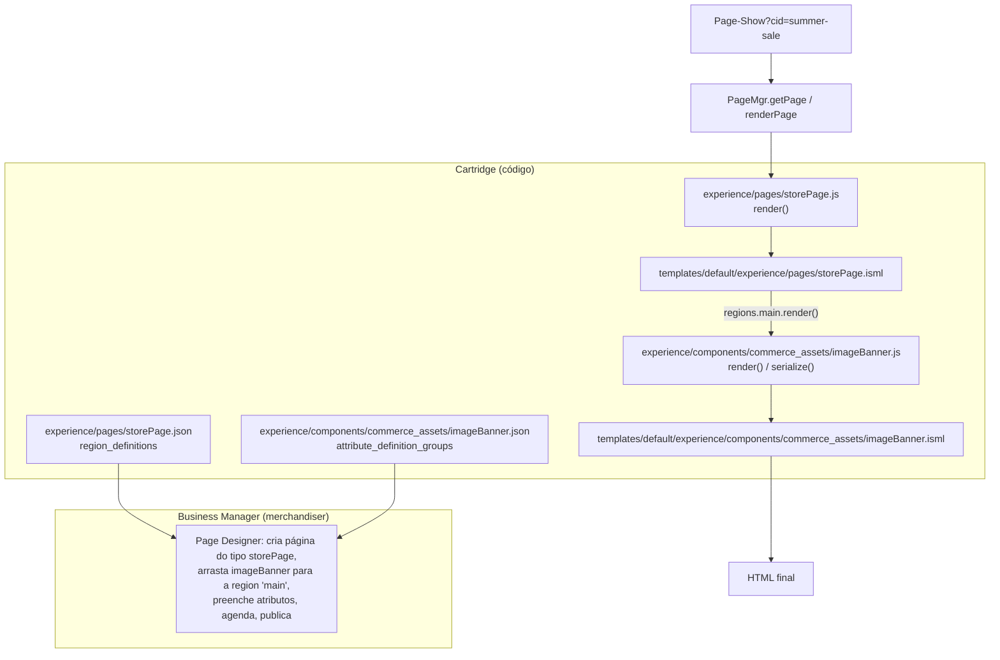
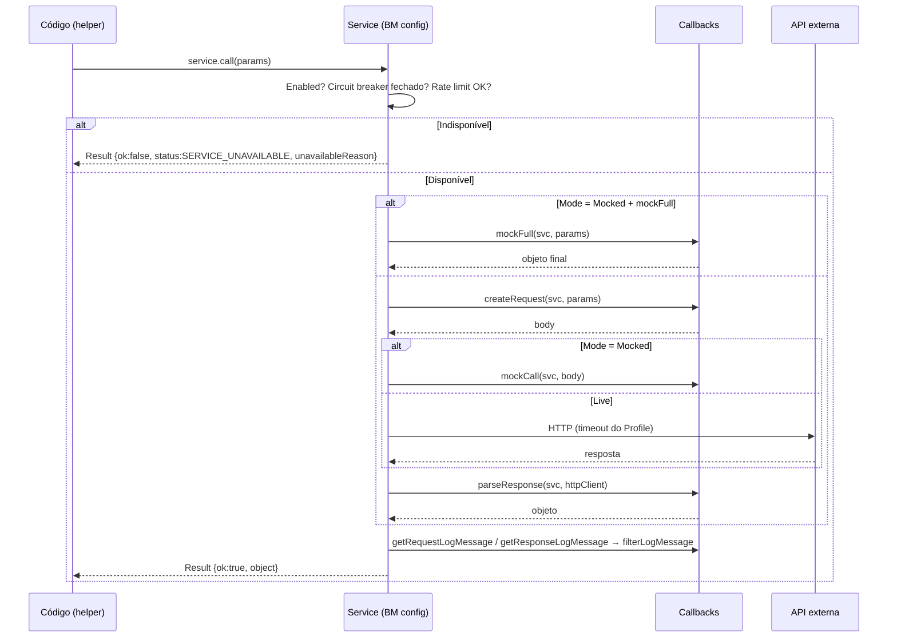
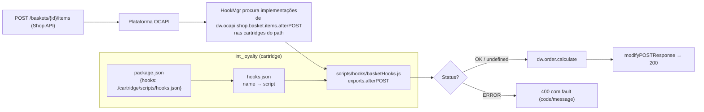
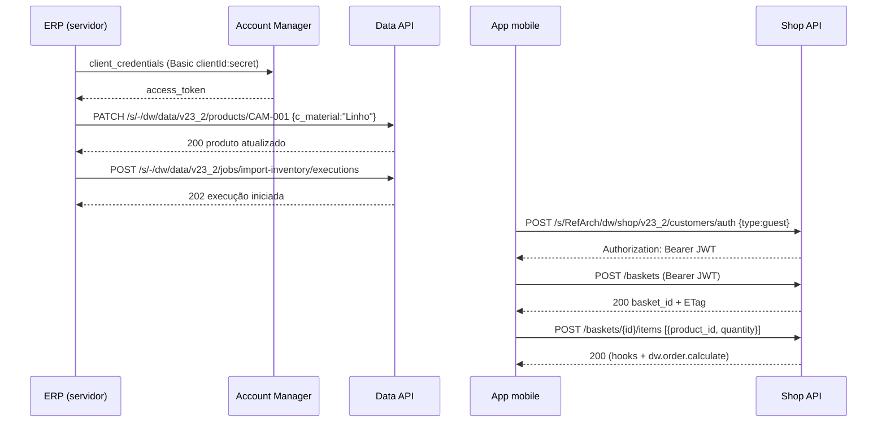
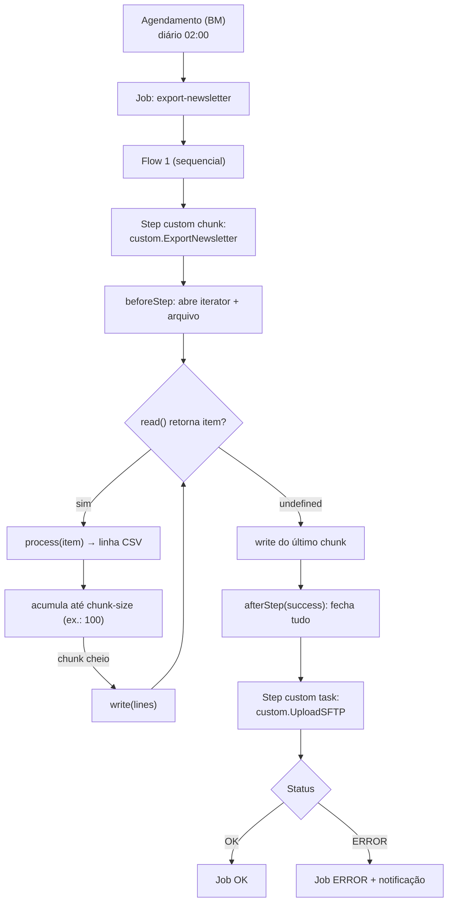
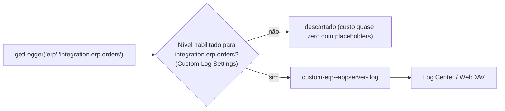
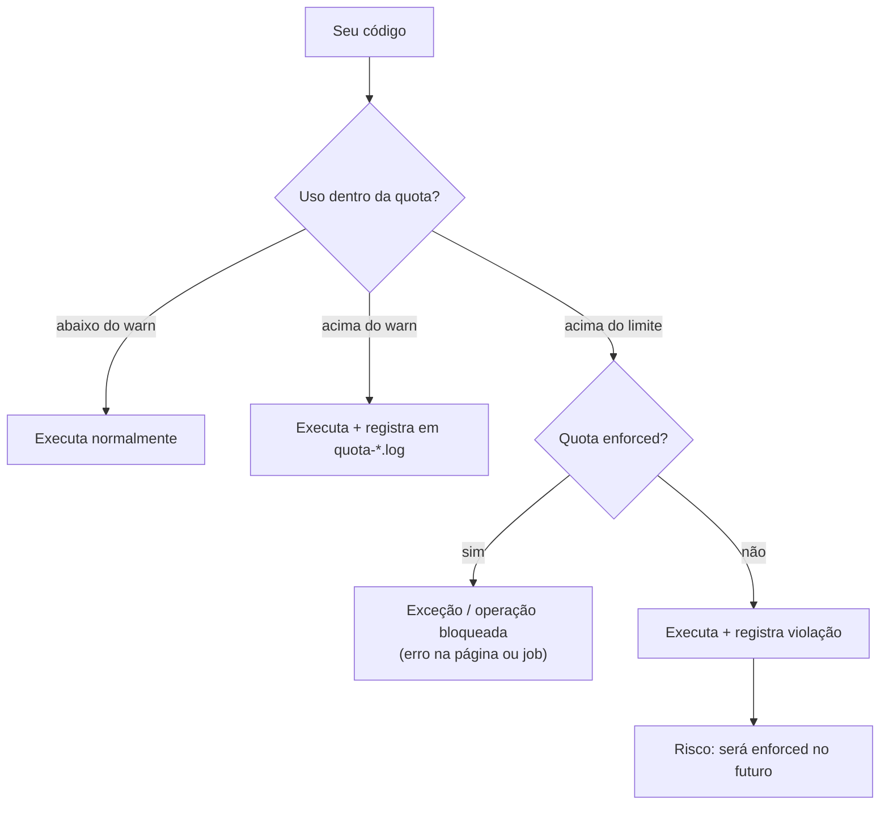

# Guia Definitivo de Engenharia e Certificação Salesforce B2C Commerce (SFRA)

## MÓDULO 5 — Desenvolvimento SFRA Parte 2: Page Designer, Integrações, Hooks, Jobs e Best Practices

> **Peso no exame:** segunda metade dos 53% de "Application Development".
> **Objetivos oficiais cobertos:** page types e components do Page Designer; integrar e usar uma instância de serviço; hooks e extension points; OCAPI Shop/Data para interoperabilidade; jobs e scripts de job; logs não sensíveis com níveis; identificar e corrigir código que viola boas práticas de performance e escalabilidade; integração síncrona vs assíncrona.

---

### Sumário

1. [Tópico 5.1 — Page Designer para Desenvolvedores](#tópico-51--page-designer-para-desenvolvedores)
2. [Tópico 5.2 — Service Framework no Código](#tópico-52--service-framework-no-código)
3. [Tópico 5.3 — Hooks e Extension Points](#tópico-53--hooks-e-extension-points)
4. [Tópico 5.4 — OCAPI na Prática (Interoperabilidade)](#tópico-54--ocapi-na-prática-interoperabilidade)
5. [Tópico 5.5 — Jobs Agendados: Task-oriented vs Chunk-oriented](#tópico-55--jobs-agendados-task-oriented-vs-chunk-oriented)
6. [Tópico 5.6 — Logging Customizado no Código](#tópico-56--logging-customizado-no-código)
7. [Tópico 5.7 — Performance, Escalabilidade, Transações e Quotas](#tópico-57--performance-escalabilidade-transações-e-quotas)
8. [Revisão Relâmpago do Módulo 5](#revisão-relâmpago-do-módulo-5)

---

## Tópico 5.1 — Page Designer para Desenvolvedores

### 1. Conceito & Glossário Desmistificado

| Termo | Significado |
|---|---|
| **Page Type** | "Modelo" de página (ex.: *Store Page*, *Landing de Campanha*). Define **regions** onde o merchandiser solta componentes. |
| **Component Type** | Bloco reutilizável (banner, carrossel, grid de produtos). Define **atributos editáveis** (imagem, texto, produto, link) e pode ter **regions** internas (layouts). |
| **Region** | Área de uma página ou componente que aceita componentes (com limites e regras de inclusão/exclusão). |
| **Meta definition (`.json`)** | Descreve o tipo: nome, grupo, `attribute_definition_groups`, `region_definitions`. |
| **Script (`.js`)** | Exporta `render(context, model)` (gera HTML) e, opcionalmente, `serialize(context)` (gera JSON para cenários headless). |
| **Template (`.isml`)** | Markup do tipo. |
| **ID do tipo** | Derivado do caminho: `experience/components/commerce_assets/imageBanner.json` → `commerce_assets.imageBanner`. |

**Tipos de atributo** (`type`): `boolean`, `category`, `cms_record`, `custom`, `enum`, `file`, `image`, `integer`, `markup`, `page`, `product`, `string`, `text`, `url`.

### 2. Arquitetura & Como Funciona por Baixo dos Panos



**Ciclo de renderização:**

1. O controller obtém a página (`PageMgr.getPage(id)`) e checa visibilidade (`page.isVisible()`).
2. A plataforma chama o `render()` do **page type**, que monta o model e as regions.
3. O template da página chama `regions.<id>.render()`, que chama o `render()` de cada **componente** na ordem definida pelo merchandiser.
4. Cada componente devolve HTML; o resultado entra no page cache.

### 3. Guia Prático de Business Manager (BM)

1. Cartridge com a pasta `experience/` no **cartridge path do site**.
2. Para editores customizados de atributos (tipo `custom`) e alguns recursos do editor, a cartridge correspondente precisa estar no **Business Manager cartridge path** (ex.: `bm_app_storefront_base` nas versões que o incluem).
3. `Merchant Tools > Content > Page Designer` → **New Page** → escolha o tipo `Store Page` → arraste componentes → **Publish**.
4. Visibilidade: agendamento, customer groups, locales por página/componente.
5. Teste: `https://<host>/on/demandware.store/Sites-<site>-Site/pt_BR/Page-Show?cid=<pageId>`.

> 🔎 **Verificar:** novos tipos às vezes só aparecem no editor após invalidação de cache/reload do BM; a forma de atribuir páginas a categorias (landing de categoria) depende da versão.

### 4. Implementação em Código (Hands-On)

**(a) Page type — `experience/pages/storePage.json`:**

```json
{
    "name": "Store Page",
    "description": "Página livre com duas regiões",
    "region_definitions": [
        {
            "id": "main",
            "name": "Região principal",
            "max_components": 10
        },
        {
            "id": "sidebar",
            "name": "Barra lateral",
            "max_components": 3,
            "component_type_exclusions": [
                { "type_id": "commerce_assets.heroCarousel" }
            ]
        }
    ]
}
```

**(b) Page script — `experience/pages/storePage.js`:**

```javascript
'use strict';

var Template = require('dw/util/Template');
var HashMap = require('dw/util/HashMap');
var PageRenderHelper = require('*/cartridge/experience/utilities/PageRenderHelper.js');

/**
 * @param {dw.experience.PageScriptContext} context - contém page, renderParameters...
 * @param {dw.util.Map} [modelIn]
 * @returns {string} HTML da página
 */
module.exports.render = function (context, modelIn) {
    var model = modelIn || new HashMap();
    var page = context.page;

    model.page = page;
    // Registry de regions: permite regions.main.render() no template
    model.regions = PageRenderHelper.getRegionModelRegistry(page);

    // Meta tags SEO da página (título/descrição definidos no Page Designer)
    model.CurrentPageMetaData = PageRenderHelper.getPageMetaData(page);

    // Política de cache da página: até o próximo dia (exemplo)
    var expires = new Date();
    expires.setDate(expires.getDate() + 1);
    response.setExpires(expires);

    return new Template('experience/pages/storePage').render(model).text;
};
```

> 🔎 **Verificar:** `PageRenderHelper` é um utilitário do SFRA (`app_storefront_base/cartridge/experience/utilities/PageRenderHelper.js`); seus métodos disponíveis variam por versão. A API de plataforma é `dw.experience.PageMgr`, `dw.experience.Page`, `dw.experience.Region`, `dw.experience.Component`.

**(c) Page template — `templates/default/experience/pages/storePage.isml`:**

```html
<isdecorate template="common/layout/page">
    <div class="storepage" id="${pdict.page.ID}">
        <div class="row">
            <div class="col-md-9">
                <!-- render() devolve HTML confiável dos componentes -->
                <isprint value="${pdict.regions.main.setClassName('region-main').render()}" encoding="off" />
            </div>
            <aside class="col-md-3">
                <isprint value="${pdict.regions.sidebar.render()}" encoding="off" />
            </aside>
        </div>
    </div>
</isdecorate>
```

**(d) Component type — `experience/components/commerce_assets/promoBanner.json`:**

```json
{
    "name": "Banner Promocional",
    "description": "Imagem com título, subtítulo, CTA e produto em destaque",
    "group": "commerce_assets",
    "attribute_definition_groups": [
        {
            "id": "content",
            "name": "Conteúdo",
            "description": "Textos e imagem",
            "attribute_definitions": [
                { "id": "image", "name": "Imagem", "type": "image", "required": true },
                { "id": "title", "name": "Título", "type": "string", "required": true },
                { "id": "subtitle", "name": "Subtítulo", "type": "text", "required": false },
                { "id": "ctaUrl", "name": "Link do botão", "type": "url", "required": false },
                {
                    "id": "theme",
                    "name": "Tema",
                    "type": "enum",
                    "values": ["light", "dark"],
                    "default_value": "light",
                    "required": true
                }
            ]
        },
        {
            "id": "merch",
            "name": "Merchandising",
            "attribute_definitions": [
                { "id": "product", "name": "Produto em destaque", "type": "product", "required": false }
            ]
        }
    ],
    "region_definitions": []
}
```

**(e) Component script — `experience/components/commerce_assets/promoBanner.js`:**

```javascript
'use strict';

var Template = require('dw/util/Template');
var HashMap = require('dw/util/HashMap');
var URLUtils = require('dw/web/URLUtils');

/**
 * @param {dw.experience.ComponentScriptContext} context
 *        context.content = valores preenchidos pelo merchandiser (Map)
 * @param {dw.util.Map} [modelIn]
 * @returns {string} HTML
 */
module.exports.render = function (context, modelIn) {
    var model = modelIn || new HashMap();
    var content = context.content;

    model.title = content.title;
    model.subtitle = content.subtitle || '';
    model.theme = content.theme || 'light';
    model.ctaUrl = content.ctaUrl || null;

    // Tipo "image": objeto dw.experience.image.Image → URL absoluta da mídia
    model.imageUrl = content.image ? content.image.file.absURL.toString() : null;
    model.imageAlt = content.title;

    // Tipo "product": dw.catalog.Product → passe só o necessário para o template
    if (content.product) {
        model.productName = content.product.name;
        model.productUrl = URLUtils.url('Product-Show', 'pid', content.product.ID).toString();
    }

    return new Template('experience/components/commerce_assets/promoBanner').render(model).text;
};

/**
 * Opcional: representação JSON (headless). Retorne só dados serializáveis.
 */
module.exports.serialize = function (context) {
    var content = context.content;
    return {
        title: content.title,
        subtitle: content.subtitle || '',
        theme: content.theme || 'light',
        imageUrl: content.image ? content.image.file.absURL.toString() : null
    };
};
```

> 🔎 **Verificar:** a forma recomendada de obter URL/escala de imagem varia; o SFRA traz um helper `ImageTransformation` em `experience/utilities/` em versões recentes.

**(f) Component template — `templates/default/experience/components/commerce_assets/promoBanner.isml`:**

```html
<div class="promo-banner promo-banner--${pdict.theme}">
    <isif condition="${pdict.imageUrl}">
        
    </isif>
    <div class="promo-banner__body">
        <h2>${pdict.title}</h2>
        <p>${pdict.subtitle}</p>
        <isif condition="${pdict.ctaUrl}">
            <a class="btn btn-primary" href="${pdict.ctaUrl}">${Resource.msg('button.shopnow', 'common', null)}</a>
        </isif>
        <isif condition="${pdict.productName}">
            <a href="${pdict.productUrl}">${pdict.productName}</a>
        </isif>
    </div>
</div>
```

**(g) Controller que exibe a página (padrão SFRA `Page-Show`, simplificado):**

```javascript
'use strict';

var server = require('server');
server.extend(module.superModule);

server.prepend('Show', function (req, res, next) {
    var PageMgr = require('dw/experience/PageMgr');
    var page = PageMgr.getPage(req.querystring.cid);

    if (page && page.isVisible()) {
        // res.page(...) é um helper do SFRA que delega a PageMgr.renderPage
        res.page(page.ID, {});
        return next();
    }
    return next(); // não é página do Page Designer → segue fluxo de content asset da base
});

module.exports = server.exports();
```

> 🔎 **Verificar:** a base do SFRA já implementa esse comportamento em `Page-Show`; você normalmente **não precisa** escrever esse prepend. Ele está aqui para mostrar o fluxo.

❌ **Anti-padrões:**

- Fazer consultas pesadas (busca de produtos, chamadas de serviço) dentro do `render()` de cada componente sem cache.
- Passar objetos `dw.*` inteiros para o template do componente.
- Mudar o `id` de atributos já usados em páginas publicadas (os valores salvos ficam órfãos).

### 5. Foco no Exame (Pegadinhas & Quotas)

- **"Quais arquivos compõem um component type?"** → `.json` (meta definition) + `.js` (render) + `.isml` (template), em `experience/components/<grupo>/` e `templates/default/experience/components/<grupo>/`.
- **"Onde se definem as áreas que aceitam componentes?"** → `region_definitions`.
- **"Onde se definem campos editáveis?"** → `attribute_definition_groups` → `attribute_definitions`.
- **"Componente não aparece no editor"** → cartridge fora do path, JSON inválido, ou grupo/ID errado.
- **"Restringir componentes numa region"** → `component_type_inclusions` / `component_type_exclusions`.
- **Saída do render é HTML** → no template da página, `encoding="off"`.

---

## Tópico 5.2 — Service Framework no Código

### 1. Conceito & Glossário Desmistificado

| API | Papel |
|---|---|
| `dw.svc.LocalServiceRegistry.createService(serviceId, callbacks)` | Cria a instância do serviço configurado no BM (Módulo 3) e associa os **callbacks**. |
| `service.call(params...)` | Executa: aplica rate limit/circuit breaker → `createRequest` → execução (ou mock) → `parseResponse`. Retorna `dw.svc.Result`. |
| `dw.svc.Result` | `ok` (boolean), `status` (`OK`, `ERROR`, `SERVICE_UNAVAILABLE`), `error` (código numérico, ex.: HTTP), `errorMessage`, `object` (retorno do `parseResponse`), `unavailableReason`, `mockResult`. |

**Callbacks:**

| Callback | Quando roda | Deve retornar |
|---|---|---|
| `createRequest(svc, ...params)` | Antes da chamada. Configura método, headers, URL, corpo. | Corpo da requisição (string) ou objeto de request (SOAP), ou `null` para GET. |
| `parseResponse(svc, response)` | Depois de resposta bem-sucedida. | O objeto que vai para `result.object`. |
| `initServiceClient(svc)` | (SOAP/genérico) cria o client/stub. | O client. |
| `execute(svc, request)` | (GENERIC/SOAP) executa a chamada de fato. | Resposta. |
| `mockCall(svc, request)` | No modo **Mocked**: substitui **só a execução remota**. `createRequest` e `parseResponse` **continuam rodando**. | Objeto simulando resposta (para HTTP: `{statusCode, statusMessage, text}`). |
| `mockFull(svc, ...params)` | No modo **Mocked**: substitui **a chamada inteira** (sem `createRequest` nem `parseResponse`). | O valor final de `result.object`. |
| `getRequestLogMessage(request)` | Gera a mensagem de log da requisição (communication log). | String. |
| `getResponseLogMessage(response)` | Gera a mensagem de log da resposta. | String. |
| `filterLogMessage(msg)` | Filtra **qualquer** mensagem de log do serviço (mascarar dados sensíveis). | String filtrada. |

### 2. Arquitetura & Como Funciona por Baixo dos Panos



### 3. Guia Prático de Business Manager (BM)

Recapitulando (detalhes no Módulo 3): `Administration > Operations > Services` → **Credentials** (URL/usuário/senha), **Profiles** (timeout, rate limit, circuit breaker), **Services** (ID usado no código, tipo, enabled, mode Live/Mocked, log prefix, communication log, profile, credential).

### 4. Implementação em Código (Hands-On)

**Serviço HTTP JSON completo (consulta de frete numa transportadora):**

```javascript
// app_custom_mystore/cartridge/scripts/services/shippingQuoteService.js
'use strict';

var LocalServiceRegistry = require('dw/svc/LocalServiceRegistry');
var Logger = require('dw/system/Logger').getLogger('shippingquote', 'service.shippingquote');

/**
 * Cria o serviço. O ID 'carrier.quote.http' DEVE existir em Administration > Operations > Services.
 */
function getService() {
    return LocalServiceRegistry.createService('carrier.quote.http', {

        /**
         * @param {dw.svc.HTTPService} svc
         * @param {Object} params - {postalCode, weightKg, valueAmount}
         */
        createRequest: function (svc, params) {
            var credential = svc.getConfiguration().getCredential();
            svc.setRequestMethod('POST');
            svc.addHeader('Content-Type', 'application/json');
            svc.addHeader('Accept', 'application/json');
            // API key guardada na credential (password), nunca no código
            svc.addHeader('Authorization', 'Bearer ' + credential.getPassword());
            svc.setURL(credential.getURL() + '/v1/quotes');
            return JSON.stringify({
                destinationPostalCode: params.postalCode,
                weight: params.weightKg,
                declaredValue: params.valueAmount
            });
        },

        /**
         * @param {dw.svc.HTTPService} svc
         * @param {dw.net.HTTPClient} client
         */
        parseResponse: function (svc, client) {
            var body = JSON.parse(client.getText());
            return {
                price: body.price,
                days: body.deliveryDays
            };
        },

        /** Modo Mocked: só a parte remota é simulada; parseResponse continua rodando */
        mockCall: function () {
            return {
                statusCode: 200,
                statusMessage: 'OK',
                text: JSON.stringify({ price: 19.9, deliveryDays: 5 })
            };
        },

        /** Mensagens de log (communication log) */
        getRequestLogMessage: function (request) {
            return request;                         // corpo JSON já não contém dados sensíveis
        },
        getResponseLogMessage: function (response) {
            return response.getText();
        },

        /** Mascara qualquer token que tenha escapado para o log */
        filterLogMessage: function (msg) {
            return msg ? msg.replace(/Bearer\s+[\w\-.]+/g, 'Bearer ****') : msg;
        }
    });
}

/**
 * API pública do módulo: trata todos os tipos de falha.
 * @returns {{price:number, days:number}|null}
 */
function getQuote(params) {
    var result = getService().call(params);

    if (result.ok) {
        return result.object;
    }

    if (result.status === 'SERVICE_UNAVAILABLE') {
        // TIMEOUT, RATE_LIMITED, CIRCUIT_BROKEN, DISABLED, CONFIG_PROBLEM...
        Logger.warn('Cotação indisponível: {0}', result.unavailableReason);
    } else {
        // status ERROR: resposta HTTP de erro (result.error = código HTTP)
        Logger.error('Erro na cotação: HTTP {0} - {1}', result.error, result.errorMessage);
    }
    return null;  // chamador usa fallback (ex.: frete padrão da tabela do BM)
}

module.exports = { getQuote: getQuote };
```

**`mockFull` (quando nem `createRequest` deve rodar — ex.: credencial ainda não existe):**

```javascript
mockFull: function (svc, params) {
    return { price: 0, days: 1 };   // vira result.object diretamente
}
```

**Tipos de serviço:** `HTTP` (`dw.svc.HTTPService`), `HTTP Form` (`HTTPFormService`, envia form-urlencoded), `SOAP` (`SOAPService`, com `initServiceClient` usando WSDL na cartridge e `dw.ws.WebReference2`), `FTP`/`SFTP` (`FTPService`), `GENERIC` (você implementa `execute`).

❌ **Anti-padrões:**

```javascript
// 1) createService dentro de loop (recria objeto a cada item) e chamada síncrona por item
items.forEach(function (i) {
    LocalServiceRegistry.createService('carrier.quote.http', cb).call(i);
});

// 2) Ignorar result.ok e acessar result.object direto → null pointer quando falha
var price = service.call(p).object.price;

// 3) Credenciais no código
svc.addHeader('Authorization', 'Bearer abc123SECRET');

// 4) Logar corpo com dados de cartão sem filterLogMessage
```

### 5. Foco no Exame (Pegadinhas & Quotas)

- **`mockCall` vs `mockFull`**: `mockCall` mantém `createRequest`/`parseResponse`; `mockFull` substitui tudo.
- **"Mascarar dados no log do serviço"** → `filterLogMessage`.
- **"Onde definir a URL"** → Credential (lida no `createRequest` via `svc.getConfiguration().getCredential()`), e não no código.
- **"Serviço retorna `SERVICE_UNAVAILABLE` sem chamar o externo"** → circuit breaker aberto, rate limit, ou serviço **desabilitado**.
- **Sempre checar `result.ok`** antes de usar `result.object`.
- **Integração síncrona** (durante a requisição) deve ser **rápida** e com fallback; o que puder ser **assíncrono** (envio de pedidos ao ERP, catálogo) vai para **jobs**.

---

## Tópico 5.3 — Hooks e Extension Points

### 1. Conceito & Glossário Desmistificado

| Termo | Significado |
|---|---|
| **Hook** | Ponto de extensão nomeado onde a plataforma (ou o SFRA, ou seu código) chama implementações registradas. |
| **Extension point** | O **nome** do hook (ex.: `dw.order.calculate`, `dw.ocapi.shop.basket.beforePOST`). |
| **`hooks.json`** | Arquivo que liga extension points a scripts. |
| **`package.json` (da cartridge)** | Aponta onde está o `hooks.json` (propriedade `hooks`). |
| **`dw.system.HookMgr`** | API para chamar hooks: `HookMgr.hasHook(name)`, `HookMgr.callHook(name, functionName, args...)`. |
| **`dw.system.Status`** | Retorno de hooks de OCAPI: `new Status(Status.OK)` continua; `new Status(Status.ERROR, 'CODIGO', 'mensagem')` interrompe e devolve erro ao cliente. |

**Famílias de hooks:**

| Família | Exemplos |
|---|---|
| **Plataforma (cálculo)** | `dw.order.calculate` (recalcular cesta: preços, promoções, frete, impostos), `dw.order.calculateShipping`, `dw.order.calculateTax`. A plataforma/OCAPI chama `dw.order.calculate` em operações de cesta. |
| **SFRA (app.*)** | `app.payment.processor.<id>` (`Handle`, `Authorize`), `app.payment.form.processor.<id>`, `app.fraud.detection`, `app.template.htmlHead`, `app.template.afterFooter` (plugins injetam HTML sem sobrescrever templates). |
| **OCAPI (Shop/Data)** | Padrão `dw.ocapi.<api>.<recurso>.<momento><MÉTODO>`: `beforePOST`, `afterPOST`, `beforePATCH`, `afterPATCH`, `beforePUT`, `afterPUT`, `beforeDELETE`, `afterDELETE`, `beforeGET`, `modifyGETResponse`, `modifyPOSTResponse`, `validateBasket`, `validateOrder`... |
| **Customizados** | Você define o nome (ex.: `app.custom.loyalty.award`) e chama com `HookMgr.callHook`. |

**Ordem dos momentos num POST OCAPI:**

```text
beforePOST  → (plataforma executa a operação) → afterPOST → modifyPOSTResponse
```

- `before*`: validar/alterar a entrada; **não** grava ainda.
- `after*`: roda dentro da **transação** da operação; ideal para ajustes no objeto criado/alterado.
- `modify*Response`: ajustar o **documento JSON** de resposta (ex.: adicionar `c_` atributos calculados).

### 2. Arquitetura & Como Funciona por Baixo dos Panos



**Várias cartridges registrando o mesmo hook:** a plataforma executa as implementações seguindo o cartridge path. 🔎 **Verificar:** para hooks de OCAPI, a execução para quando uma implementação retorna `Status.ERROR` (ou valor não nulo, conforme o tipo de hook). Documente a ordem esperada entre cartridges e evite depender de efeitos colaterais entre implementações.

### 3. Guia Prático de Business Manager (BM)

- Hooks não se configuram no BM: são **descobertos** pelas cartridges no **cartridge path** (com `package.json` + `hooks.json`).
- Para hooks OCAPI, o recurso precisa estar **liberado** em `Open Commerce API Settings` (Módulo 3).
- Erros em hooks aparecem nos logs (`error-*`, `customerror`) e como **500**/fault na resposta OCAPI.
- 🔎 **Verificar:** algumas versões exigem habilitar a execução de hooks OCAPI em `Administration > Global Preferences > Feature Switches`. Confira na sua instância se houver um switch relacionado.

### 4. Implementação em Código (Hands-On)

**`package.json` (raiz da cartridge `int_loyalty/`):**

```json
{
  "name": "int_loyalty",
  "hooks": "./cartridge/scripts/hooks.json"
}
```

**`cartridge/scripts/hooks.json`:**

```json
{
  "hooks": [
    {
      "name": "dw.ocapi.shop.basket.items.afterPOST",
      "script": "./hooks/basketHooks"
    },
    {
      "name": "dw.ocapi.shop.product.modifyGETResponse",
      "script": "./hooks/productHooks"
    },
    {
      "name": "dw.ocapi.shop.order.beforePOST",
      "script": "./hooks/orderHooks"
    },
    {
      "name": "app.custom.loyalty.award",
      "script": "./hooks/loyaltyAward"
    }
  ]
}
```

> O caminho em `script` é **relativo ao `hooks.json`**. A **função** exportada deve ter o nome do momento (ex.: `afterPOST`, `modifyGETResponse`, `beforePOST`).

**Hook de OCAPI que valida e altera a cesta:**

```javascript
// cartridge/scripts/hooks/basketHooks.js
'use strict';

var Status = require('dw/system/Status');

/**
 * Executado após adicionar itens à cesta via Shop API (dentro da transação da operação).
 * @param {dw.order.Basket} basket
 * @param {Array} items - documentos de item enviados no request
 * @returns {dw.system.Status}
 */
exports.afterPOST = function (basket, items) {
    var MAX_QTY = 10;
    var plis = basket.getProductLineItems();
    for (var i = 0; i < plis.length; i++) {
        if (plis[i].getQuantityValue() > MAX_QTY) {
            // Interrompe e retorna erro ao cliente da API
            return new Status(Status.ERROR, 'MAX_QTY_EXCEEDED', 'Quantidade máxima por item é ' + MAX_QTY);
        }
    }
    // Já estamos na transação da operação: escrita permitida
    basket.custom.lastItemAddChannel = 'mobile-app';
    return new Status(Status.OK);
};
```

**Hook que enriquece a resposta de produto:**

```javascript
// cartridge/scripts/hooks/productHooks.js
'use strict';

var Status = require('dw/system/Status');

/**
 * @param {dw.catalog.Product} scriptProduct
 * @param {Object} doc - documento JSON da resposta (mutável)
 */
exports.modifyGETResponse = function (scriptProduct, doc) {
    // Atributo calculado com prefixo c_ (convenção para customizados)
    doc.c_loyaltyPoints = Math.floor((doc.price || 0) * 10);
    return new Status(Status.OK);
};
```

**Implementando `dw.order.calculate` customizado (estendendo o da base):**

```javascript
// int_loyalty/cartridge/scripts/hooks/cart/calculate.js
'use strict';

var base = require('app_storefront_base/cartridge/scripts/hooks/cart/calculate');
// Aqui usamos o caminho explícito da base porque o hooks.json desta cartridge
// substitui o registro do hook para o mesmo nome.

exports.calculate = function (basket) {
    var status = base.calculate(basket);        // preços, promoções, frete, impostos da base
    // ... ajuste adicional (ex.: taxa de embalagem)
    return status;
};
```

> 🔎 **Verificar:** como a plataforma lida com o mesmo hook `dw.order.calculate` registrado em duas cartridges. A prática segura é **uma** implementação efetiva que delega explicitamente à da base, como acima.

**Hook customizado chamado pelo seu código:**

```javascript
// Disparando
var HookMgr = require('dw/system/HookMgr');
if (HookMgr.hasHook('app.custom.loyalty.award')) {
    HookMgr.callHook('app.custom.loyalty.award', 'award', order);  // (nome, função, ...args)
}
```

```javascript
// cartridge/scripts/hooks/loyaltyAward.js
'use strict';
exports.award = function (order) {
    // integração com sistema de fidelidade (via job ou serviço)
};
```

❌ **Anti-padrões:**

```javascript
// 1) Chamar serviço externo lento num hook de OCAPI de cada GET de produto (sem cache)
exports.modifyGETResponse = function (p, doc) { doc.c_x = svc.call(p.ID).object; };

// 2) Lançar exceção em vez de retornar Status → 500 genérico
exports.beforePOST = function () { throw new Error('inválido'); };

// 3) Abrir Transaction.wrap dentro de afterPOST (já existe transação da operação)

// 4) Esquecer o "hooks" no package.json → hook nunca é registrado
```

### 5. Foco no Exame (Pegadinhas & Quotas)

- **"Hook não é executado"** → falta `hooks` no `package.json`, caminho errado no `hooks.json`, nome do extension point errado, função exportada com nome errado, ou cartridge fora do path.
- **"Bloquear criação de pedido OCAPI se regra falhar"** → `dw.ocapi.shop.order.beforePOST` retornando `Status.ERROR`.
- **"Adicionar campo calculado ao JSON"** → `modify<METHOD>Response`.
- **"Recalcular cesta com regra de frete customizada"** → `dw.order.calculate` (ou `calculateShipping`).
- **"Plugin injeta script no `<head>` sem sobrescrever templates"** → `app.template.htmlHead`.
- **`HookMgr.callHook(extensionPoint, functionName, ...args)`** — atenção à ordem dos parâmetros.

---

## Tópico 5.4 — OCAPI na Prática (Interoperabilidade)

### 1. Conceito & Glossário Desmistificado

| Cenário | API | Autenticação |
|---|---|---|
| App mobile/headless do comprador | **Shop API** | `client_id` + JWT do cliente (`/customers/auth`) |
| ERP/PIM/OMS integrando dados | **Data API** | OAuth2 **client credentials** no Account Manager (token Bearer) |
| Descobrir recursos | **Meta API** | — |

**Tokens e fluxos:**

- **Shop — convidado:** `POST /customers/auth` com `{"type":"guest"}` e `x-dw-client-id` → resposta traz header **`Authorization: Bearer <JWT>`** (validade curta, ~30 min) e o `customer_id`.
- **Shop — registrado:** `{"type":"credentials"}` + header `Authorization: Basic base64(login:senha)`.
- **Shop — renovar:** `{"type":"refresh"}` com o JWT atual no `Authorization`.
- **Data:** `POST https://account.demandware.com/dwsso/oauth2/access_token` com `Authorization: Basic base64(clientId:secret)` e corpo `grant_type=client_credentials` (`application/x-www-form-urlencoded`) → `access_token`.

**Parâmetros comuns:** `expand` (ex.: `prices,availability,images,variations`), `locale`, `currency`, `start`/`count` (paginação), `select` (filtra campos retornados), `q` e `refine` em `product_search`.

**Paginação:** respostas de coleção trazem `count`, `start`, `total` e links `next`/`previous` quando existem. 🔎 **Verificar** o máximo de `count` por recurso na documentação da versão.

**Síncrono vs assíncrono (cobrado no outline):**

| Síncrono | Assíncrono |
|---|---|
| Chamada de serviço durante a requisição do cliente (cotação de frete, autorização de pagamento). | Jobs agendados exportando pedidos, importando catálogo/estoque por arquivo; sistemas externos puxando dados via Data API. |
| Precisa ser **rápida**, com timeout e fallback. | Volume alto, tolerante a atraso, reprocessável. |

### 2. Arquitetura & Como Funciona por Baixo dos Panos



### 3. Guia Prático de Business Manager (BM)

1. **Account Manager:** criar API Client (ID + secret), definir método de autenticação do token e roles necessários.
2. `Administration > Site Development > Open Commerce API Settings`: JSON de **Shop** (por site ou global) e **Data** (global) com recursos/métodos/atributos mínimos.
3. Para Data API acessar recursos de site, o client/usuário precisa de permissão no site.
4. Para custom objects via Data API, libere `/custom_objects/<tipo>/*` (e o tipo precisa existir).

### 4. Implementação em Código (Hands-On)

**Data API — Node.js (ERP atualizando produto e disparando job):**

```javascript
// integração externa (Node 18+, fetch nativo)
const HOST = 'https://zzzz-001.dx.commercecloud.salesforce.com';
const VERSION = 'v23_2';

async function getToken(clientId, secret) {
    const res = await fetch('https://account.demandware.com/dwsso/oauth2/access_token', {
        method: 'POST',
        headers: {
            'Authorization': 'Basic ' + Buffer.from(`${clientId}:${secret}`).toString('base64'),
            'Content-Type': 'application/x-www-form-urlencoded'
        },
        body: 'grant_type=client_credentials'
    });
    if (!res.ok) throw new Error(`Auth falhou: ${res.status}`);
    return (await res.json()).access_token;
}

async function updateMaterial(token, productId, material) {
    const res = await fetch(`${HOST}/s/-/dw/data/${VERSION}/products/${encodeURIComponent(productId)}`, {
        method: 'PATCH',
        headers: { 'Authorization': `Bearer ${token}`, 'Content-Type': 'application/json' },
        body: JSON.stringify({ c_material: material })   // atributo custom com prefixo c_
    });
    if (res.status === 403) throw new Error('Sem permissão: revise OCAPI Settings (Data)');
    if (!res.ok) throw new Error(`Erro ${res.status}: ${await res.text()}`);
    return res.json();
}

async function runJob(token, jobId) {
    const res = await fetch(`${HOST}/s/-/dw/data/${VERSION}/jobs/${jobId}/executions`, {
        method: 'POST',
        headers: { 'Authorization': `Bearer ${token}`, 'Content-Type': 'application/json' },
        body: JSON.stringify({})
    });
    return res.json();   // contém id da execução para acompanhar
}
```

**Shop API — paginação de busca:**

```javascript
async function fetchAllHits(jwt, query) {
    const pageSize = 50;
    let start = 0, total = Infinity, hits = [];
    while (start < total) {
        const url = `${HOST}/s/RefArch/dw/shop/${VERSION}/product_search?q=${encodeURIComponent(query)}` +
                    `&start=${start}&count=${pageSize}&expand=prices,images`;
        const res = await fetch(url, { headers: { 'Authorization': `Bearer ${jwt}`, 'x-dw-client-id': CLIENT_ID } });
        const body = await res.json();
        total = body.total;
        hits = hits.concat(body.hits || []);
        start += pageSize;
    }
    return hits;
}
```

**Data API — custom object (upsert via PUT):**

```http
PUT /s/-/dw/data/v23_2/custom_objects/NewsletterSubscription/ana%40exemplo.com
Authorization: Bearer <token>
Content-Type: application/json

{ "c_firstName": "Ana", "c_optIn": true }
```

> 🔎 **Verificar:** para custom objects com escopo **Site**, a URL inclui o site (`/sites/{site_id}/custom_objects/...`). Confira o recurso correto na documentação da sua versão da Data API.

❌ **Anti-padrões:**

- ERP fazendo **um GET por produto** em loop para sincronizar 200 mil produtos → use **import de arquivo via job** (assíncrono) ou endpoints de busca/lote.
- Guardar `client_secret` no app mobile (Data API não é para clientes finais).
- Ignorar `ETag`/`If-Match` em atualizações concorrentes de cesta.

### 5. Foco no Exame (Pegadinhas & Quotas)

- **"Sincronizar grande volume de catálogo"** → arquivo + job de import (assíncrono), não chamadas unitárias.
- **"401"** → token ausente/expirado; **"403"** → configuração de permissão OCAPI.
- **"Atributo custom no JSON"** → prefixo `c_` + `read_attributes`/`write_attributes`.
- **"Disparar job a partir de sistema externo"** → Data API `POST /jobs/{job_id}/executions`.
- **Shop = comprador / Data = administração**.

---

## Tópico 5.5 — Jobs Agendados: Task-oriented vs Chunk-oriented

### 1. Conceito & Glossário Desmistificado

| Termo | Significado |
|---|---|
| **Job** | Processo agendado/manual no BM composto de **steps** em **flows** (sequenciais ou paralelos). |
| **Step type** | Tipo de passo: **padrão** da plataforma (ex.: import/export de catálogo, price book, inventário, reindexação, site import) ou **customizado** (definido em `steptypes.json`). |
| **`steptypes.json`** | Arquivo na **raiz da cartridge** que declara steps customizados: ID, módulo JS, função, parâmetros, status codes, se é transacional, contexto (site/organização). |
| **Task-oriented (`script-module-step`)** | Executa **uma função** do início ao fim (ex.: copiar arquivos, chamar API, limpar dados). |
| **Chunk-oriented (`chunk-script-module-step`)** | Processa **lista grande** em lotes: `read` → `process` → `write` por chunk. Mostra progresso e escala melhor. |
| **Scope (contexto)** | **Site** (roda por site selecionado; usa cartridge path do site) ou **Organization** (global; usa BM cartridge path). |
| **Status** | Retorno `dw.system.Status` (`OK`, `ERROR`), com **código** opcional usado para decidir o fluxo (*exit status*). |

**Funções do chunk-oriented:**

| Função (atributo em steptypes) | Assinatura | Papel |
|---|---|---|
| `before-step-function` | `(parameters, stepExecution)` | Abrir iterators/arquivos. |
| `total-count-function` | `(parameters, stepExecution)` → number | Total para barra de progresso. |
| `read-function` | `(parameters, stepExecution)` → item ou `undefined` | Lê **um** item; `undefined` = fim. |
| `process-function` | `(item, parameters, stepExecution)` → item processado ou `undefined` | Transforma; `undefined` = **filtra** (não vai ao write). |
| `write-function` | `(lines: dw.util.List, parameters, stepExecution)` | Grava o chunk inteiro. |
| `after-chunk-function` | `(parameters, stepExecution)` | (opcional) após cada chunk. |
| `after-step-function` | `(success, parameters, stepExecution)` | Fechar recursos, gravar resumo. |

### 2. Arquitetura & Como Funciona por Baixo dos Panos



### 3. Guia Prático de Business Manager (BM)

1. Cartridge do job no **cartridge path do site** (scope Site) e/ou no **Business Manager cartridge path** (scope Organization).
2. `Administration > Operations > Jobs` → **New Job** → **ID** (`export-newsletter`), descrição.
3. Aba **Job Steps** → **Configure a step** → escolha o step (padrão ou `custom.ExportNewsletter`) → **Scope** (sites selecionados ou organização) → preencha **parâmetros**.
4. Adicione mais steps/flows (sequenciais ou paralelos).
5. Aba **Schedule and History** → **Enabled**, *Once* ou *Recurring* (intervalo, dias, horário), **Run Now** para testar; histórico de execuções com logs.
6. **Notification:** e-mails em erro/término.
7. **Resources:** bloquear recursos (ex.: catálogo) para evitar execução concorrente conflitante. 🔎 **Verificar** nome da aba na sua versão.
8. Logs: `jobs-*.log` e o log de cada execução (link no histórico), além dos seus custom logs.

**Steps padrão úteis (nomes ilustrativos):** `ImportCatalog`, `ImportPriceBook`, `ImportInventoryLists`, `ExportCatalog`, `SearchReindex`, `SiteImport`... 🔎 **Verificar** os IDs exatos no seletor de steps.

### 4. Implementação em Código (Hands-On)

**`int_newsletter/steptypes.json` (raiz da cartridge, ao lado de `package.json`):**

```json
{
  "step-types": {
    "chunk-script-module-step": [
      {
        "@type-id": "custom.ExportNewsletter",
        "@supports-parallel-execution": "false",
        "@supports-site-context": "true",
        "@supports-organization-context": "false",
        "description": "Exporta inscrições da newsletter para CSV em IMPEX/src/newsletter",
        "module": "int_newsletter/cartridge/scripts/jobs/exportNewsletter.js",
        "before-step-function": "beforeStep",
        "total-count-function": "getTotalCount",
        "read-function": "read",
        "process-function": "process",
        "write-function": "write",
        "after-step-function": "afterStep",
        "chunk-size": 100,
        "transactional": "false",
        "parameters": {
          "parameter": [
            { "@name": "FileNamePrefix", "@type": "string", "@required": "true", "description": "Prefixo do arquivo", "default-value": "newsletter" },
            { "@name": "OnlyOptIn", "@type": "boolean", "@required": "false", "default-value": "true" }
          ]
        },
        "status-codes": {
          "status": [
            { "@code": "ERROR", "description": "Falha na exportação" },
            { "@code": "OK", "description": "Exportação concluída" }
          ]
        }
      }
    ],
    "script-module-step": [
      {
        "@type-id": "custom.CleanupOldFiles",
        "@supports-parallel-execution": "true",
        "@supports-site-context": "true",
        "@supports-organization-context": "true",
        "description": "Remove arquivos antigos de uma pasta IMPEX",
        "module": "int_newsletter/cartridge/scripts/jobs/cleanupOldFiles.js",
        "function": "execute",
        "transactional": "false",
        "timeout-in-seconds": "900",
        "parameters": {
          "parameter": [
            { "@name": "Folder", "@type": "string", "@required": "true" },
            { "@name": "DaysToKeep", "@type": "long", "@required": "true", "default-value": "7" }
          ]
        },
        "status-codes": {
          "status": [
            { "@code": "ERROR", "description": "Erro" },
            { "@code": "OK", "description": "Sucesso" },
            { "@code": "NO_FILES", "description": "Nada a remover" }
          ]
        }
      }
    ]
  }
}
```

**Chunk step — `scripts/jobs/exportNewsletter.js`:**

```javascript
'use strict';

var CustomObjectMgr = require('dw/object/CustomObjectMgr');
var File = require('dw/io/File');
var FileWriter = require('dw/io/FileWriter');
var CSVStreamWriter = require('dw/io/CSVStreamWriter');
var StringUtils = require('dw/util/StringUtils');
var Calendar = require('dw/util/Calendar');
var Status = require('dw/system/Status');
var Logger = require('dw/system/Logger').getLogger('newsletterjob', 'job.newsletter.export');

// Estado do step (vive durante a execução do step)
var iterator;
var fileWriter;
var csvWriter;

exports.beforeStep = function (parameters, stepExecution) {
    var query = parameters.OnlyOptIn ? 'custom.optIn = {0}' : '';
    iterator = parameters.OnlyOptIn
        ? CustomObjectMgr.queryCustomObjects('NewsletterSubscription', query, 'creationDate asc', true)
        : CustomObjectMgr.getAllCustomObjects('NewsletterSubscription');

    var dir = new File(File.IMPEX + '/src/newsletter');
    if (!dir.exists()) {
        dir.mkdirs();
    }
    var stamp = StringUtils.formatCalendar(new Calendar(), 'yyyyMMddHHmmss');
    var file = new File(dir, parameters.FileNamePrefix + '_' + stamp + '.csv');

    fileWriter = new FileWriter(file, 'UTF-8');
    csvWriter = new CSVStreamWriter(fileWriter, ';');
    csvWriter.writeNext(['email', 'firstName', 'locale', 'createdAt']);   // cabeçalho
};

exports.getTotalCount = function () {
    return iterator.getCount();          // SeekableIterator sabe o total
};

exports.read = function () {
    if (iterator.hasNext()) {
        return iterator.next();
    }
    return undefined;                    // fim da leitura
};

exports.process = function (co) {
    if (!co.custom.firstName) {
        return undefined;                // filtra registros incompletos
    }
    return [
        co.custom.email,                 // atributo-chave do tipo (definido no custom object type)
        co.custom.firstName,
        co.custom.locale || '',
        StringUtils.formatCalendar(new Calendar(co.getCreationDate()), "yyyy-MM-dd'T'HH:mm:ss")
    ];
};

exports.write = function (lines) {
    // lines é dw.util.List com o resultado de process() do chunk
    for (var i = 0; i < lines.size(); i++) {
        csvWriter.writeNext(lines.get(i));
    }
};

exports.afterStep = function (success) {
    // SEMPRE liberar recursos, mesmo em falha
    try {
        if (csvWriter) { csvWriter.close(); }
        if (fileWriter) { fileWriter.close(); }
    } finally {
        if (iterator) { iterator.close(); }
    }
    if (!success) {
        Logger.error('Exportação da newsletter terminou com falha.');
        return new Status(Status.ERROR, 'ERROR', 'Falha na exportação');
    }
    return new Status(Status.OK, 'OK', 'Exportação concluída');
};
```

> 🔎 **Verificar:** o nome do atributo-chave (aqui supomos `email`) é o definido no custom object type. Use o mesmo nome no `process`.

**Task step — `scripts/jobs/cleanupOldFiles.js`:**

```javascript
'use strict';

var File = require('dw/io/File');
var Status = require('dw/system/Status');
var Logger = require('dw/system/Logger').getLogger('newsletterjob', 'job.cleanup');

/**
 * @param {Object} parameters - valores configurados no BM (Folder, DaysToKeep)
 * @param {dw.job.JobStepExecution} stepExecution
 * @returns {dw.system.Status}
 */
exports.execute = function (parameters, stepExecution) {
    var dir = new File(File.IMPEX + '/src/' + parameters.Folder);
    if (!dir.exists() || !dir.isDirectory()) {
        return new Status(Status.ERROR, 'ERROR', 'Pasta inexistente: ' + parameters.Folder);
    }

    var limit = Date.now() - (parameters.DaysToKeep * 24 * 60 * 60 * 1000);
    var removed = 0;
    var files = dir.listFiles();   // dw.util.List de File

    for (var i = 0; i < files.size(); i++) {
        var f = files.get(i);
        if (f.isFile() && f.lastModified() < limit) {
            if (f.remove()) { removed++; }
        }
    }

    if (removed === 0) {
        // Status OK com código customizado → pode direcionar o fluxo no BM
        return new Status(Status.OK, 'NO_FILES', 'Nenhum arquivo removido');
    }
    Logger.info('Removidos {0} arquivos de {1}', removed, parameters.Folder);
    return new Status(Status.OK, 'OK', 'Removidos ' + removed);
};
```

❌ **Anti-padrões em jobs:**

```javascript
// 1) Carregar tudo em memória (estoura quota de coleção/memória)
var all = CustomObjectMgr.getAllCustomObjects('X').asList(); // lista gigante

// 2) Não fechar o iterator (vazamento de recurso)

// 3) Uma transação gigante para 500 mil objetos
Transaction.wrap(function () { /* atualiza tudo */ });

// 4) Task step para processar milhões de registros (sem progresso nem chunks)
// 5) Escrever arquivo fora de File.IMPEX (sem acesso/sem visibilidade via WebDAV)
```

### 5. Foco no Exame (Pegadinhas & Quotas)

- **"Processar milhares de registros com progresso e baixo uso de memória"** → **chunk-oriented**.
- **"Tarefa única (mover arquivo, chamar API)"** → **task-oriented** (`script-module-step` com `function`).
- **"Step custom não aparece no BM"** → `steptypes.json` fora da **raiz** da cartridge, JSON inválido, ou cartridge fora do path do contexto (site vs **BM** para organização).
- **`read` retorna `undefined`** para encerrar; **`process` retorna `undefined`** para filtrar.
- **Retorno do step:** `dw.system.Status` (`OK`/`ERROR`) com código customizado opcional.
- **Arquivos de job** → `File.IMPEX` (`/src`), acessíveis por WebDAV.
- **Imports padrão** (catálogo, preço, estoque) devem usar **steps padrão**, não código customizado.

---

## Tópico 5.6 — Logging Customizado no Código

### 1. Conceito & Glossário Desmistificado

`dw.system.Logger` escreve em logs **custom**. Dois modos:

| Chamada | Arquivo | Uso |
|---|---|---|
| `Logger.info('msg')` (estático) | `custominfo-*`, `customerror-*`... (compartilhado) | Mensagens rápidas (evite em código de produção). |
| `Logger.getLogger('prefixo', 'categoria')` | `custom-prefixo-*.log` | **Recomendado**: arquivo próprio por integração/domínio + categoria para controlar níveis. |
| `Logger.getLogger('categoria')` | logs custom padrão, com categoria | Controle de nível por categoria sem arquivo dedicado. |

**Métodos:** `debug`, `info`, `warn`, `error`, `fatal` (com placeholders `{0}`), e `isDebugEnabled()`, `isInfoEnabled()`, `isWarnEnabled()`, `isErrorEnabled()`.

**Regras do prefixo:** curto e com caracteres simples (letras, números, hífen/underscore). 🔎 **Verificar** o limite de tamanho do prefixo na documentação da `Logger.getLogger` da sua versão.

### 2. Arquitetura & Como Funciona por Baixo dos Panos



### 3. Guia Prático de Business Manager (BM)

`Administration > Operations > Custom Log Settings` → defina nível da categoria `integration.erp.orders` (ex.: `INFO` em Staging, `WARN` em Production) e quais níveis vão para arquivo (Módulo 3).

### 4. Implementação em Código (Hands-On)

```javascript
'use strict';

var Logger = require('dw/system/Logger');
var log = Logger.getLogger('erp', 'integration.erp.orders');

/**
 * Exporta pedido ao ERP, logando apenas dados não sensíveis.
 */
function exportOrder(order) {
    log.info('Exportando pedido {0} (itens: {1})', order.orderNo, order.productLineItems.length);

    if (log.isDebugEnabled()) {
        log.debug('Shipping method: {0}; país: {1}',
            order.defaultShipment.shippingMethodID,
            order.defaultShipment.shippingAddress.countryCode.value);
    }

    // NUNCA: e-mail, CPF, endereço completo, telefone, cartão, CVV, tokens
    try {
        // ...
    } catch (e) {
        log.error('Falha ao exportar pedido {0}: {1}', order.orderNo, e.message);
        throw e;
    }
}

/**
 * Utilitário para mascarar valores quando for inevitável referenciá-los.
 */
function mask(value) {
    if (!value) { return ''; }
    var s = String(value);
    return s.length <= 4 ? '****' : '****' + s.slice(-4);
}
```

❌ **Anti-padrões:**

```javascript
Logger.error('Pagamento negado para ' + customer.profile.email + ' cartão ' + cardNumber); // PII + PCI
Logger.getLogger('x').debug('Basket completo: ' + JSON.stringify(basket));                 // concatenação cara
Logger.fatal('Produto sem imagem');                                                         // nível errado
```

### 5. Foco no Exame (Pegadinhas & Quotas)

- **"Logs da integração X em arquivo separado"** → `getLogger('x', 'categoria')`.
- **"Habilitar debug só para uma parte do código"** → categoria + Custom Log Settings.
- **"O que é aceitável logar?"** → IDs técnicos (orderNo, productID), status, códigos de erro. **Nunca** PCI (cartão/CVV) ou PII desnecessário.
- **Placeholders** `{0}` evitam custo de concatenação; `isDebugEnabled()` evita montar objetos caros.

---

## Tópico 5.7 — Performance, Escalabilidade, Transações e Quotas

### 1. Conceito & Glossário Desmistificado

| Conceito | Significado prático |
|---|---|
| **API Quota** | Limite da plataforma sobre uso de APIs/objetos (tamanho de string, tamanho de coleção, chamadas por requisição, objetos por tipo...). Pode ser **enforced** (bloqueia com exceção ao passar do limite) ou **não enforced** (só registra). Quotas novas/realms novos tendem a ser enforced. |
| **Warn threshold** | Nível de alerta antes do limite; gera mensagem no `quota-*.log`. |
| **SeekableIterator** | Iterator de consultas (`queryCustomObjects`, `queryAllSiteProducts`, `searchProfiles`...). **Precisa de `close()`**. |
| **Transaction** | `dw.system.Transaction`: obrigatória para **escrever** em objetos persistentes. `wrap(fn)` (preferido) ou `begin()`/`commit()`/`rollback()`. |
| **Índice vs banco** | Busca (`ProductSearchModel`) usa índice (rápido). `ProductMgr.queryAllSiteProducts()` varre o banco (lento) — só em jobs. |

**Exemplo real de quota (da documentação):** `api.jsStringLength` aparece como **enforced**, com **warn 600.000** e **limite 1.000.000** caracteres em uma string JS. Use `Administration > Operations > Quota Status` para ver os limites vigentes da sua instância; os valores e o status (enforced ou não) podem mudar.

### 2. Arquitetura & Como Funciona por Baixo dos Panos



### 3. Guia Prático de Business Manager (BM)

- `Administration > Operations > Quota Status`: quotas, limites, se são enforced, violações nas últimas 24h.
- `quota-*.log` (WebDAV `Logs/`): detalhes com localização (site, controller/pipeline, template).
- **Pipeline/Code Profiler** para localizar o trecho lento (Módulo 3).
- **Storefront Toolkit → Cache Information** para checar cache.

### 4. Implementação em Código (Hands-On)

**Transações: formas corretas**

```javascript
var Transaction = require('dw/system/Transaction');

// 1) Preferido: wrap (commit automático; rollback se lançar exceção)
var orderNo = Transaction.wrap(function () {
    basket.custom.giftMessage = msg;
    return basket.UUID;          // wrap retorna o valor da função
});

// 2) Controle manual: quando precisa decidir commit/rollback
Transaction.begin();
try {
    profile.custom.loyaltyTier = 'GOLD';
    if (!isValid(profile)) {
        Transaction.rollback();
    } else {
        Transaction.commit();
    }
} catch (e) {
    Transaction.rollback();      // garante que não fica transação aberta
    throw e;
}
```

**Boas práticas vs anti-padrões (lado a lado):**

```javascript
/* ❌ RUIM 1: consulta ao banco + serviço dentro de loop */
var lineItems = basket.getProductLineItems();
for (var i = 0; i < lineItems.length; i++) {
    var p = ProductMgr.getProduct(lineItems[i].productID);        // lookup desnecessário (pli.product já existe)
    var stock = stockService.call(p.ID).object;                   // N chamadas HTTP por página!
}

/* ✅ BOM 1: use o que já está carregado e faça UMA chamada em lote */
var ids = [];
for (var j = 0; j < lineItems.length; j++) {
    ids.push(lineItems[j].getProduct().getID());
}
var stockMap = stockService.call({ ids: ids }).object;           // 1 chamada (com cache/fallback)
```

```javascript
/* ❌ RUIM 2: queryAllSiteProducts na loja e sem close() */
var it = ProductMgr.queryAllSiteProducts();
while (it.hasNext()) { /* filtra por atributo */ }

/* ✅ BOM 2: ProductSearchModel com refinement indexado */
var psm = new (require('dw/catalog/ProductSearchModel'))();
psm.setCategoryID('root');
psm.addRefinementValues('material', 'Algodão');
psm.search();
```

```javascript
/* ❌ RUIM 3: transação por item num job (lento) ou uma transação gigante */
items.forEach(function (it) { Transaction.wrap(function () { /* 1 objeto */ }); });

/* ✅ BOM 3: chunk-oriented com escrita por chunk (ex.: 100 objetos) no write() */
exports.write = function (lines) {
    Transaction.wrap(function () {
        for (var i = 0; i < lines.size(); i++) { applyUpdate(lines.get(i)); }
    });
};
```

```javascript
/* ❌ RUIM 4: guardar objetos grandes na sessão */
session.custom.cartSnapshot = JSON.stringify(bigObject);

/* ✅ BOM 4: guarde só IDs/flags pequenos; dados grandes em custom object ou recalcule */
session.privacy.lastViewedPid = pid;   // privacy é limpo no logout
```

```javascript
/* ❌ RUIM 5: iterator sem close() */
var it = CustomObjectMgr.queryCustomObjects('X', 'custom.a = {0}', null, 1);
var first = it.next();   // e nunca fecha

/* ✅ BOM 5 */
var it2 = CustomObjectMgr.queryCustomObjects('X', 'custom.a = {0}', null, 1);
try {
    var firstItem = it2.hasNext() ? it2.next() : null;
} finally {
    it2.close();
}
```

```html
<!-- ❌ RUIM 6: página inteira sem cache por causa de um pedaço personalizado -->
<iscache status="off"/>

<!-- ✅ BOM 6: página cacheada + remote include para o pedaço personalizado -->
<isinclude url="${URLUtils.url('Account-Header')}" />
```

```javascript
/* ❌ RUIM 7: require dentro de loop / em todo render de tile */
for (var k = 0; k < n; k++) { var helper = require('*/cartridge/scripts/helpers/x'); }

/* ✅ BOM 7: require no topo do módulo (cacheado pela engine, mas o código fica claro) */
```

**Checklist de code review (o que o exame procura):**

| Sinal no código | Problema | Correção |
|---|---|---|
| `queryAllSiteProducts()` em controller | Varre banco na loja | Search model / índice |
| Iterator sem `close()` | Vazamento | `try/finally { it.close() }` |
| Chamada de serviço/DB em loop | N+1 | Lote, cache, job |
| Escrita sem `Transaction` | Erro | `Transaction.wrap` |
| Transação enorme | Locks, quota | Chunks |
| `iscache` off na página inteira | Sem cache | Remote include |
| Dados grandes em sessão | Memória | IDs / custom objects |
| String gigantesca (JSON enorme) | `api.jsStringLength` | Paginar, stream |
| Coleções enormes em memória (`asList()` de milhões) | Memória/quota | Iterar com iterator |
| `HTTPClient` cru | Sem resiliência | Service Framework |
| Dados de cartão em log/atributo | PCI | Tokenização, nunca logar |

### 5. Foco no Exame (Pegadinhas & Quotas)

- Questões trazem um **trecho de código** e pedem **"qual a melhor prática violada"** ou **"duas mudanças que melhoram a performance"**. Procure: loop com DB/serviço, falta de `close()`, falta de cache, `queryAllSiteProducts` na loja, transação ausente/gigante, `encoding="off"` em dado de usuário.
- **Quota enforced** → a operação **falha** ao passar do limite; **não enforced** → só log.
- **Onde ver quotas** → `Administration > Operations > Quota Status` e `quota-*.log`.
- **`Transaction.wrap`** é o padrão recomendado para escritas.
- **Sessão**: guarde pouco (`session.privacy` para dados limpos no logout).

---

## Revisão Relâmpago do Módulo 5

| Pergunta | Resposta |
|---|---|
| Arquivos de um componente PD | `.json` + `.js` (`render`) + `.isml` |
| Áreas que aceitam componentes | `region_definitions` |
| Campos editáveis | `attribute_definition_groups` |
| `mockCall` vs `mockFull` | parcial (mantém create/parse) vs total |
| Mascarar log de serviço | `filterLogMessage` |
| Registrar hook | `package.json` → `hooks.json` → script com função do momento |
| Erro em hook OCAPI | `return new Status(Status.ERROR, ...)` |
| Chamar hook | `HookMgr.callHook(nome, função, args)` |
| Comprador vs admin | Shop API vs Data API |
| Job com progresso em lote | chunk-oriented (`read/process/write`) |
| Fim da leitura no chunk | `read()` retorna `undefined` |
| `steptypes.json` | raiz da cartridge |
| Log em arquivo próprio | `Logger.getLogger('prefixo','categoria')` |
| Escrever no banco | `Transaction.wrap` |
| Iterator | sempre `close()` |

➡️ **Próximo:** Módulo 6 — Cheat Sheet interativo + Simulado (página HTML).
